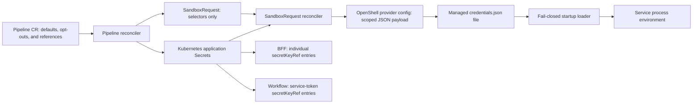

# Draft: operator-managed application credentials

This is an **experimental design** built on the merged application-security and
standalone SDK changes. **Application-secret generation and local provider-file
delivery are enabled by default.** Either can be explicitly disabled. The file
mechanism is a NON-SECRET provider-config channel, not protected credential
injection; this default is intended for the synthetic-data development deployment.
Do not use it with production clinical data or production keys without a separate
security review and an approved delivery mechanism.

## Ownership boundary

The operator can generate the random application keys currently created by
`bootstrap-prerequisites.sh`:

| Namespace-local Secret | Keys / consumers |
|---|---|
| `carewright-service-tokens` | Eleven per-receiver `SERVICE_TOKEN_*` values; BFFs, workflow callers, and scoped receiving services |
| `carewright-approval-signing-key` | `APPROVAL_SIGNING_KEY`; writer BFF and FHIR publication service only |
| `carewright-session-signing-key` | `SESSION_SIGNING_KEY`; writer BFF only |
| `carewright-ingester-signing-key` | `CPG_SIGNING_KEY`; ingester BFF only |

Each missing default Secret is created with independent cryptographically random
32-byte values encoded as 64 hex characters. Reconciliation does not regenerate
existing keys, replace incomplete Secrets, adopt externally owned Secrets, or
change existing Secret references. Explicit built-in default names are eligible
for generation too, so shipped deployment overlays work without removing their
references. Explicit custom Secret names must already exist. Missing or invalid
required keys stop dependent
reconciliation. Application credential failures clear stale `Ready=True` and set
`SecurityReady=False`; existing running processes are not forcibly revoked by
that condition alone. `SecurityReady=True` means references were resolved, not
that OAuth, application authentication, or the workflow has passed a live test.

Defaults intentionally retain the existing bootstrap's **namespace-shared trust
scope**. They have no pipeline controller owner reference: deleting one pipeline
must not delete another pipeline's shared credentials. They survive pipeline
removal and require explicit administrative deletion/rotation. They are not
per-pipeline tenant isolation. Independent tenants need separate namespaces or
explicit independent Secret references with deliberately coordinated caller and
receiver credentials. Retention, per-pipeline identities, and key rotation policy
must be reviewed before graduating the draft.

The operator does **not** invent or register external credentials: LLM API keys,
object-store account credentials (except the existing managed MinIO path),
FHIR/SMART OAuth client registrations, issuer configuration, Medplum users, and
registry push/pull credentials remain externally provisioned. In particular,
generating a random SMART client secret is not equivalent to registering it with
an authorization server.

## Defaults and opt-outs

No `security` block is required. Both pipeline CRs behave as though configured
with:

```yaml
spec:
  security:
    managedSecrets: true
    localCredentialFiles: true
```

Omitting the entire block, supplying `security: {}`, or omitting either individual
field enables that behavior. The CRD and controller runtime apply the same
defaults, including for older stored resources that omit these fields. Explicit
`false` values are preserved, not replaced by defaults.

To opt out of both behaviors:

```yaml
spec:
  security:
    managedSecrets: false
    localCredentialFiles: false
```

The settings are independent:

- `managedSecrets: false` prevents application-key generation and automatic
  default references. Supply existing application Secret references yourself.
  File delivery remains enabled unless separately disabled.
- `localCredentialFiles: false` disables the scoped provider-config/file path
  and startup loader. Generation remains enabled unless separately disabled.
  Supply an alternative working local-validation credential mechanism; the
  legacy placeholder-only provider path does not itself fix local validation.

The default `managedSecrets: true` fills omitted application Secret references
on the effective in-memory pipeline spec and creates missing built-in default
Secrets. Explicit references to those same built-in names/profiles are also
eligible for creation. Existing values are never replaced. Explicit **custom**
Secret references must already exist; the operator does not generate credentials
in arbitrary externally named Secrets.

The default `localCredentialFiles: true` uses OpenShell's **NON-SECRET**
provider-config/file mechanism for selected local validation keys. It also works
with externally supplied service-token / approval-signing references. Those keys
must contain 64-character hex tokens in this initial implementation. No generated
key values or resolved provider config are written to the parent CR.

Bootstrap now defaults to `OPERATOR_MANAGED_SECURITY=1`, skipping application-key
creation while still provisioning external prerequisites and importing existing
provider profiles. The operator imports/verifies its local-file profile when
needed. Set `OPERATOR_MANAGED_SECURITY=0` for legacy script-based application-key
generation. That switch does not change CR settings: use the explicit `false`
fields above if the operator should also relinquish generation/file delivery.

Existing bootstrap-created Secrets are reused unchanged. Before upgrading a
manually patched installation, follow the migration section below or explicitly
opt out until a replacement delivery mechanism is in place.

## File/provider path



The dedicated `carewright-local-credentials-file` profile declares one file:
`credentials.json`, templated from `config.payload`, with no credentials,
endpoints, or binary access declarations. The operator verifies the file schema
before reuse and refuses to overwrite a different existing profile. Provider
names include the pipeline UID and component identity to avoid cross-pipeline
provider reuse. Existing SandboxRequest provider tracking/finalizers handle
provider-instance cleanup. The shared, non-secret profile is retained.

`SandboxProviderRegistration.localCredentials` contains only namespace-local
Secret key selectors. The reconciler resolves those keys into JSON **in memory**
and sends that JSON as provider config. The resolved JSON is never copied back
to CRs, ConfigMaps, annotations, or status. Provider-sync error details are
suppressed for this mode because upstream diagnostics could contain the payload.

The startup wrapper reads
`/run/openshell/providers/<provider-name>/credentials.json`, verifies the exact
expected key set and token format, adds those values to the service environment,
and `exec`s the original application command. Missing, malformed, or
unexpected credentials refuse startup without printing contents. The wrapper
also applies to a user-supplied application command; it does not embed credentials
in its arguments.

| Sandbox | Locally available application keys |
|---|---|
| writer patient-data | `SERVICE_TOKEN_ACP_PATIENT_DATA` |
| writer decision-engine | `SERVICE_TOKEN_ACP_DECISION_ENGINE` |
| writer llm-reasoning | `SERVICE_TOKEN_ACP_LLM_REASONING`, `SERVICE_TOKEN_ACP_DECISION_ENGINE` for its downstream call |
| writer fhir-generation | `SERVICE_TOKEN_ACP_FHIR_GENERATION` |
| writer fhir-server | `SERVICE_TOKEN_ACP_FHIR_SERVER`, `APPROVAL_SIGNING_KEY` |
| ingester ingestion | `SERVICE_TOKEN_CPG_INGESTION` |
| ingester llm-analysis | `SERVICE_TOKEN_CPG_LLM_ANALYSIS` |
| ingester assembly | `SERVICE_TOKEN_CPG_ASSEMBLY` |
| ingester delivery | `SERVICE_TOKEN_CPG_DELIVERY` |

No browser-session/ingester signing keys enter component sandboxes or workflow
pods. No local-file provider is attached to decision-service or MCP. Existing
external LLM, object-store, and FHIR providers remain on their existing paths.
With the default file delivery, the legacy blanket service-token/signing provider attachments are
replaced rather than layered on top of the scoped file providers.

### Security cost of the workaround

Provider config and profile files are documented as non-secret SDK surfaces.
Anyone who can inspect that provider config or run code in the attached sandbox
can read the scoped values; the service environment also contains them. This is
**not** equivalent to keeping credentials outside the sandbox and resolving them
only at egress. A compromised FHIR publication sandbox that holds the approval
HMAC key can potentially forge approvals. Narrow delivery reduces exposure; it
does not solve that trust-boundary problem.

Treat the gateway, its API/workspace access, storage/backups, and receiving
workload as trusted for this exception. Do not inspect/dump provider config to
collect test evidence. Use presence checks or controlled comparisons that never
print raw values. Kubernetes Secret encryption/access controls do not make an
exported provider config payload secret again.

## Rotation and migration

- Namespace-local Secret watches enqueue both pipeline reconcilers and affected
  SandboxRequests, including a file provider's secondary approval-key Secret.
- Secret UID/resource-version metadata produces non-secret revision markers.
  BFF Pod-template annotations and workflow container environment revisions
  change so their existing `secretKeyRef` values are reread on rollout.
- File-provider sync markers participate in the sandbox spec hash. Updating a
  local credential Secret replaces the sandbox/process, rather than only
  changing a file after the process has already loaded its environment.
- This is **not atomic, zero-downtime rotation**. A namespace-shared Secret update
  may roll multiple services. Quiesce or drain active workflows and plan for
  callback failures, session invalidation, and approval invalidation. A versioned
  keyring/overlap protocol remains future work.
- Deleting a generated Secret can create new random values on the next
  reconciliation. That is key loss/rekeying, not recovery of the old value;
  protect Secrets with backups and appropriately scoped RBAC.

**Before upgrading** the manually patched test installation (file mode is now
default-on), remove the
manual credential-loader `command`, `carewright-file-*` `extraProviders`, and
`CAREWRIGHT_FILE_REVISION` workaround settings from each affected **parent CR**.
Keep unrelated component overrides/providers. The operator rejects recognized
manual loaders/providers and plaintext application-key `extraEnv` overrides
rather than silently stacking conflicting mechanisms. Do not mutate generated
SandboxRequests. Old externally managed manual providers are not claimed or
deleted by this draft: remove those only after no sandboxes reference them.

## Additional security integration and graduation gates

Already covered by #203 and preserved here: trusted BFF Secret references,
workflow caller token references, callback origins, SMART issuer/origin/redirect
configuration, review/approval validation, and authenticated FHIR publication.

Required before marking this draft ready:

- [ ] Review namespace-shared versus pipeline-scoped credential ownership,
      retention/deletion, and caller-to-receiver key distribution.
- [ ] Decide whether the non-secret provider-file exception is acceptable even
      for the intended deployment; prefer a genuine secret-file facility or a
      trusted validation/publication boundary for production.
- [ ] Verify SDK/gateway compatibility for profile import, managed files, sandbox
      replacement, and cleanup on the supported gateway version; no version bump
      is performed by this draft.
- [ ] Test fresh bootstrap with script key generation disabled, and migration
      with existing bootstrap credentials preserved.
- [ ] Run the full missing/wrong/right service-token matrix, callback checks,
      browser SMART login/logout/replay checks, and approval-gated FHIR writes.
- [ ] Exercise missing/invalid files, missing Secrets, rotation, pipeline deletion,
      operator restart, and shared namespace lifecycle on a live synthetic cluster.
- [ ] Define reload/rollout behavior for externally rotated SMART client credentials
      on the BFF; this draft's automatic rollout markers cover application keys,
      not external OAuth client credentials.
- [ ] Harden gateway authentication/TLS/workspace authorization, Secret RBAC,
      secret-at-rest/backups, and provider config API visibility. The development
      bootstrap's unauthenticated gateway is not a production security boundary.
- [ ] Keep terminology egress policy changes (#208) and unrelated publishing
      fixes (#207) separate; generating keys does not fix missing network access.

Unit/envtest and fake-SDK coverage do not replace these deployment checks.
