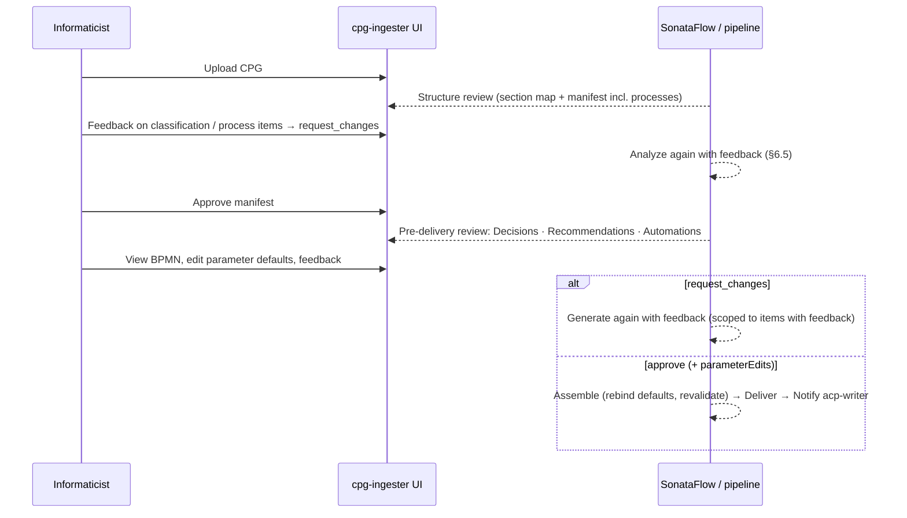

> Point-in-time copy of `working/bpmn-automation/design.md`, captured 2026-10-22 on branch `feature/bpmn-automation`. Errata E1–E40 are appended as written.

# BPMN Automation — Design

Status: **draft 4 + errata** (approved 2026-10-07; engine errata E19–E22 from the T1.1 Kogito probe applied 2026-10-09). Prompt: `working/prompts/planning_bpmn_261006.md`. Evidence: `research.md` (cited as R§n). Four review rounds so far (an independent adversarial review of draft 1, Sam's review of draft 2, an external model review of draft 3, an external model review of the plan) plus the T1.1 engine probe; every finding and its disposition is in §20.
Paths are repo-relative. Nothing here is implemented; `dev-plan.md` follows approval.

## 0. Summary

Carewright gains a second computable output from CPGs: **automation templates**. `cpg-ingester` identifies care processes in a CPG, has an LLM express each in the **Process IR** — the Kogito-supported subset of BPMN 2.0 written as JSON, never XML and never coordinates — compiles the IR deterministically into Kogito-executable BPMN 2.0, validates it through a ladder that ends at the Kogito engine, lets the informaticist review it graphically next to the DMN and recommendations it belongs to, and publishes it to the knowledge base alongside the DMN. `acp-writer` selects templates by the recommendations and DMN outputs behind each care-plan activity, has an LLM **synthesise** a per-patient process IR as a composition of template fragments with bound parameters, validates it with the same ladder plus a **grounding validator** that proves every element came from a template, shows it in the care-plan review inside the activity it serves with a parameter form and an enable switch, and on approval writes it into the FHIR bundle as a `DocumentReference` (the BPMN; no patient data inside) plus a `Task` (the instance: parameter values, status) linked from the activity, then publishes it to a receive-and-store automation service. Execution stays in Phase 9.

### Decisions this design implements (from the prompt)

| # | Decision | Where |
|---|---|---|
| 1 | Two stages: templates in cpg-ingester, per-patient BPMN in acp-writer | §2, §6, §7 |
| 2 | Per-patient BPMN is LLM-synthesised from templates; "not made up" enforced mechanically; no live link back; edits affect only that plan | §7.3, §5.6 |
| 3 | Valid = Kogito-executable; validation only, no execution | §4, §5, §18 |
| 4 | Abstract capability catalog in `shared/`, binding later | §3.2 |
| 5 | Templates stored alongside DMN; Kogito validate endpoint in `decision-service`; validate on receipt; optional preflight; no new coupling | §7.1, §7.2, §6.7 |
| 6 | Editing = parameter form + feedback → regenerate, both UIs; templates not edited in acp-writer | §6.6, §7.5, §7.6 |
| 7 | Fix dropped review feedback for all artifact types | §6.5 |
| 8 | Eval harness, extraction + synthesis; goldens authored | §14 |
| 9 | Out of scope: execution, graphical editing, mock-EHR rendering, durable KB store, CMMN | §1 |

Gate answers (2026-10-07): **Task + activity extension** for the FHIR shape (§8); automations **enabled by default, clinician can disable** (§7.6); dev plan follows the in-repo plan format.

## 1. Goals, non-goals, scope

**Goals.** (G1) Extract automation templates from CPGs that are grounded, Kogito-valid, catalog-conformant and reviewable. (G2) Attach grounded, valid per-patient automations to care-plan activities, reviewable and adjustable by the clinician. (G3) Persist approved automations in FHIR and hand them to the automation service. (G4) Measure extraction and synthesis quality. (G5) Keep component boundaries: the only new cpg-ingester → acp-writer dependency is publishing templates through the existing artifacts-available path (plus the optional pre-delivery validation call that follows the existing DMN-preflight pattern).

**Non-goals (decision 9).** Executing automations; graphical BPMN editing; mock-EHR rendering; pgvector/durable KB; CMMN. The optional knowledge-base browser in acp-writer's UI is its own phase and nothing core depends on it (§7.8).

**Vertical slice (first thing built end to end).** The extended synthetic hypertension CPG (§6.8) → process "Home blood pressure monitoring with outreach and escalation" identified at structure review → template generated, reviewed in the cpg-ingester UI, delivered → acp-writer registers it → a care plan for the E2E hypertension patient gets the automation on its home-BP monitoring activity → reviewed (viewer, parameter form) → approved → bundle with DocumentReference + Task on the FHIR server → automation service confirms receipt and storage. The backend path runs on local compose (monolith paths, fresh knowledge base) end to end by script. The two review UIs are driven by SonataFlow in this repository (both BFFs serve real runs only through it), so on compose each UI renders the slice's **real artifacts** through its dev fixtures (a run-directory loader for the cpg-ingester mock router; a generated MSW fixture for acp-writer); the interactive review gates are exercised locally only if the optional SonataFlow dev-mode spike (plan T3.7) succeeds, and in any case on the cluster in Phase 5 (§18 A3).

## 2. Architecture

```mermaid
flowchart LR
  subgraph ING["cpg-ingester"]
    A[Structure analysis<br/>+ item manifest] -->|process items| B[BPMN subgraph<br/>IR creator → compiler → static ladder → semantic reviewer]
    B --> C[Assembly: links rec ↔ template ↔ DMN<br/>parameter-default edits]
    C --> D[Delivery: published/{cpg}/bpmn/*]
    UI1[Structure review<br/>Automations review] -.feedback / parameter defaults.-> A
    UI1 -.-> B
  end
  subgraph SH["shared/cpg_contracts.automation"]
    IR[ProcessIR + expressions]
    CAT[Capability catalog v1]
    CMP[IR → BPMN compiler<br/>Kogito profile]
    VAL[Validators L0–L5<br/>XSD · lint · catalog · grounding]
  end
  subgraph ACP["acp-writer"]
    REG[(Template registry<br/>decision-engine pod)]
    KOG[decision-service<br/>/jit/dmn · /jit/bpmn/validate]
    SYN[automation_synthesizer<br/>select → LLM IR → ladder → reviewer]
    FB[fhir_bundle_generator<br/>DocumentReference + Task + extension]
    GATE[Care-plan review<br/>viewer · parameter form · enable]
    WR[fhir_server_writer<br/>approval transition → publish]
  end
  AUT[automation service<br/>receive · validate · store]
  FHIR[(HAPI / Medplum)]
  D -->|artifacts-available type=bpmn| REG
  REG --> KOG
  REG --> SYN --> FB --> GATE -->|approve| WR
  GATE -.apply_edits (no LLM).-> FB
  GATE -.request_changes.-> SYN
  WR --> FHIR
  WR --> AUT
  B -. optional preflight (validate_only) .-> REG
  SH --- ING
  SH --- ACP
  SH --- AUT
```

Two orchestration paths exist per pipeline (LangGraph monolith; SonataFlow split pods). Every new node is a plain function used by both, as `_compose_pipeline` already does (R§1.4). The shared package is pure Python (lxml, pydantic) — no Node, no JVM — so every pod can run the static ladder.

## 3. Contracts (`shared/`)

New module `shared/src/cpg_contracts/automation/` (`ir.py`, `expressions.py`, `catalog.py` + `catalog.v1.json`, `templates.py`, `instances.py`, `compiler/` with the Kogito profile, `validators/`, `schemas/` with the vendored OMG XSDs). This is the largest thing `shared/` has held; it is justified because the prompt requires one validator in three components (cpg-ingester, acp-writer, automation) and because the IR is the contract between them. lxml becomes a `cpg-contracts` dependency (cpg-ingester already uses it). `cpg-contracts` version → **1.1** (additive): the `automation` module, `Recommendation.automation_template_ids`, and `DecisionModelSummary.namespace` (the DMN `targetNamespace`, which `businessRuleTask` bindings need; populated by `_decision_summary` in cpg-ingester and `_parse_dmn_metadata` in acp-writer). TypeScript mirror in `shared/ui/src/types/contracts.ts`. AGENTS.md "Standards as Contracts" gains the rows *Automation templates | BPMN 2.0 (Kogito execution profile) + cpg-contracts `AutomationTemplate` | cpg-ingester | acp-writer* and *Automation instances | FHIR (Task + DocumentReference) | acp-writer | automation*.

### 3.1 Process IR — the BPMN 2.0 subset as JSON

**What it is.** The IR is not a new process language. It is the Kogito-supported subset of BPMN 2.0 (R§3.1), serialised as JSON with BPMN's own element and attribute names, plus one `acp` block per element and per process for the metadata BPMN has no slot for (provenance, parameters, template references). Every IR element compiles to exactly one BPMN element of the same name. The only additions are the closed list of **macros** below, each of which expands to plain BPMN that the IR could have spelled out but the LLM is not allowed to write.

**Why it exists** (recorded for readers in `docs/automation-ir.md`, §15):
1. *Validity by construction.* LLMs writing BPMN XML fail on exactly what a serializer prevents — dangling references, missing events, duplicate ids — and are unreliable at editing (R§3.3); JSON costs 2–7× fewer tokens.
2. *Engine boilerplate.* Roughly 80% of a Kogito-executable file is `itemDefinition`/`ioSpecification`/`dataInputAssociation`/`drools:` plumbing (Appendix A). The compiler produces it from the macros; the LLM never touches it.
3. *Metadata BPMN cannot hold.* Typed parameters with cited defaults and constraints, per-element provenance and template references have no BPMN slot; the grounding validator (§5.6), the parameter forms and `apply_edits` all need them structured. Without an IR the same schema would be embedded in `extensionElements` for the LLM to author inside XML.
4. *Analysable conditions.* BPMN conditions are opaque Java/FEEL strings; the IR's tiny expression grammar lets §5.6 T4 prove that a threshold is a parameter, not a literal.
5. *Restriction by schema.* The IR admits only the subset the engine supports and the validators can reason about — before generation, rather than by rejection afterwards.

**Two rules that keep it BPMN.**
- **The XML is the contract.** The published `.bpmn` (with its `acp:` extension elements) is self-sufficient: `parse(compile(ir)) == ir` is a tested round-trip, and acp-writer can rebuild the IR from the XML alone. The IR copy in `template.json` is a convenience.
- **The subset guard.** An element type may enter the IR only if it is a BPMN 2.0 element in the Kogito-supported table (R§3.1), with a compiler mapping, L3 rules and a viewer check; a macro may enter only if it expands to such elements and is listed in the macro table. Nothing else — this is the guard against re-inventing BPMN one feature at a time.

```json
{"ir_version": "1.0",
 "process": {"id": "home-bp-monitoring", "name": "…", "isExecutable": true, "kind": "template",
   "properties": [{"name": "reading_count", "type": "integer"}],
   "flowElements": [{"type": "task", "id": "…", "name": "…", "taskName": "patient.request_observation",
                     "inputs": {"…": "…"}, "outputs": {"…": "…"}, "acp": {"provenance": {"…": "…"}}}],
   "acp": {"triggers": [{"…": "…"}], "parameters": [], "invariants": [], "produces": [], "provenance": {"…": "…"}, "template_refs": []}}}
```

**Element table** (IR `type` → BPMN element; fields use BPMN names where BPMN has them):

| IR `type` | BPMN element | IR fields | Macros |
|---|---|---|---|
| `startEvent` | `bpmn2:startEvent` | `id`, `name` | M4 |
| `endEvent` | `bpmn2:endEvent` | `id`, `name`, `acp.outcome` | M4 |
| `task` | `bpmn2:task` (custom work item) | `id`, `name`, `taskName` (catalog id = `drools:taskName`; the literal `TaskName` input is the derived per-node name, §4 E19), `inputs {name: ValueRef}`, `outputs {name: property}`, `acp.counter?` | M1, M3 |
| `userTask` | `bpmn2:userTask` | `id`, `name`, `groupId` ∈ clinicians / care-team / patients, `outputs` | M1 |
| `businessRuleTask` | `bpmn2:businessRuleTask` | `id`, `name`, `dmnModel` (decision model id), `inputs`, `outputs` | M1, M2 |
| `exclusiveGateway` | `bpmn2:exclusiveGateway` | `id`, `name`, `gatewayDirection` Diverging / Converging, `default` (flow id) | — |
| `intermediateCatchEvent` | `bpmn2:intermediateCatchEvent` + `timerEventDefinition` | `id`, `name`, `timerEventDefinition {timeDuration \| timeCycle: ValueRef}` | M6 |
| `boundaryEvent` | `bpmn2:boundaryEvent` + `timerEventDefinition` | `id`, `name`, `attachedToRef` (element id or `main`), `cancelActivity`, `timerEventDefinition` | M4, M6 |
| `sequenceFlow` | `bpmn2:sequenceFlow` | `id`, `name`, `sourceRef`, `targetRef`, `conditionExpression?` (acp-expr) | compiled to Java |

Not in IR 1.0 (by the subset guard; added only with evidence of need): parallel, inclusive and event-based gateways; message and signal events; `subProcess` other than the implicit `main`; multi-instance; lanes and pools. Never: `serviceTask`, `sendTask`, `receiveTask` (R§3.1); `scriptTask` (compiler-only).

**Macros** (closed list; each documented with its expansion in `docs/automation-ir.md`):
- **M1 I/O expansion.** `inputs`/`outputs` maps → `itemDefinition`, `ioSpecification` (`dataInput`/`dataOutput`, `inputSet`/`outputSet`), `dataInputAssociation` (property or literal `assignment`), `dataOutputAssociation`, the literal `TaskName` input (= `task_label(capability id, element id)` of §4 E19: `{capability id with "." → "_"}__{element id}` for a `task`, the element id for a `userTask` — unique per process and Java-safe, because Kogito generates REST routes and method names from it), and for `userTask` the `Skippable`/`GroupId` inputs. **The XML I/O is exactly the IR's I/O (E23):** one `dataInput` per IR-supplied input plus `TaskName`, one `dataOutput` + `dataOutputAssociation` per IR-mapped output, nothing else — catalog inputs the IR does not supply are *not* emitted (their defaults are applied by the binding from the catalog version pinned in `acp:template`), unmapped catalog outputs are not declared, and the compiler never invents properties. L4 still rejects a missing *required* input. This keeps `parse` trivial (inputs = associations minus `TaskName`; outputs = output associations) and the XML a pure function of IR + catalog.
- **M2 DMN binding.** `dmnModel` → `implementation="http://www.jboss.org/drools/dmn"` plus literal `namespace` (`DecisionModelSummary.namespace`) and `model` inputs; other inputs/outputs name-matched to the DMN variables.
- **M3 Counters.** `acp.counter` on a task → a `scriptTask` incrementing the property after the task, plus an `init` script task after the start event setting every counter to 0 and `outcome` to ""; `acp.resets: [property]` on a `sequenceFlow` → a `scriptTask` on that flow setting those counters back to 0 (so a week with readings resets the reminder count and each missed-report episode starts from zero, Appendix B).
- **M4 Body scope and outcomes.** The body is wrapped in `subProcess id="main"` with its own start/end events (the IR `startEvent`'s outgoing flow is moved to `main_start`); `boundaryEvent.attachedToRef = "main"` attaches there; every `endEvent` inside `main` becomes `scriptTask outcome="<acp.outcome>"` + end event, and a compiler-emitted `exclusiveGateway gw_outcome` after `main` routes to one top-level end event per outcome plus `end_completed`; end events reached only from a `main` boundary are top-level.
- **M5 `acp` serialization (E25).** The XML must carry everything the IR has that BPMN cannot, so `parse` can rebuild the IR without guessing. Per element: `extensionElements/acp:element` = the **whole** `AcpElement` as compact JSON in CDATA (`provenance`, `template_ref`, `counter`, `resets`, `outcome`, `structural_constant`; `exclude_none`, sorted keys), plus, on a conditional `sequenceFlow`, `"conditionExpression": "<the acp-expr source>"` — the Java in `bpmn2:conditionExpression` is derived from it, and `parse` recompiles the source and raises if the two differ (the XML is the contract; the Java can never drift from the expression). Per process: `extensionElements/acp:template` = `{"template_id", "version", "kind", "description", "ir_version", "catalog_version", "profile"}` plus the **whole** `AcpProcess` JSON (`triggers`, `parameters`, `invariants`, `produces`, `provenance`, `template_refs`, `unify`, `pruned`, `consolidated_boundaries`). Elements with an empty `acp` block still get `<acp:element><![CDATA[{}]]></acp:element>` so the shape is uniform. Nothing patient-specific is in any block (§3.1 definition vs bindings).
- **M6 Timers.** `ValueRef{param}` in a timer → `#{param}`; literal durations normalised to days/hours (§4).
- **Generated ids and names (closed table, E23).** Every element the macros add has an id derived from the IR element it serves, so the output is deterministic and `parse` strips exactly these. Structural macro ids are reserved at L0; all generated XML ids are checked for collisions and a collision raises `ValueError` (there is no collision renaming). IR flows keep their ids and are re-targeted; new flows are named after the inserted node.

| Macro | Inserted element | id | name |
|---|---|---|---|
| M1 | data input for IR input `name` on task `T` | `{T}_{xml-id-component(name)}_input` | `name` (BPMN data-input name) |
| M1 | data output for mapped output `name` on task `T` | `{T}_{xml-id-component(name)}_output` | `name` (BPMN data-output name) |
| M1 | profile-added inputs (`TaskName`, `Skippable`, `GroupId`, DMN `namespace`/`model`) | `{T}_{name}` | `name` |
| M3 | init script after the start event | `init` | `Initialise` |
| M3 | flows start → init → main | `f_init`, `f_main` | — |
| M3 | counter script after task `T` | `{T}_counter` | `Count {counter property, "_" → " "}` |
| M3 | flow `T` → counter (the IR's outgoing flow of `T` now leaves the counter) | `{T}_counter_in` | — |
| M3 | reset script on flow `F` (the IR flow `F` now targets the script) | `{F}_reset` | `Reset {properties, ", "-joined, "_" → " "}` |
| M3 | flow reset script → `F`'s original target | `{F}_reset_out` | — |
| M4 | body sub-process | `main` | `Monitoring` (the body's name; fixed) |
| M4 | start event inside `main` (the IR start's outgoing flow now leaves it) | `main_start` | — |
| M4 | outcome script for IR end event `E` (the IR flow into `E` now targets the script) | `{E}_outcome` | `Outcome: {acp.outcome}` |
| M4 | flow outcome script → inner end | `{E}_outcome_out` | — |
| M4 | inner end event for `E` | `main_{E}` | `E`'s name |
| M4 | flow main → outcome gateway | `f_after` | — |
| M4 | outcome gateway | `gw_outcome` | `Outcome` |
| M4 | top-level end event for `E` | `E` (the IR id, verbatim) | `E`'s name |
| M4 | flow gateway → top-level end for `E` | `{E}_route` | `{acp.outcome}` |
| M4 | default end event and its flow | `end_completed`, `f_completed` | `Completed` |

`xml-id-component(name)` preserves ASCII letters, digits, `_`, `.`, and `-`, and maps every other character to `_`. It applies only to generated XML IDs for external DMN variable labels; the BPMN I/O `name` remains the exact DMN variable name. If distinct names map to the same generated ID, compilation raises `ValueError` under the generated-ID collision rule.

Ids of boundary-only end events, boundary events and their flows are IR ids verbatim (top-level, M4). Consequently the **L0 reserved space** is: the fixed ids `init`, `main`, `main_start`, `gw_outcome`, `end_completed`, `f_init`, `f_main`, `f_after`, `f_completed`; the property `outcome`; and any IR id that starts with `main_` or contains `_counter`, `_reset`, `_outcome` or `_route`.

Structural rules enforced at L0 on the IR itself (mirroring L3 on the XML): one `startEvent`, ≥1 `endEvent`, explicit converging gateways (no implicit joins — Kogito rejects them too, E22), exactly one `default` per diverging gateway, every `attachedToRef`/`sourceRef`/`targetRef` resolves, unique ids, names required, element types ∈ the table. (Same-named `boundaryEvent`s are an L3 *warning*, not an error: Kogito exposes one signal route per distinct top-level boundary name and deduplicates, E21.)

**Identifiers.** Kogito's code generator turns element ids into Java class and variable names, property and parameter names into Java fields, and work-item names into REST routes (T1.1 probe, E19–E20). So every IR identifier — element `id`, property `name`, parameter `name` — matches `^[a-z][a-z0-9_]*$`, is not a Java keyword or literal (`default`, `return`, `new`, `class`, `int`, `true`, `null`, … — the full list lives in `compiler/kogito_profile.py`), and is not compiler-reserved: the fixed ids `init`, `main`, `main_start`, `gw_outcome`, `end_completed`, `f_init`, `f_main`, `f_after`, `f_completed`, the property `outcome`, and any id that starts with `main_` or contains `_counter`, `_reset`, `_outcome` or `_route` (the macro-generated id space of the "Generated ids" table that `parse` strips). There are **no dots** in identifiers; composed instances prefix fragment-scoped ids, properties and parameters with `{fragment}__` (`confirm__request_readings`, §5.6 I9, Appendix D). Identifiers therefore reach the XML and the generated Java verbatim — no lowering, nothing for `parse` to reverse. Catalog capability ids keep their dots (`patient.request_observation`); they are not XML identifiers and are mapped once, by the profile (§4).

**ValueRef** = `{param: name}` | `{property: name}` | `{concept: name}` | `{literal, type}` with literal `type ∈ {integer, decimal, boolean, duration, quantity, enum, unit, code}`. `concept` is the only way to supply a `code`-typed input in a template: the concept name must appear in the element's `source_text` or the section text; the synthesizer resolves it to a `system|code` token through acp-writer's existing concept resolution (the same path DMN inputs use), recording the binding as `plan-derived`. `enum` literals are values of a catalog input declared `type: enum` with a `values` list (e.g. `urgency: routine`); `unit` literals are UCUM codes for a `unit` input (`mm[Hg]`). Free-text inputs (`instructions`, `message`, `reason`) are never literals: they are string **parameters** with `source.kind = authored`, so authored text is visible in the parameter form and to the reviewer; there is no `string` literal type. On source-derived elements every literal must either be a parameter reference, a structural constant, or have its value token in that element's `source_text` — `enum`/`unit` literals are checked against the catalog and the declared unit instead (§5.6 T4).

**Definition vs bindings.** The IR is a *definition*: a template, or an instance's structure (prefixed ids, `template_refs`, `unify`, `pruned` and fragment records that name template element ids, rule kinds and justification *kinds*). **Bound values and patient-specific evidence are never in the IR and never in the XML**: bindings live in `ActivityAutomation.bindings` (and in the FHIR Task), and the evidence behind prunes and compositions (DMN audit entries, category flags, feedback quotes) lives in `ActivityAutomation.derivation_evidence`. The round-trip rule holds over the definition in canonical form (`canonical_json(parse(compile(ir))) == canonical_json(ir)`, §4); an instance's `revision` is `sha256(canonical definition ‖ canonical bindings)[:12]` (one hash over the two canonical JSON strings concatenated; bindings sorted by name). A compile test asserts that no binding value token appears in the XML.

**Expressions** (`conditionExpression`, language `acp-expr`): a tiny grammar — operands are properties, parameters, literals; operators `== != < <= > >= and or not defined(x)`; arithmetic only in invariants. Type table: `integer op integer → integer` (`+`), `integer * duration` and `duration * integer → duration`, `duration + duration → duration`; comparisons between equal types (quantities only with equal declared units; durations as elapsed time), with one widening: an **`integer` literal** is promoted when its other operand is `decimal` or `quantity` (E28; guidelines write `140`, not `140.0`, and DMN `number` outputs are `decimal`; only literals promote — a `decimal` property against an `integer` property is still a type error, and T4 still checks the literal's token). A parameter with `constraints.enum` types as `enum` (so `x == "value"` is legal and compiles to `.equals`), and **every** typing environment — L0, grounding, the compiler, the parser — is built by the single `expression_environment(process)` in `expressions.py` (E29). Operands name properties and parameters by their identifier (the identifier grammar above: `confirm__reading_count`, never a dotted name), so they reach Java unchanged. Conditions compile to Java `return …;` with a null guard on every identifier (`x != null && …`), so a missing value makes the condition false and the default flow is taken. No free-form code ever reaches the XML.

**Invariants** (`process.acp.invariants`): acp-expr over parameters, e.g. `max_duration >= reporting_interval * (max_reminder_attempts + 1)`. At template stage an invariant is evaluated against defaults **only if every parameter it references has a default**; otherwise it is recorded as `deferred` (the reserved `max_duration` never has a template default, so this invariant is deferred on every template). On an instance every invariant must hold against the bindings once the instance is fully bound; an unbound referenced parameter makes the instance `incomplete`, not invalid.

**Parameter** (in `process.acp.parameters`; BPMN has process variables but no template parameters, which is why this is `acp`; each compiles to a `property` plus its entry in the `acp:template` block) = `{name, type, unit?, default?, constraints{min,max,enum,pattern}?, required, description, source: SourceRef|None, reserved: bool}`. Types: `duration` (ISO-8601), `integer`, `decimal`, `boolean`, `string`, `quantity`. **Quantities are magnitudes in a declared UCUM unit:** a `quantity` parameter or property declares `unit` once, statically; its BPMN property is a `Double` holding the magnitude (M1 records the unit as `drools:metaData name="acp.unit"`); the FHIR `Task.input` is a `valueQuantity` with that unit; catalog outputs that are quantities are returned already converted to the unit the caller passes (§3.2); conditions may compare two quantities only if their declared units are equal (an L0 type error otherwise). `SourceRef.kind ∈ {cpg, authored, reviewer, policy}`: `cpg` cites CPG text that must contain the value token (T2); `authored` is LLM-authored text, allowed only for string parameters; `reviewer` = `{reviewer, note, previous: SourceRef}`, written when the informaticist edits a default at pre-delivery (§6.6) and keeping the original provenance — `previous` is the CPG citation for numeric, duration, boolean and enum defaults, or the `authored` source for string parameters, whose text is editable at the gate (E40); a `reviewer` value is exempt from T2's token check in both cases and still passes L3 PHI and L7; `policy` names a project policy value (e.g. `automation.default_monitoring_period`) and is written only by the compiler profile or the synthesizer, never by the LLM. **Operational defaults (E39):** a deployment ships a reviewed policy file (`acp-writer` config, `automation_policy.parameters`) of defaults for **operational** parameters that guidelines leave unstated — reminder and review intervals, notification urgency, check windows — keyed by parameter name with a UCUM unit or enum value and a note. At synthesis, a required parameter with no template default that has no `cpg`/`clinician`/`plan-derived` binding is bound from the policy with `source: policy` and the policy key recorded in the note. The policy may **never** carry a clinical threshold, a drug, a dose or a code; the file's loader rejects `quantity`/`code` entries and any key matching a template parameter whose template `description` or `source_text` names a threshold. Policy-bound parameters stay editable at the gate (§7.5) and are shown with a `policy` badge. Template defaults **must** carry a `SourceRef`. `constraints` carry their own `source` (default `authored`: guard rails on clinician edits, reviewed at L7 and visible in the UI; `cpg` when the guideline states a range). A parameter with no CPG default is `required: true, default: None` and blocks enabling until bound (§7.6). **Reserved parameters** are defined by the compiler profile, not invented by the LLM: `max_duration` (duration, required, no default) bounds every template's `main` scope and is bound at synthesis from the plan (§12). **They are nevertheless present in the IR (E24):** every process carries the `max_duration` parameter *and* exactly one `boundaryEvent` with `attachedToRef: "main"`, `timerEventDefinition.timeDuration: {param: max_duration}` and structural provenance `plan-bound` — L0 rejects an IR without them, and the compiler never synthesises either (the compiler is a pure function of the IR; its generated-id table has no boundary row). The cpg-ingester creator node adds both deterministically when the LLM omits them (§6.2), so the LLM is told about them but cannot get them wrong; Appendix B shows the shape (`period_elapsed`). Instances carry `bindings: [{name, value, source: cpg-default|clinician|plan-derived|reviewer|authored, note?}]`.

**Provenance on every element** (`acp.provenance`; requirement "distinguish source-derived from structural"):
- `kind: source` → `{source_text, source_location}`; required for `task`, `userTask`, `businessRuleTask`, timer `intermediateCatchEvent`, `boundaryEvent`, and every conditional `sequenceFlow`.
- `kind: structural` → `{derivation_rule, supports: [element ids]}`; allowed rules (closed enum): `start-event`, `end-event`, `sequence`, `exclusive-split`, `exclusive-join`, `default-flow`, `plan-bound` (the `main` boundary tied to `max_duration`; the only structural rule a boundary may carry), `fragment-boundary`, `fragment-merge`, `parameter-binding`, `branch-prune` (instances; recorded on the removed ids list).
- instances additionally carry `template_ref: {template_id, version, element_id}` on every retained element.

Appendix B shows the vertical-slice template as IR.

### 3.2 Capability catalog v1

`catalog.v1.json`, loaded by `catalog.py` (`Capability{id, version, direction, description, inputs[{name,type,required}], outputs[{name,type}], human_in_loop}`); the compiler emits `drools:taskName="{id}"` on every `task` (the work-item handler name Kogito resolves at runtime; dots are fine there) and a literal `TaskName` input = `{id with "." → "_"}__{element id}` (unique per process and Java-safe, which Kogito's generated REST resource requires, §4 E19), plus `drools:metaData name="acp.catalogVersion"` on the process. Names never collide with Kogito's reserved `Rest` / `Service Task` (R§3.1). Derived from the pattern families and outreach constraints in R§3.5; v1 is intentionally small and every entry is exercised by a golden (§14):

| id | direction | inputs | outputs | semantics |
|---|---|---|---|---|
| `patient.request_observation` | patient | `code` code, `instructions` string, `due` duration, `channel_policy` string="preferred" | `request_id` string | Ask the patient to report a measurement; channel/consent handled by the binding |
| `patient.send_message` | patient | `message` string, `kind` enum reminder/education/result | `delivered` boolean | One message; the binding enforces frequency limits and opt-out |
| `ehr.query_observations` | system | `code` code, `window` duration, `unit` unit (UCUM), `min_count` integer=1 | `count` integer, `latest_value` quantity, `latest_date` string, `average_value` quantity — magnitudes in `unit` | Look up patient observations for one code; the binding converts to `unit` |
| `ehr.query_results` | system | `code` code, `window` duration | `found` boolean, `result_ref` string | Lab/diagnostic result present? |
| `ehr.query_orders` | system | `code` code, `window` duration | `found` boolean, `order_ref` string | Open orders/referrals |
| `clinician.notify` | clinician | `urgency` enum routine/urgent/emergency, `reason` string, `context` string | `notification_id` string | Notify the responsible clinician |
| `care_team.escalate` | clinician | `reason` string, `attempts` integer | `escalation_id` string | Hand to a human after automated outreach fails |
| `schedule.request_visit` | system | `reason` string, `within` duration | `request_id` string | Request an appointment |

Clinical judgement is never a capability: it is a `businessRuleTask` (DMN) or a `userTask`. The catalog is versioned; templates and instances record the version they used. Candidates for 1.1 (not in v1): `careplan.record_outcome`, `patient.send_questionnaire`.

### 3.3 Automation template

```python
class AutomationTemplateSummary(BaseModel):
    id: str; version: str              # version = sha256(canonical IR)[:12]
    name: str; description: str
    source_cpg: str; section: str | None; source_location: SourceLocation | None
    triggers: list[Trigger]                # ≥ 1
    linked_recommendation_ids: list[str]   # ≥ 1
    linked_decision_model_ids: list[str]
    parameters: list[Parameter]
    capabilities_used: list[str]; catalog_version: str; ir_version: str
    pattern_family: Literal["schedule-and-check", "wait-for-result-then-decide", "remind-until-done", "escalate-on-threshold", "do-confirm-repeat", "other"]
    automatability: Automatability     # tier A|B, rationale
    validation: ValidationRecord        # status, rungs passed (incl. L5b result from cpg-ingester), kogito_checked, warnings
    artifact_id: str

class AutomationTemplate(BaseModel):   # what is published and registered
    contract_version: str = "1.1"; summary: AutomationTemplateSummary; ir: ProcessIR; bpmn_xml: str
```

Templates may declare `acp.produces: [{outcome, trigger}]` — which recommendation or DMN output becomes applicable when an `endEvent` outcome is reached — used by the `trigger-chain` composition justification (§5.6 I9). `Recommendation` gains `automation_template_ids: list[str] | None` (optional, additive). Cardinality: a template links to **one or more** recommendations and zero or more decision models; a recommendation may have **many** templates. The link is explicit ids, not cross-references (R§1.2 shows cross-references don't survive). Trigger kinds: `dmn-output {model_id, output_name, output_value}` (the DMN output that makes the recommendation applicable), `recommendation {recommendation_id}` (applies whenever the recommendation is in the plan), or both.

### 3.4 Automation instance (acp-writer internal, in the planning brief)

Defined in `shared/src/cpg_contracts/automation/instances.py` because the publication payload (§3.5) carries it; it is used only by acp-writer and the automation service, never by cpg-ingester.

```python
class ActivityAutomation(BaseModel):
    id: str                                 # uuid; becomes the Task identifier
    template_refs: list[TemplateRef]        # template_id, version, source_cpg — pinned across review rounds
    template_snapshots: list[ProcessIR]     # the exact template IRs used, so pinning never depends on the registry (§12)
    ir: ProcessIR                           # kind=instance
    bpmn_xml: str
    bindings: list[ParameterBinding]
    capabilities_used: list[str]
    validation: ValidationRecord            # status ∈ {valid, incomplete, escalated}
    enabled: bool                           # default True when status == valid
    revision: str                           # sha256(canonical IR + bindings)[:12]
    review_notes: list[str]
```

`PlanActivity` gains `id: str` (uuid, stamped by `plan_composer` post-processing for every activity and preserved across `request_changes` rounds when revision mode keeps an activity — matched on type + source recommendation + description) and `automations: list[ActivityAutomation]` (empty by default; an activity can carry several, §7.3). The activity id is what the FHIR `activity.id`, the UI and feedback items use (fixes the index/`code.text[:8]` fragility, R§1.4); each automation's own `id` is what `automationEdits`, the FHIR extension entries, the publication payload and the automation service key on. A composed instance (§5.6 I9) is listed on every activity it serves and has one `id`.

### 3.5 Publication payload (acp-writer → automation service)

`POST /api/v1/automations` body `{job_id, careplan_id, careplan_server_id, patient_server_id, replaces_careplan_id?, approved_at, reviewer, automations: [{automation_id, activity_ids, revision, template_refs, task: <FHIR Task>, document_reference: <FHIR DocumentReference>}]}`, header `Idempotency-Key: {job_id}`. Every reference inside `task` and `document_reference` is **rewritten from the transaction-local `urn:uuid:` form to the server-assigned `ResourceType/id`** using the transaction response — FHIR R4 transaction processing remaps references, and `fhir_server_writer` already records that mapping as `server_ids` — so the service receives resources that resolve against the FHIR server. The list is the **complete set** for that care plan: anything previously stored for the same `careplan_id` and not in the list is marked `superseded`. Defined in `shared/src/cpg_contracts/automation/instances.py` so acp-writer and `automation/` share one model.

## 4. Compiler (IR → BPMN, Kogito profile)

Deterministic, pure Python (`compiler/`), with engine specifics confined to `compiler/kogito_profile.py` so another profile can be added without touching the IR (AGENTS.md: producers must not assume a consumer runtime; decision 3 fixes Kogito as the validation target, the profile keeps that assumption in one place). Profile rules (R§3.1):
- One `<bpmn2:definitions>` with one executable `<bpmn2:process id="{ir.id}" isExecutable="true" processType="Public" drools:packageName="org.carewright.automation" drools:version="{version}">`; namespaces `bpmn2` (MODEL 20100524), `drools`, `xsi`, `acp` (`https://github.com/samschifman/cpg-to-acp/bpmn`). No collaboration, pools, lanes, message flows, data objects.
- Elements are emitted one-to-one by the §3.1 element table; the IR already requires explicit converging gateways and one `default` per diverging gateway, so the compiler never invents control flow beyond the macros.
- **Work-item names (E19, verified by three builds on 2026-10-09).** Kogito maps the two names on a custom task differently: `drools:taskName` becomes the node's **work name** (`workName("patient.request_observation")`), which is the handler lookup key at runtime and tolerates dots and repeats; the literal **`TaskName` data input** becomes the work parameter from which the code generator derives the REST sub-resource (method `completeTask_<TaskName>_<n>`, path `/{id}/<TaskName>/{taskId}`), so *that* value must be a Java identifier fragment and unique within the process — two tasks sharing it fail the build with duplicate routes, dots fail it with invalid method names. The profile therefore keeps **`drools:taskName` = the canonical catalog id** and emits the literal **`TaskName` input = `task_label(capability_id, element_id)` = `capability_id.replace(".", "_") + "__" + element_id`** (`patient_request_observation__request_readings`). A `userTask` gets `TaskName` = its element id. No extra metadata is needed; `parse` reads `taskName` from `drools:taskName` and raises if the `TaskName` literal is not the derived label; L4 checks the same on the XML. The first-run file had the dotted id in *both* places, which is why it failed.
- **Identifiers are verbatim (E20).** Element ids become generated class and variable names (`Home_bp_monitoring_query_systolic_TaskModel`, `workItemNoderequest_readings`), property and parameter names become Java fields; the §3.1 identifier grammar keeps them Java-safe, so nothing is lowered or renamed on the way to XML.
- **Boundary event names become signal routes (E21, verified 2026-10-09).** For each boundary event attached at the top level (in our profile: attached to `main`) Kogito generates `POST /{id}/<name with spaces → "_">` calling `signalProcessInstance(…, "<name>")`; boundary events inside the sub-process get no route. Two same-named top-level boundaries **deduplicate to one route** (one `signal_0`), and the build stays green, so no hard rule is needed; L3 emits a `duplicate-boundary-names` warning because the shared route and label are confusing in the viewer.
- `properties` and `acp.parameters` → `<itemDefinition structureRef="String|Integer|Double|Boolean">` + `<property>`; `duration` and `code` are `String`, `quantity` is `Double` (the magnitude) with its unit in `drools:metaData name="acp.unit"`, all carrying `drools:metaData name="acp.type"`; the compiler also declares `outcome: String`.
- Macros M1–M6 (§3.1) are the only expansions: I/O plumbing, DMN binding, counters with an `init` script, the `main` body scope with outcome routing, provenance serialization, timer expressions.
- Conditions → `conditionExpression language="http://www.java.com/java"` `return …;` with null guards; scripts → `scriptFormat="http://www.java.com/java"` with `kcontext.setVariable(...)`.
- **Durations are normalised to days/hours (`P7D`, `PT24H`) before they reach the XML or a bound property** — `java.time.Duration` has no weeks; whether jBPM's `DateTimeUtils` accepts `P1W` is a T1.1 test case, not an assumption.
- Names and documentation of **instances** are copied verbatim from the referenced template elements; the LLM's instance IR may omit them and must not change them (§5.6 I6).
- `acp` blocks → `<bpmn2:extensionElements><acp:element>` (the full `AcpElement` JSON, plus the acp-expr source on conditional flows) on every element, like `<acp:extraction>` in DMN; process-level `<acp:template>` block with `kind`, `description`, the full `AcpProcess` and the catalog/IR/profile versions (M5, E25). Nothing patient-specific is ever written (instances carry bindings only in the Task, §8).
- **No BPMNDI** is emitted (§10). Element ids, property names and parameter names are copied verbatim from the IR (Appendix A uses them as-is; the identifier grammar makes that safe); determinism comes from fixed element ordering, so re-compiling the same IR is byte-identical; `version` is the hash of the canonical IR.
- Concept encoding: a template `{concept}` on a `code` input serialises as the literal assignment `concept:{name}`; an instance carries the resolved `system|code` token as a `code` literal, recorded as a `plan-derived` binding (§5.6 I1 allows exactly this substitution).
- **Round-trip rule (§3.1):** `compiler.parse(xml)` rebuilds the full IR from the XML and its `acp:` elements, and `canonical_json(parse(compile(ir))) == canonical_json(ir)` is asserted on every golden. Equality is over the **canonical form**, in which `flowElements` are sorted by `id` (E25): the order of elements in an authored IR carries no meaning, the compiler emits nodes then flows in a fixed order, and `ir_version` is therefore independent of authoring order. The registry and the BFF use `parse` when only XML is at hand.

Appendix A is the compiler's **literal output shape** for the vertical-slice template (sub-process, outcome routing, boundary on `main`). Plan task T1.1 produces the complete file from Appendix A and runs it through `/jitbpmn/validate` on the stock `kogito-jit-runner:10.2.0` image — together with variants that probe `P1W`, `#{var}` timers, `attachedToRef` on a sub-process, `kcontext` script tasks and a converging gateway fed from a start event — **and** builds a minimal `jbpm-quarkus` project containing the same file in a container (`mvn package`), because `/jitbpmn/validate` runs only the structural validator and the Quarkus build is what compiles the generated Java conditions and scripts. Both happen **before** the compiler is written (R§3.1 notes none of this is engine-verified).

**T1.1 verdicts (2026-10-09, `kogito-jit-runner:10.2.0` + a `jbpm-with-drools-quarkus` build; details in the plan's `t1-probe/RESULTS.md`).** The validator accepts the Appendix A shape, `#{param}` timers, `P7D`, the boundary on the sub-process, the `kcontext` scripts, Java conditions and the start→converging-gateway flow. It **rejects `P1W`** (normalisation confirmed), **rejects an implicit join** (so that is engine-invalid, not only project policy), and **accepts a conditioned gateway without a `default`** (project policy only, enforced at L0/L3). The Quarkus build exposed the two naming rules above (E19–E20) and disproved a suspected third (E21: same-named boundary events deduplicate to one signal route; warning only); with the canonical id in `drools:taskName` and unique Java-safe `TaskName` literals the complete file builds. The compiler profile records these verdicts in `kogito_profile.py`'s docstring.

## 5. Validation ladder

Shared implementation; the same code runs in cpg-ingester (templates), acp-writer (instances, and templates on receipt) and the automation service (on receipt).

| Rung | Check | Runs in | Failure → |
|---|---|---|---|
| L0 IR schema | Pydantic `ProcessIR`; element types ∈ the §3.1 table (subset guard); the §3.1 structural rules; expression parse + type check incl. unit agreement; parameter constraints; `acp.invariants` hold for defaults (templates) and bindings (instances); catalog ids resolvable; reserved parameters present | creator loop | creator repair |
| L1 XML preflight | well-formed, no control chars, namespaces present (reuse `validate_dmn_preflight` pattern) | after compile | internal error (compiler output must always pass): item escalated with reason `compiler-error`, logged |
| L2 XSD | lxml against vendored OMG `20100501/{BPMN20,Semantic,BPMNDI,DC,DI}.xsd` (R§3.2) | after compile | internal error, as L1 |
| L3 structural lint | Python port of the relevant bpmnlint rules: single start, ≥1 end, no disconnected nodes (a `boundaryEvent` is reached through its `attachedToRef` host, and its outgoing flow continues from there), no implicit split/join, no duplicate flows, conditional flows only out of exclusive splits with exactly one default, boundary `attachedToRef` resolves (incl. `main`), unique ids, labels required, same-named `boundaryEvent`s → warning (E21), ISO-8601 timers normalised; PHI heuristics (§13) | after compile | creator repair (PHI: hard fail for instances) |
| L4 catalog conformance | every `drools:taskName` ∈ catalog version and the task's `TaskName` literal equals `task_label(capability, id)` (§4, E19); inputs/outputs typed and complete; no reserved names; DMN task `namespace/model` present and, when the summary is known, names match DMN inputs/outputs | after compile | creator repair |
| L5a grounding — structure | §5.6 rules that need only the IR (and, for instances, the template IRs) | everywhere | creator repair |
| L5b grounding — text | §5.6 text-containment rules; needs the CPG section text | cpg-ingester only; result recorded in `validation.rungs` and trusted downstream together with the IR hash | creator repair |
| L6 Kogito | `decision-service POST /jit/bpmn/validate` → `RuleFlowProcessValidator` messages | acp-writer always (on receipt and for instances); cpg-ingester optional preflight (`BPMN_PREFLIGHT_URL`, `validate_only`) | creator repair; **escalate** if budget exhausted |
| L7 LLM semantic review | claim-level adversarial review with source access (§6.3, §7.3) | creator loop | creator repair; escalate if budget exhausted |

Retry budgets mirror DMN: static (L0–L5) 3, semantic 2; engine errors route to repair within the static budget. **Blocking vs warning:** every rung above is blocking for publication/approval; rung outputs classified `WARNING` (Kogito warnings, lint style rules, catalog deprecations) are recorded in `ValidationRecord.warnings`, shown in the UI, and do not block. **Exhaustion:** the artifact is kept, `escalated=True` with reason/errors (as DMN does), surfaced in the review UI. A template escalated on a mechanical rung (L0–L6) cannot be delivered at all — acp-writer would reject it on receipt — and must be regenerated with feedback or dropped; a template escalated only on L7 (reviewer disagreement on an otherwise valid model) may be delivered when the reviewer approves it with an acknowledgement note recorded in `validation.warnings` (stricter than DMN's "approve anyway", which stays as-is for DMN). An instance escalated on any rung is attached `enabled=False` and locked. An instance with an unbound required parameter is `incomplete`: attached `enabled=False` but unlockable by binding the parameter in the review form (§7.6). `ValidationRecord.status ∈ {valid, incomplete, escalated}`. `BPMN_PREFLIGHT_URL` unreachable → warning only (as DMN), because acp-writer validates on receipt regardless (decision 5).

### 5.6 Grounding validator

**What L5 proves, and what it does not.** L5 is mechanical: it proves that every clinically meaningful element *cites* source text that exists and contains the values it uses, and that structural elements follow closed rules. Whether a citation *supports* the element — that the CPG really means a reminder after a missed week — is a semantic judgement; that is L7's job (reviewer with the full section) and the human reviewer's. Element provenance alone does not establish grounded behaviour; the instance-side behaviour check (I3) and the L7 reviewer cover the gap.

**Template side (CPG derivation).**
- T1 Every element with `provenance.kind == source`: normalise (case, whitespace, punctuation, abbreviation expansion from the run's `abbreviations`) and require the `source_text` to be contained in the item's section text (or any section the item cross-references) with token-level similarity ≥ 0.9.
- T2 Parameter defaults with `source.kind == cpg`: the value token (number and unit, e.g. `135`, `7 days`, `three`) must appear in the cited text; `authored` defaults only for string parameters; `reviewer` defaults keep their `previous` citation and stay within constraints; `policy` only on reserved parameters.
- T3 Structural elements: rule ∈ allowed set, `supports` non-empty and resolvable; a diverging `exclusiveGateway` must be supported by at least one conditional flow whose operands are source-derived properties/parameters; a `boundaryEvent` with structural provenance is allowed only with rule `plan-bound` and duration `{param: max_duration}`.
- T4 **Literals on source-derived elements** (task inputs, timer durations, boundary durations, condition literals). **Severity restated (E38):** a literal on an element that carries **no** source citation at all is an ERROR; a literal whose value token is **not found** in the cited `source_text` is a **WARNING** (`T4-value-uncorroborated`) that is carried into the semantic reviewer's input, because whether "a week" supports `P7D` or a table cell supports "two weeks" is a judgment the reviewer makes with source access and the mechanical token match makes badly (seven false rejections in Phase 2, zero true ones). Enum/unit/code rules below keep their severity. The original rule, now the warning's definition: each duration, quantity or number literal must be a parameter reference or have its value token in that element's `source_text` — except the **structural constants** `0` and `1` in existence/count checks (`> 0`, `>= 1`, `== 0`), which carry `acp.structural_constant: true` on the flow and are exempt; an `enum` literal must be one of the catalog input's declared `values` and its word must appear in the element's `source_text` or the section text ("routine", "reminder"); a `unit` literal must be a valid UCUM code equal to the declared unit of the property it feeds (terminology mapping, not a clinical value); `code` inputs must be `{concept}` references whose name appears in the element's `source_text` or in the item's section text (terminology mappings are section-level); there is no free-text literal type (free text is an `authored` string parameter).
- T5 Any element that could change clinical behaviour (`task`, `businessRuleTask`, `userTask`, timer `intermediateCatchEvent`, `boundaryEvent`, conditional `sequenceFlow`) with `structural` provenance → fail (except T3's `plan-bound`).

**Instance side (template derivation).** Let T = union of selected templates.
- I1 Every retained element has `template_ref` resolving to an element of the same `type` in T; its `taskName`, `groupId`, `dmnModel`, I/O mappings and expression shape equal the template's (parameters may be rebound; literals may not change — except that a template `{concept}` input may appear as a resolved `code` literal when a `plan-derived` binding records the resolution, §4).
- I2 Structural elements the **synthesizer adds** are allowed only with rules `fragment-boundary`, `fragment-merge`, `exclusive-join`, `start-event`, `end-event`, `parameter-binding`, `plan-bound`. An element **copied from a template** — its `template_ref` resolves to a source element whose provenance is identical — keeps whatever rule the template passed T3 with (`sequence`, `default-flow`, `exclusive-split`, …); I3 already proves the copy is unchanged, so re-judging its rule adds nothing (E31).
- I3 **Fragment integrity:** for each template t, the subgraph of retained elements from t must equal t's subgraph induced on those elements (same flows, same conditions, same boundary attachments) — no reordering, no new edges inside a fragment. This proves *what was kept is unchanged*; it cannot prove that *what was removed was removable* or that fragments are in the right order, which is why pruning and composition need evidence (I8, I9) and the semantic reviewer is told that evidence.
- I8 **Pruning evidence and obligations.** A `branch-prune` record lists the removed template element ids and a `reason` that is one of `inapplicable-dmn-output` (cites the `dmn_audit_trail` entry whose output makes the branch inapplicable), `inapplicable-category` (cites the patient category flag the template's condition tests), or `clinician-directed` (cites the `careplan_feedback` text). Pruning may remove a whole branch only from a diverging gateway and must leave the default flow. **Obligations that must survive:** a branch whose subgraph contains a `clinician.notify`, `care_team.escalate` or `userTask` element, any `plan-bound` boundary (removable only by consolidation, I10), and any flow out of a timer `intermediateCatchEvent` cannot be pruned at all, whatever the reason. Prune records in the IR name template element ids and the reason *kind*; the evidence itself (the DMN audit entry, the category flag, the feedback quote) is in `ActivityAutomation.derivation_evidence` keyed by the record id, and the validator checks both together.
- I9 **Composition preconditions.** Fragments from different templates may be joined only through a `fragment-boundary` record whose `justification` is one of `trigger-chain` (template B's trigger is a recommendation or DMN output that template A declares in `acp.produces` for the outcome being connected), `plan-sequence` (the activities the fragments serve carry `ActivityWorkflow.sequence_after` in that order), or `clinician-directed` (cites feedback). Without a justification the templates become **separate instances** — the safe default. Element ids, properties and parameters are fragment-scoped (prefixed `{fragment}__`, §3.1 identifiers) unless the synthesizer records a `unify` for same-named, same-typed, same-unit items; unification is a binding with provenance. **Overlapping templates (two loops that would run concurrently) are never merged**: IR 1.0 has no parallel gateway, so they become separate instances, one Task each, and `conflict_analyst` flags the overlap (§7.4). Appendix D shows a justified composition.
- I10 **Boundary consolidation.** A composed instance has exactly one `main` scope and therefore one `plan-bound` boundary. The other templates' `plan-bound` boundaries are not pruned (I8 forbids it) but **consolidated**: the instance records `consolidated_boundaries: [{template_id, element_id}]`, the surviving boundary carries `template_ref` to one of them, and the composed `max_duration` must satisfy the invariants of **every** consolidated template. Consolidation is the only transformation allowed to remove a `plan-bound` boundary, and it is allowed only inside a justified composition (I9).
- I4 Bindings: every parameter bound exactly once; value within constraints; `source` recorded; required parameters bound or the instance is `incomplete`; no literal in the instance that is not a literal in T or a bound parameter.
- I5 Exactly one `main` boundary (the template's `plan-bound` one, rebound to the plan's `max_duration`).
- I6 Names, labels, descriptions and authored-text parameter values equal the template's verbatim unless a binding with `source: clinician` changed an authored parameter; any other textual divergence fails (this is the PHI guard for LLM-authored text, §13).
- I7 Negative examples are part of the test suite: two valid fragments joined with no justification, or with `plan-sequence` in the wrong order; a threshold moved from a parameter into a literal; a reminder loop whose timer changed; a pruned default flow; a pruned escalation branch; a prune with no reason; two fragments sharing a property without a `unify` record; a capability swapped for a similar one; a renamed node; a message text rewritten by the LLM.

## 6. cpg-ingester changes

### 6.1 Manifest: process items and the automatability rubric
`item_identifier` produces a third item type, `process`: `{type: "process", name, section, pages, trigger_hint, actors, steps[], timing_cues[], pattern_family_hint, tier_hint, linked_recommendations[], linked_decisions[]}`; GUIDs and `template_id = automation_template_id(name)` as decisions get `model_id`. Prompt additions reuse the Trisotech care-process criteria and hidden-roles sweep (R§2.1) and state the rubric:
- **Tier A — automate:** the CPG states a repeatable sequence with explicit timing/cadence/trigger whose steps are data lookups, patient outreach, notifications, scheduling or waiting, and whose clinical judgement is either a DMN decision or left to a human task.
- **Tier B — assist:** the sequence is stated but a timing/threshold is unspecified → template with a `required` parameter and no default.
- **Tier C — not automated:** one-off clinical acts (prescribe, examine, counsel), shared decision-making, judgement not expressible as DMN/human task, narrative advice. Stays a recommendation only; not a manifest process item.
`classification_reviewer` (already "skeptical of over-automation") gets explicit instructions to reject process items whose steps/timing are not in the text and to demote A→B/C.

### 6.2 Generation
`generate_all` runs DMN → recommendations → **BPMN** so triggers can reference DMN summaries and rec GUIDs (R§2.1). New subgraph (`generation.py`, state `BPMNPipelineState`):
`bpmn_ir_creator → bpmn_compile_and_validate (L0–L5) ⇄ creator (≤3) → bpmn_semantic_reviewer ⇄ creator (≤2) → bpmn_accept → bpmn_engine_preflight (optional L6) → END | bpmn_escalate`.
Inputs: item, section text (+ cross-referenced sections), linked DMN summaries (model ids, output names/values, `namespace`), linked recs (ids, titles, content), catalog, abbreviations, figure-interpreter Mermaid for flowchart figures in the section, prior human feedback (§6.5). Before validation the creator node deterministically adds the reserved `max_duration` parameter and the `plan-bound` boundary on `main` when the LLM omitted them (E24; id `period_elapsed`, `supports` = every task id). **Principle (E37): anything deterministic is ours, never demanded of the model.** The same normaliser also fills, when absent: structural provenance on unconditional `sequenceFlow`s (`sequence`, `supports` = source and target), on `startEvent`/`endEvent` (`start-event`/`end-event`), on converging gateways (`exclusive-join`) and on a diverging gateway's default flow (`default-flow`); `name` on any flow node from its id (`_` → space, sentence case); an `integer` property for every `acp.counter` a task names; the converging gateway before any node with several incoming flows; `P1W`-style durations normalised to days. The model may supply any of these and is never rejected for omitting them. Source provenance on behaviour-changing elements (T1/T5) remains the model's job and is never synthesised. The creator uses structured output against the `ProcessIR` JSON schema; repair mode feeds rung errors and error-pattern hints (`reference/bpmn_error_patterns.py`, seeded from R§2.1 and the ladder's own messages).

### 6.3 Semantic reviewer
Persona: **nurse care manager / clinical operations lead** (distinct from the creator's informaticist persona; `docs/adversarial-review-pattern.md`). Claim-level: each step, actor, timing, threshold, escalation path, parameter default and authored text is a claim checked against the source — including whether a citation *supports* the element, not merely contains its words. CRITICAL (changes clinical behaviour, invents a step, drops an escalation, wrong cadence, authored text that adds advice) vs MINOR. Outputs discrepancies in the same shape as the DMN reviewer.

**Inputs and scope (E30).** The reviewer receives, besides the IR and the section text: the **manifest item** (its `steps`, `trigger_hint`, `timing_cues`, `actors`) and the **sibling process items** that structure analysis carved out of the same section(s), with their names and steps. The item is the unit of review: an omitted step is a discrepancy only when it belongs to this item's steps or is a safety response the source attaches to one of them; a step assigned to a sibling item is not an omission here. The reviewer is also told the contract facts that are not clinical claims and must not be flagged: the reserved `max_duration` parameter and the `plan-bound` `period_elapsed` boundary (bound at synthesis from the care plan's period, §12, present on every template by construction, E24); structural elements (`exclusive-split`/`exclusive-join`/`sequence`/`start-event`/`end-event`/`default-flow` provenance); and **required parameters with no default**, which are the sanctioned representation of a value the source leaves unstated (the clinician binds them at synthesis, §7.6) — the reviewer checks that such a parameter is not given an invented default, not that it has one. The creator prompt states the same rule for unstated values, so both personas work from one contract.

### 6.4 Assembly and delivery
Assembly resolves `linked_recommendations`/`linked_decisions` names → rec GUIDs / DMN slugs, writes `automation_template_ids` onto recs, applies parameter-default edits (§6.6), checks: every template has ≥1 rec link (else escalate), unique template ids, capability ids valid, template `version` computed; escalated items of type `automation` join `escalated-items.json`. Delivery writes **immutable, versioned** objects `published/{cpg}/bpmn/{template_id}/{version}.template.json` (`AutomationTemplate` incl. `bpmn_xml` and the `validation` record with the L5b result) and `…/{version}.bpmn` (raw, no DI), plus `…/{template_id}/latest.json` pointing at the current version, and adds `{type: "bpmn", ref: <versioned template.json ref>, name, artifact_id, template_id, version}` to the artifact list → `NotifyConsumers` unchanged. `PublishedArtifact.type` gains `bpmn`. The local dev loader (`cpg_ingester/deploy.py`, a CLI that POSTs artifacts to acp-writer) learns templates so the compose slice can load them without SonataFlow; the cluster loader (root `deploy/load-published-artifacts.sh`) learns the versioned `bpmn/` layout.

### 6.5 Review feedback actually used (decision 7)
`_do_analyze` and `_do_generate` already put `review_feedback`/`review_comment` in state; the fix is on the consumers: `structure_analyzer` and `item_identifier` receive a rendered "Reviewer feedback from round N" block (classification/process items by id, plus the overall comment); `generate_all` passes each item's feedback (matched by item id, plus the overall comment) into its subgraph as `human_feedback`, and the DMN/rec/BPMN creators render it in repair mode on the first attempt. **Scoped regeneration:** when a pre-delivery `request_changes` carries item-level feedback, `generate_all` regenerates only the items that received feedback or were escalated and carries the others over from the previous generate result (so approved DMN/recs do not drift); an overall comment with no item feedback regenerates everything, as today. Mock mode and tests cover: comment present in the prompt; item-level feedback reaches only its item; carry-over of untouched items; no feedback → prompts unchanged. This is a prerequisite for the BPMN editing story and benefits DMN and recommendations equally.

### 6.6 Parameter-default edits at pre-delivery
`ReviewAction` gains `parameterEdits: [{templateId, parameter, value, note?}]`. The BFF validates values against the template's constraints synchronously (400 on violation). On `approve`, the workflow passes the edits to `Assemble` (new action argument `artifact_review`), which rebinds defaults in the IR (`source: {kind: reviewer, note}`), recompiles, re-runs L0–L5 (and L6 when `BPMN_PREFLIGHT_URL` is set), and recomputes `version`. On `request_changes`, edits are carried as feedback into regeneration (§6.5). Free-text structural feedback → regenerate.

### 6.7 Both orchestration paths
LangGraph: `pipeline.py` unchanged in shape (generation already lives in `generation.py`; assembly applies edits from state). SonataFlow: `Generate` and `Assemble` action arguments carry `review_feedback`/`review_comment` and `artifact_review` (parameter edits); `ReviewArtifacts` notification lists automations; no new states. Pods: **llm-analysis and assembly** both get the shared package (pure Python); `BPMN_PREFLIGHT_URL` is optional and, like `DMN_PREFLIGHT_URL` (documented in `cpg-ingester/README.md:54` but set in no chart or compose today), unset by default; the cluster phase wires both through the API gateway route to acp-writer's `POST /api/v1/automation/templates?validate_only=true` (the only route that exists — there is no BFF proxy for validation).

### 6.8 Test CPG
`cpg-ingester/data/synthetic-hypertension-cpg-v2.md` (+ `.pdf` via reportlab, as `tests/benchmarks/parsing/generate_synthetic.py` does) = the v1 text plus **§3.5 Home Blood Pressure Monitoring** and **§3.6 Follow-up Contact and Outreach** (Appendix C), numbers from R§3.5. Guideline ID `SYN-HTN-2026-002`, version 2.0. **The slice runs on a fresh knowledge base loaded with v2 only:** DMN ids are name slugs and acp-writer's registry rejects a cross-CPG id collision with 409 (`decision_engine.py:55-66`), so v1 and v2 cannot both be registered without renaming v2's decision tables; coexistence is not claimed. v1 stays untouched.

### 6.9 UI (`cpg-ingester/ui`)
- `api/types.ts`: `ManifestItem` (incl. process fields), `AutomationResult` (mirrors `DecisionResult`: `artifact_id, bpmn_xml, process_ir, template_summary, item, escalated…`), `RunDetail.manifest`, `RunDetail.automations`, `ReviewFeedbackItem.itemType` + `process | automation`, `ReviewAction.parameterEdits`, `PublishedArtifact.type` + `bpmn`.
- `services/artifact_resolver.py`: expose `item_manifest → manifest` and `bpmn_results → automations`.
- **Structure review:** fix `CLASSIFICATION_COLORS` keys; add an "Identified items" panel from the manifest grouped by type; process items show tier, trigger, linked rec/decision names and a `FeedbackInput` (`itemType: process`).
- **Automations tab** (`AutomationReviewPage.tsx`, gate `pre-delivery`): one card per template — name, pattern family, tier, trigger, linked rec/decision chips, `BpmnViewer` (§10), parameters table with editable defaults (typed inputs, constraint validation; authored-text parameters editable as text), capabilities list, validation status/warnings/escalation (with the acknowledgement note for L7-escalated templates), `FeedbackInput` (`itemType: automation`), expandable XML and IR JSON.
- `RecommendationReviewPage` / `DecisionReviewPage`: items that have templates get an expandable **Automation** section rendering the linked template(s) inline in `BpmnViewer` (collapsed by default) with the association stated ("triggered by output *Start medication* of *Treatment Recommendation*"), plus a link to the full card on the Automations tab.
- Mock mode (`mocks/data.py`) gains a process item, a template and an escalated template.

## 7. acp-writer changes

### 7.1 Template registry and intake
Decision-engine pod (`services/decision_engine.py`) and the monolith (`api.py`) hold `_automation_templates: dict[(template_id, version), AutomationTemplate]` with a latest-version index, next to `_dynamic_models`; every received version is retained (versions are immutable). Endpoints (added to `api/openapi.yaml`): `POST /api/v1/automation/templates?source_cpg=&validate_only=&replace=` (**IR/XML agreement first**: recompiles the received IR with the pinned profile version and requires the result to be byte-identical to the received `bpmn_xml` — the deterministic compiler makes this a cheap exact check; then L1–L4, L5a, L6, and the IR hash against the recorded L5b result; 422 with messages on failure; 409 on cross-CPG id collision as DMN does), `GET /api/v1/automation/templates?recommendation_id=&dmn_model_id=`, `GET /api/v1/automation/templates/{id}?version=` (latest when omitted), `POST /api/v1/automation/validate` (any `{ir|bpmn_xml}` → ladder result; used for instances). No `DELETE`: templates are read-only in acp-writer and are replaced only by re-publication (decision 5). MCP tools `list_automation_templates` and `validate_automation` are added for parity with the DMN tools in a later phase (not the slice). BFF `artifacts-available` handles `type == "bpmn"` (`_register_automation_template`), and `_reload_cpg_artifacts` rehydrates every `published/*/bpmn/*/*.template.json`. The monolith registers through the same `POST` (used by the local loaders, §6.4).

### 7.2 Kogito validation endpoint
`decision-service` adds the jBPM parser/validator libraries at `${kie.version}` = 10.2.0 — `jbpm-bpmn2`, `jbpm-flow`, `jbpm-flow-builder`, published under `org.kie.kogito` (Maven Central also carries them under `org.jbpm`; the plan verifies which group resolves the classes with `mvn dependency:tree` and records it) — and `JitBpmnResource` (`POST /jit/bpmn/validate {bpmn_xml_base64}` → `{valid, messages[{severity, text}]}`) implemented as `XmlProcessReader(SemanticModules{BPMN, BPMNExtensions, BPMNDI}).read()` + `RuleFlowProcessValidator.getInstance().validateProcess(process)` (returns `ProcessValidationError[]`; `validate(process)` returns `void`), mirroring `JitDmnResource` (R§3.1). JUnit tests use the Appendix A file and committed copies of the engine-invalid probe files. Verification without a local JVM: `mvn test` in a Maven container (the Containerfile skips tests) + `podman build` + `curl`; the stock `apache/incubator-kie-kogito-jit-runner:10.2.0` image is the cross-check oracle.

### 7.3 `automation_synthesizer` node
Inserted after the brief-review loop and **before** `conflict_analyst` in `pipeline.py` and `_compose_pipeline` (so the analyst sees automations). Steps per activity:
1. **Select** (deterministic): templates whose `linked_recommendation_ids` contain `activity.source_recommendation_id`, plus templates whose `dmn-output` trigger matches an entry in `dmn_audit_trail` referenced by `activity.source_dmn_call`. None → no automation. Fetched from the registry (`GET …?recommendation_id=`; monolith: in-process). **Pinning:** on a `request_changes` round the prior brief's `template_refs` (id + version) are reused, read from the brief's own `template_snapshots` — never silently upgraded. A newer template version is adopted only when the clinician's feedback asks for it or the plan is regenerated from scratch, and `review_notes` then records the version change. One instance per (template, activity); when two activities select the same template with identical bindings the instance attaches to the first and the second records a note; different bindings yield two instances (the analyst sees both). A composed instance (§5.6 I9) is listed on every activity it serves.
2. **Synthesise** (LLM, structured output = `ProcessIR` instance): inputs are the activity (description, frequency, `workflow` context), the candidate template IRs, plan-derived facts (the activity's frequency and follow-up window, DMN outputs feeding it, patient category flags — never the IPS, never names), the latest `careplan_feedback` and history, prior bindings from `prior_planning_brief` (revision mode keeps clinician-set values), and the transformation rules of §5.6. Output elements carry `template_ref`; bindings carry `source`; `max_duration` is bound `plan-derived` from the activity's follow-up window or the plan period; `concept` inputs are resolved to codes through the existing concept resolution; names/labels are filled from the templates by the compiler.
3. **Validate**: compile → L0–L5a (instance rules) ⇄ repair (≤3) → L6 via `POST /api/v1/automation/validate` on the decision-engine pod → L7 `automation_reviewer` (persona: clinical nurse specialist / care coordinator; claims: fidelity to templates, parameter values consistent with the activity and plan, escalation path intact, no PHI) ⇄ repair (≤2) → accept, `incomplete`, or escalate (`enabled=False`).
4. **Attach** `ActivityAutomation` to the activity; stamp `revision`.
The F18c enforcement retry in `_compose_pipeline` re-runs the synthesizer after the composer, since activities may have changed. Prompts are captured as AI-InputPrompt DocumentReferences like the composer's (`_prompt_artifact`), gated by `ACP_CAPTURE_PROMPTS`.

### 7.4 Reviewers and analyst
`brief_reviewer` is **not** changed: it runs before the synthesizer and never sees automations; automation quality is the `automation_reviewer`'s job. `conflict_analyst._format_activities` adds a one-line automation summary (templates, cadence/threshold bindings, notify urgency) so it can flag `divergent_schedule`/`overlap` between automations (including two instances of overlapping templates, §5.6 I3) or between an automation and a manual activity. `fhir_semantic_reviewer` keeps stripping `attachment.data`; it sees `Task.input` and the activity extension. `fhir_syntax._check_required_fields` learns `Task{status,intent,for}` and `DocumentReference{status,content}`; because `_check_references` skips `extension` subtrees (`fhir_syntax.py:128`), a targeted check resolves the `activity-automation` extension references and `Task.input` references within the bundle; the existing AIAST-on-every-resource rule covers both resources.

### 7.5 Deterministic edit path (`apply_edits`)
`ReviewDecision` gains **`apply_edits`**; `ReviewAction` gains `automationEdits: [{automationId, enabled?, parameters?: {name: value}}]`. Semantics: the llm-reasoning pod's new `POST /api/v1/automations/rebind {planning_brief_ref, automation_edits}` rebinds parameters (`source: clinician`), toggles `enabled`, recompiles, and **refreshes checks by edit kind**: a parameter value within its constraints → L0–L6 and a `conflict_analyst` re-run on the whole brief (one LLM call; a cadence or threshold change can invalidate the conflict assessment) but no L7 (the clinician is the authority within the reviewed constraints); enable/disable → `conflict_analyst` re-run; an authored-text edit → L3 PHI heuristics and L0–L6; a value outside its constraints is rejected at the BFF (400) and reachable only through `request_changes` (regeneration with L7). It stamps new revisions, stores a new brief (preserving `prompts_ref`), and returns `planning_brief_ref`. **SonataFlow:** `CheckCarePlanReview` gets a third condition `apply_edits → RebindAutomations` (operation state; `actionDataFilter` merges the new `planning_brief_ref` into `.composerData` so a later `request_changes → ComposePlan` revises from the edited brief) `→ InitFHIRReview` (resets `fhirReviewCount` and clears `fhirReviewFeedback`) `→ GenerateBundle → ReviewFHIR → ReviewCarePlan` as a **new round**, so the clinician approves exactly what will be written and the round-binding guard stays intact (R§1.4). `IncrementCarePlanReview` still appends the round to `careplanReviewHistory`; `normalize_review_history` and the composer's "Clinician-directed changes" section skip `apply_edits` rounds (structured edits, no comment). `approve` with pending unsaved edits is rejected by the UI/BFF (400). `request_changes` with free text about automations → `ComposePlan` as today; the synthesizer reads the feedback. **Monolith:** the monolith moves to write-on-approval like the split path — `POST /api/v1/careplans` keeps the draft bundle in `_care_plans` and no longer POSTs it to the FHIR server; `POST /api/v1/careplans/{id}/edits` runs the same rebind function and regenerates the draft in memory; `PUT /careplans/{id}/status` → `active` writes the bundle once (approval transition applied), exactly as `services/fhir_server.py` does. Drafts are therefore not visible on the local FHIR server before approval (they are listed by `GET /api/v1/careplans`); this removes the "PUT only the CarePlan" gap (R§1.4) rather than patching it, and `build_fhir_bundle`'s fresh UUIDs per call stop mattering.

### 7.6 Review UI (`acp-writer/ui`)
- `bff-openapi.yaml`: `PlanActivity.id` (now the FHIR `activity.id`), `PlanActivity.automations: AutomationView[]` with `AutomationView{id, templateRefs[], activityIds[], parameters[{name,type,unit,value,source,constraints,required}], enabled, validationStatus, warnings[], capabilities[], bpmnXml}`, `ReviewDecision` + `apply_edits`, `ReviewAction.automationEdits` (keyed by `automationId`), `CarePlanView.automationPublication {status, attempts, lastError, lastAttemptAt}`.
- BFF view model: **at the gate, automations come from the brief** (`planning_brief_ref`, which the review notification already carries) so disabled, incomplete and escalated automations stay visible with their state; **for persisted plans** they come from the bundle (`activity.id`, the `activity-automation` extension, the Task inputs, the DocumentReference) — only enabled automations were written, which is what the persisted view should show. `_extract_view_from_bundle` reads `activity.id` for ids.
- `ActivityCard` gains an **Automations** `ExpandableSection` listing each automation (a composed one appears on every activity it serves, marked as shared) with: status badge (valid / incomplete / escalated / disabled), template chips with source CPG, `BpmnViewer`, `ParameterForm` (typed inputs with constraint validation; an `incomplete` automation shows its unbound required parameters highlighted and cannot be enabled until they are bound and applied), an **Enabled** switch (default on when `valid`; `escalated` → off and locked), warnings, "View BPMN XML".
- `ReviewPanel`: collects `automationEdits`; shows **Apply automation changes** (→ `apply_edits`, new round) when edits exist; disables **Approve** until edits are applied; shows previous-round feedback as today.
- `CarePlanDetail` (persisted plans): read-only automation section from the bundle; publication status banner with a **Retry publish** action (BFF route → fhir-server pod).

### 7.7 FHIR generation, approval, publication
`fhir_bundle_generator` emits, per **enabled** automation, a DocumentReference and a Task and the activity extension (§8); disabled automations are omitted from the bundle (the brief keeps the decision). Approval covers exactly the revisions present in the bundle of the approved round; the publication payload carries those revisions and nothing else. `apply_approval_transition` additionally moves `Task.status draft → requested`. Both paths now write once, on approval (§7.5). **Approval and publication are one durable job** (`services/automation_publisher.py`, `services/job_store.py`). The job store is MinIO (`cpg-phi:automation-publications/{careplan_id}/{job_id}.json`) when an artifact store is configured and a **local directory** (`ACP_JOB_STORE_DIR`, a compose volume) otherwise — never in-memory. Sequence: (1) on approval the writer persists the job in state **`approving`** with the care-plan id, the revision set, the reviewer and `approved_at` — *before* the FHIR transaction; (2) it writes the stored bundle (the one built at pipeline time; both paths write once, §7.5) in which the CarePlan carries `identifier = {system: {CS}/careplan-id, value: <careplan_id>}` and the entry uses `ifNoneExist=identifier=…`, so a repeated write is a no-op; (3) on the transaction response it stores the server-id mapping and the server-id-rewritten payload and moves the job to **`pending`**; (4) one publication attempt inline with a short timeout, then background retries (3, with backoff) → `published` or `failed`. **Recovery on start:** a job in `approving` is reconciled by searching the FHIR server for the CarePlan identifier — found → rebuild the mapping from the server and continue to `pending`; not found → the approval is re-driven from the stored bundle; `pending`/`failed` jobs with attempts left are resumed. **Duplicate approval** of the same care plan is idempotent (the job exists; the identifier makes the write a no-op). Withdrawal and replacement write a tombstone `…/{careplan_id}/withdrawn.json` **before** any call is made, and a job is never sent once a tombstone exists. The BFF reads job state for `automationPublication`. Failures never roll back the FHIR write (publication is at-least-once, idempotent by `job_id`, retried via `POST /api/v1/careplans/{id}/automations/publish`); rejection (`entered-in-error`) writes the tombstone and sends a best-effort `POST …/withdraw`. **Plan replacement:** when a generation request names the plan it replaces (`replaces_careplan_id`, optional, provided by the caller), the CarePlan carries `replaces` and the publication payload carries `replaces_careplan_id` so the service withdraws the replaced plan's automations; without it nothing is withdrawn (documented; Phase 9 must also stop instances when a CarePlan leaves `active`).

### 7.8 Optional phase: knowledge-base browser
A read-only browser in acp-writer's UI listing templates (viewer, parameters, links), DMN models (reusing `DmnDecisionTable` moved to `shared/ui`) and recommendations, with search. Own phase, marked optional; depends only on the registry endpoints of §7.1.

## 8. FHIR shapes

All examples abbreviated; `{EXT}` = `ACP_EXT_BASE`, `{CS}` = `https://github.com/samschifman/cpg-to-acp/fhir/CodeSystem`. Documented in `docs/ai-transparency.md`'s extension table (new rows: `activity-automation`, `automation-template`, `automation-parameter-source`).

**CarePlan.activity** (reference or detail, unchanged) with id and one `activity-automation` extension **per automation** (0..*; a composed automation appears on each activity it serves, pointing at the same Task and DocumentReference):
```json
{
  "id": "6f1c…",                          // PlanActivity.id
  "reference": {"reference": "urn:uuid:<servicerequest>"},
  "extension": [{
    "url": "{EXT}/activity-automation",
    "extension": [
      {"url": "definition", "valueReference": {"reference": "urn:uuid:<docref>"}},
      {"url": "instance",   "valueReference": {"reference": "urn:uuid:<task>"}},
      {"url": "status",     "valueCode": "enabled"}
    ]
  }]
}
```

**DocumentReference** (the BPMN; no patient data inside the XML):
```json
{
  "resourceType": "DocumentReference", "id": "<uuid>",
  "meta": {"security": [{"system": "http://terminology.hl7.org/CodeSystem/v3-ObservationValue", "code": "AIAST"}]},
  "identifier": [{"system": "{CS}/automation-revision", "value": "a1b2c3d4e5f6"}],
  "status": "current",
  "type": {"coding": [{"system": "{CS}/automation-document-type", "code": "bpmn-process-definition", "display": "BPMN 2.0 process definition"}]},
  "category": [{"coding": [{"system": "{CS}/automation-document-category", "code": "care-plan-automation"}]}],
  "subject": {"reference": "urn:uuid:<patient>"},
  "date": "2026-10-07T…Z",
  "description": "Home blood pressure monitoring with outreach and escalation",   // template name, verbatim
  "content": [{
    "attachment": {"contentType": "application/xml", "data": "<base64 BPMN>", "title": "home-bp-monitoring", "creation": "…"},
    "format": {"system": "{CS}/document-format", "code": "bpmn-2.0-xml", "display": "BPMN 2.0 XML (Kogito profile)"}
  }],
  "context": {"related": [{"reference": "urn:uuid:<careplan>"}, {"reference": "urn:uuid:<task>"}]}
}
```

**Task** (the instance; parameter values live here, never in the XML):
```json
{
  "resourceType": "Task", "id": "<uuid>",
  "meta": {"security": [{"system": "…/v3-ObservationValue", "code": "AIAST"}]},
  "identifier": [{"system": "{CS}/automation-id", "value": "<ActivityAutomation.id>"},
                 {"system": "{CS}/automation-revision", "value": "a1b2c3d4e5f6"}],
  "extension": [{"url": "{EXT}/automation-template", "extension": [
      {"url": "templateId", "valueString": "home-bp-monitoring"},
      {"url": "version", "valueString": "9f8e7d6c5b4a"},
      {"url": "sourceCpg", "valueString": "SYN-HTN-2026-002"}]}],
  "status": "draft",                      // → requested on approval
  "intent": "plan",
  "code": {"coding": [{"system": "{CS}/automation-task-code", "code": "care-plan-automation"}], "text": "Home blood pressure monitoring with outreach and escalation"},
  "for": {"reference": "urn:uuid:<patient>"},
  "basedOn": [{"reference": "urn:uuid:<careplan>"}],
  "focus": {"reference": "urn:uuid:<servicerequest>"},   // omitted for inline-detail activities
  "authoredOn": "2026-10-07T…Z",
  "input": [
    {"type": {"coding": [{"system": "{CS}/automation-input", "code": "process-definition"}]},
     "valueReference": {"reference": "urn:uuid:<docref>"}},
    {"type": {"coding": [{"system": "{CS}/automation-input", "code": "parameter"}], "text": "reporting_interval"},
     "extension": [{"url": "{EXT}/automation-parameter-source", "valueCode": "cpg-default"}],
     "valueDuration": {"value": 7, "unit": "day", "system": "http://unitsofmeasure.org", "code": "d"}},
    {"type": {"coding": [{"system": "{CS}/automation-input", "code": "parameter"}], "text": "notify_systolic_threshold"},
     "extension": [{"url": "{EXT}/automation-parameter-source", "valueCode": "clinician"}],
     "valueQuantity": {"value": 135, "unit": "mmHg", "system": "http://unitsofmeasure.org", "code": "mm[Hg]"}},
    {"type": {"coding": [{"system": "{CS}/automation-input", "code": "parameter"}], "text": "max_reminder_attempts"},
     "extension": [{"url": "{EXT}/automation-parameter-source", "valueCode": "cpg-default"}],
     "valueInteger": 3},
    {"type": {"coding": [{"system": "{CS}/automation-input", "code": "parameter"}], "text": "max_duration"},
     "extension": [{"url": "{EXT}/automation-parameter-source", "valueCode": "plan-derived"}],
     "valueDuration": {"value": 84, "unit": "day", "system": "http://unitsofmeasure.org", "code": "d"}},
    {"type": {"coding": [{"system": "{CS}/automation-input", "code": "parameter"}], "text": "reminder_text"},
     "extension": [{"url": "{EXT}/automation-parameter-source", "valueCode": "authored"}],
     "valueString": "Please submit this week's home blood pressure readings."}
  ]
}
```

**AI-Provenance** per automation: targets `[DocumentReference, Task]` (+ the activity via `targetPath`), agent = AI-Device, entities = source recommendation(s) (identifier), template ids/versions (identifier), AI-InputPrompt (synthesis prompt) when captured; `Humanagent` verifier added by the approval transition. Parameter sources `cpg-default | clinician | plan-derived | reviewer | authored` are the provenance of values; the Provenance resource is the provenance of the artifact.

**Why this shape (R§3.4):** `activity.reference` cannot point at a DocumentReference; `Task` is FHIR's instance-of-work resource with `input` for exactly this; `instantiatesUri` is for reusable definitions, so template identity goes in an extension; `application/xml` is the conformant MIME type and `content.format` says "BPMN 2.0"; no standard code exists for a process definition, hence project code systems. Alternatives rejected in §17.

## 9. Automation service (`automation/`)

FastAPI (Python 3.12, same conventions as the other pods), `automation/src/automation_service/`:
- `POST /api/v1/automations` (payload §3.5; `Idempotency-Key = job_id`): re-runs L1–L4 on each BPMN and schema-checks Task/DocumentReference; **ordering guards** — `409 withdrawn` for a care plan it has already marked withdrawn (a delayed first publication of a replaced plan cannot resurrect it) and `409 stale` for a payload whose `approved_at` is older than the latest it holds for that care plan; stores each automation at `cpg-phi:automations/{careplan_id}/{automation_id}/{revision}.json` (+ `.bpmn`) via `ArtifactStore`; applies set semantics per `careplan_id` (anything not in the payload → `superseded`); honours `replaces_careplan_id` by recording the replaced plan as `withdrawn` durably before responding; returns `201` first time, `200` on replay with the same key, `409` on a different payload under the same key.
- `GET /api/v1/automations?careplan_id=`, `GET /api/v1/automations/{careplan_id}/{automation_id}`, `POST /api/v1/automations/{careplan_id}/withdraw` (idempotent; records the tombstone).
- `GET /health`. `@mlflow.trace` on every handler.
- Deployment: `automation/deploy/{Containerfile,chart,deploy.sh,verify.sh,teardown.sh}`, compose service `automation`, OpenShell policy allowing only MinIO and MLflow egress; acp-writer's fhir-server pod policy gains an allow for `automation:8080` and the deny-list comment in `target-policy.yaml` is reworded ("publishes, does not execute"). Execution (Phase 9, #59) plugs in behind the store.

## 10. Diagram layout and viewer

- **Viewer:** `shared/ui` exports `BpmnViewer` (bpmn-js 18 `NavigatedViewer`, the `DmnDecisionTable.tsx` wrapper shape: create on mount, `importXML` on change, `zoom('fit-viewport')`, destroy on unmount, PatternFly `Alert` on import error). cpg-ingester/ui adds `@cpg-to-acp/ui-shared` as a dependency (acp-writer/ui already has it) and bumps dmn-js to 17.12.x so both share diagram-js 15 (R§3.2).
- **Layout runs at render time:** `BpmnViewer` calls `bpmn-auto-layout` on XML that has no BPMNDI before `importXML`; the layout is deterministic for a given input. The viewer and `scripts/bpmn-layout.mjs` pin `bpmn-auto-layout` 2.0.0-alpha.2 because the 1.3.0 render probe left `main` collapsed. Stored artifacts — knowledge-base templates, the `DocumentReference` attachment, the automation-service copy — carry **no DI** (Kogito does not need it; any consumer can lay out). The script adds DI for exports.
- **Presentation requirement:** the clinical flow lives inside `main` (M4). The viewer must show it **expanded by default with the `main` boundary timer visible** — acceptance: the inner flow and the outer timeout are both readable in one view. The 2026-10-09 browser check showed that 1.3.0 renders `main` collapsed; alpha.2 emits a separate subprocess diagram, but bpmn-js still renders the parent subprocess collapsed in the required single view. bpmn-js drilldown is **not** an acceptable fallback: drilling into `main` hides the parent-attached timer.
- **Expanded rendering (E27):** alpha.2 lays `main` out completely but as a second `BPMNDiagram`, which bpmn-js shows as a collapsed drilldown. `BpmnViewer` therefore merges the subprocess plane into the parent plane after layout (`shared/ui/src/utils/mergeExpandedSubprocess.js`): translate the child shapes and edges to `main`'s position, grow `main` to the children's bounding box plus padding, mark it `isExpanded`, shift downstream shapes, re-seat the `main` boundary on the new bottom edge, with the boundary's end event found through the flow graph, never by id. The merge is a pure browser-side function, tested on all four goldens, and also used by `scripts/bpmn-layout.mjs`. A server-side sidecar was tried and withdrawn (see §20 E27). Canonical IR/BPMN and published resources remain DI-free.
- LLMs never see or emit coordinates (the IR has none).

## 11. UI flows



```mermaid
sequenceDiagram
  participant C as Clinician
  participant UI as acp-writer UI
  participant WF as SonataFlow / pipeline
  participant F as FHIR server
  participant A as automation service
  WF-->>UI: Care-plan review (activities with Automation sections, from the brief)
  C->>UI: Toggle enabled, edit parameters
  C->>UI: Apply automation changes
  UI->>WF: review decision = apply_edits + automationEdits
  WF-->>WF: RebindAutomations (no LLM) → InitFHIRReview → GenerateBundle → ReviewFHIR
  WF-->>UI: Care-plan review, next round
  C->>UI: Approve
  WF->>F: Write bundle (active; CLINAST_AIRPT; Task requested)
  WF->>A: Publish automations (idempotent; background retries)
  A-->>WF: 201 stored
  WF-->>UI: Plan active · publication status
```

## 12. Lifecycle

- **Template versions.** `version` = hash of the canonical IR; re-ingesting a CPG produces new versions (same `id` if the name is unchanged); the registry retains every version and resolves `(template_id, version)`; the artifact store holds immutable versioned objects under `published/{cpg}/bpmn/{template_id}/`. Instances record `template_refs` with versions and carry `template_snapshots`, so pinning holds even if a version disappears from a registry (§7.3); a later template version never changes an existing plan.
- **Instance revisions.** `revision` = hash of IR + bindings; every edit round yields a new revision; the FHIR identifiers and the publication key carry it; the automation service supersedes by `(careplan_id, activity_id)` and by set per `careplan_id` (§9).
- **Monitoring period (`max_duration`).** Every template declares the reserved `max_duration` parameter and a `plan-bound` boundary on `main`. It is the **monitoring period**, not the follow-up cadence: synthesis binds it from, in order, a CPG-stated monitoring period on the template (a `cpg` default, when the guideline gives one), the `CarePlan.period` end when the plan has one, else the policy default `automation.default_monitoring_period = P90D` (`source: policy`, shown as such in the form). The template invariant `max_duration >= reporting_interval * (max_reminder_attempts + 1)` (§3.1) rejects a period too short for the loop to complete, so a two-week follow-up can never truncate a three-reminder sequence. Phase 9 execution must also stop instances when the CarePlan leaves `active`. Plan revision (`request_changes`) re-synthesises; approval of a replacement plan withdraws the replaced plan's automations only when `replaces_careplan_id` was supplied (§7.7).
- **Rejection.** `entered-in-error` → withdraw call (§7.7).

## 13. Security and PHI

- Templates are non-PHI (`cpg-artifacts`); instances (IR with bindings, BPMN, Task, DocumentReference, publication payloads, publication status) are PHI-bearing and live in `cpg-phi` and in the brief/bundle refs already classified PHI (R§1.3). The BPMN XML itself contains no patient values (bindings are only in the Task), and instance text is template text verbatim (§5.6 I6), which keeps the DocumentReference free of PHI beyond `subject`.
- L3 PHI heuristics (names from `patient_demographics`, identifiers, dates of birth, name-like tokens in labels/documentation/literals) fail an instance hard; §5.6 I6 is the structural guard.
- OpenShell: llm-reasoning → decision-engine (exists), fhir-server → automation service (new allow), automation service → MinIO + MLflow only. No pod gains internet egress.
- Prompt capture of synthesis prompts follows the existing `ACP_CAPTURE_PROMPTS` gate and its PHI caveat.

## 14. Evaluation harness

`cpg-ingester/tests/benchmarks/bpmn/` (same layout as `benchmarks/dmn/`): `corpus.yaml` ties golden templates to CPG sections; **goldens are authored as IR only** (`cpg-ingester/data/golden/*.automation.json`), hand-written and reviewed by Sam for the v2 CPG — home-BP monitoring (Appendix B); ACEi lab follow-up (`wait-for-result-then-decide`: `ehr.query_results` at 2/4 weeks → `clinician.notify` if absent → `schedule.request_visit`); follow-up visit scheduling (`schedule.request_visit` at the Table 1 interval); lifestyle reassessment (`schedule-and-check` at 8–12 weeks) — and their BPMN is derived by the compiler so golden XML never drifts. `creator_eval.py` drives the real creator/validator/reviewer nodes; `reviewer_eval.py` runs the semantic reviewer on clean and seeded-defect variants (`defects.py`: drop the reminder loop, change a threshold, invent a step, change a timer, remove the escalation, swap a capability, rewrite authored text); `ir_diff.py` aligns IR graphs. Metrics (R§3.3): first-attempt validity per rung, mean attempts, escalation rate, activity P/R/F1 and flow P/R and gateway-type accuracy vs golden, parameter fidelity (names, defaults, units), grounding coverage, reviewer catch rate / false-positive rate, tokens and latency, ≥3 runs. `acp-writer/benchmarks/automation/`: synthesis suite over fixtures `{template set, brief, expected instance IR + bindings}` measuring grounding-violation rate, binding correctness vs the expected bindings, validity, and reviewer catch rate on seeded instance defects (§5.6 I7). Both suites expose a `shared/prompt-eval` adapter so official runs follow `docs/prompt-evaluation.md`; development runs use the DMN benchmark's MLflow style (experiments `bpmn-generation-quality`, `automation-synthesis-quality`).

## 15. Observability and docs

Every new function with meaningful work carries `@mlflow.trace` (creator, compiler, each validator rung, reviewer, synthesizer, rebind, publisher, service handlers). Docs to update (as plan tasks): `docs/ai-transparency.md` (extension table); a new `docs/automation.md` (architecture, catalog, ladder, FHIR shapes, review flows — Mermaid only); a new **`docs/automation-ir.md`** — the IR as the BPMN subset in JSON: the five reasons with their evidence, the element table, the macro table with each expansion shown as BPMN, the two rules (XML is the contract; subset guard), the expression grammar, the `acp` block schema, versioning, and Appendix B as the worked example (this is the document a future contributor reads before proposing an IR change); `cpg-ingester/README.md`, `acp-writer/README.md`, `automation/README.md`, `deploy/README.md`, `platform/mlflow/README.md` tracing inventory.

## 16. Open questions from the prompt — answers

| Question | Answer |
|---|---|
| Rubric and catalog | §6.1 tiers A/B/C; §3.2 eight capabilities, each exercised by a golden |
| Linking | Template → ≥1 recommendation (ids), → 0..n DMN models; recommendation → 0..n templates (`automation_template_ids`); trigger = DMN output and/or recommendation presence (§3.3) |
| Synthesis rules | §5.6 I1–I9: select, compose whole fragments only with a recorded justification, prune only with evidence and never an obligation branch, bind parameters, merge alternative tails; overlapping or unjustified compositions become separate instances; nothing new; fragment integrity checked mechanically, removability and order checked by the reviewer against the recorded evidence; conflicts surfaced by `conflict_analyst` (§7.4) |
| Lifecycle | §12 |
| Parameters | Definition vs value (§3.1); precedence `clinician > plan-derived (activity frequency, DMN outputs) > reviewer-edited template default > cpg-default`, `authored` for text; the source recorded per binding; constraints enforced in both UIs and L0; required-unbound → `incomplete` (§7.6) |
| Generation approach | The BPMN subset as JSON (the IR), compiled through a Kogito profile; the XML remains the contract and the IR is recoverable from it (§3.1, §4; R§3.3) |
| Viewer | bpmn-js NavigatedViewer in `shared/ui`, render-time layout (§10) |
| Knowledge-base browser | optional phase (§7.8) |

## 17. Alternatives considered

| Area | Alternative | Why not |
|---|---|---|
| Generation | No IR: LLM emits Kogito-profile BPMN XML with `acp:` extensions | Validity/syntax failures, token bloat, unreliable edits (R§3.3); the same metadata schema would still exist, authored inside XML; the LLM would write the I/O boilerplate it gets wrong |
| IR | A new process vocabulary (draft 1 used `capability`, `wait_timer`, `gateway_join`) | Re-invents BPMN one feature at a time and makes the IR, not the XML, the real artifact; replaced by the BPMN-subset-in-JSON framing with the subset guard (§3.1; Sam's review, §20 S1) |
| IR | Reuse POWL/ProMoAI or BPMN Assistant's JSON | AGPL (POWL); neither has timers, boundaries, user tasks or data (R§3.3) |
| IR | A pattern-level DSL (`schedule-and-check(code, interval, threshold)`) expanded to BPMN | Maximal safety, but CPG processes outside the pattern catalog cannot be expressed; revisit if the harness shows the LLM cannot author the subset reliably |
| Process shape | Pool per actor with message flows (prior art, Field Guide) | Not executable on Kogito (R§3.1); patient/clinician interaction is expressed as capabilities instead |
| Plan bounding | Date arithmetic in conditions instead of a `main` sub-process boundary | Needs code in conditions; the boundary is plain BPMN and Kogito-supported |
| Kogito validation | Deploy stock `kogito-jit-runner` image | Would change the `/jit/dmn` contract acp-writer already uses; mirroring the resource keeps one service |
| FHIR link | Extension → DocumentReference only, parameters as sub-extensions | Non-standard home for values; no status lifecycle; Task is what FHIR provides (R§3.4). Gate answer: Task + extension |
| FHIR link | `activity.detail.instantiatesUri` / `supportingInfo` | Wrong semantics (definitions / inputs) (R§3.4) |
| Layout | Node sidecar in pipelines persisting DI | Extra runtime in Python pods; render-time layout suffices; kept as fallback (§10) |
| Layout | pm4py (Python) | AGPL and lossy for Kogito attributes (R§3.2) |
| Editing | Embed KIE 10.2 BPMN editor | React 18/PF5 only; read-only flag unwired; graphical editing is out of scope (R§3.2) |
| Edits at the gate | Apply parameter edits silently on approve | Breaks "approve what you saw" and the round guard; `apply_edits` round instead (§7.5) |
| Monolith edits | PUT regenerated resources onto an already-written draft | Fresh UUIDs per build and `urn:uuid:` references make it unworkable; write-on-approval instead (§7.5) |
| Per-patient model | Parameter binding only, no synthesis | Rejected by decision 2; §5.6 keeps synthesis bounded so the Phase-9 build-per-plan or template-execution paths both remain open |
| Automation service | Quarkus/Kogito service now | Execution is Phase 9; a thin Python store matches the other pods and avoids a second JVM |

## 18. Risks, prerequisites, assumptions

**Risks**
- R1 *Kogito dialect unverified.* Appendix A is assembled from examples, not engine-run; `P1W`, `#{var}` timers, `attachedToRef` on a sub-process, `kcontext` scripts and start→join flows are each a T1.1 probe. Mitigation: T1.1 validates the literal shape against `kogito-jit-runner:10.2.0` before the compiler exists; compiler tests assert `/jit/bpmn/validate` passes on every golden.
- R2 *Render-time layout limits* (loops, boundary timers, sub-process). Mitigation: T1.13's browser check confirmed both auto-layout versions leave `main` collapsed; implement the Node sidecar fallback in T2.14 after the slice, without drilldown.
- R3 *Semantic quality plateau* (R§3.3). Mitigation: adversarial reviewer with source access (and the explicit "does the citation support it" claim), grounding validator, harness with seeded defects, escalation to humans.
- R4 *Over-extraction* (every recommendation becomes a "process"). Mitigation: tier rubric, reviewer instructed to demote, structure-review visibility.
- R5 *bpmn-js license watermark* — same license as dmn-js already shipped; keep the watermark visible.
- R6 *Model variance* — the plan is executed by unknown models; prompts ship with the harness and goldens so regressions are measurable.
- R7 *`shared/` growth* — the automation module is large for a "sparingly" package; mitigated by keeping it dependency-light (pydantic, lxml) and engine specifics in one profile.

**Phase 9 prerequisites recorded (decision 3 bullet 2)**
- Kogito has no runtime deployment of new BPMN (R§3.1): execution requires either an image build per care plan (OpenShift BuildConfig; heavy but automatable), or restricting executed artifacts to the template set with instances expressed as parameters (possible because §5.6 keeps instances as fragment compositions), or a different engine, or an IR → Serverless Workflow profile for OpenShift Serverless Logic, the only Red Hat-supported Kogito-derived runtime. Decide in Phase 9; nothing in this plan forecloses any of them.
- Capability bindings (FHIR Communication/Task/Observation, Ansible, other), consent/channel policies and attempt limits (R§3.5), duration normalisation at the binding, and stopping instances on CarePlan status change are implemented with execution.
- A Kogito-based executor registers one work-item handler per **capability** (`drools:taskName` is the catalog id, §4 E19); the per-node `TaskName` label only shapes the generated REST surface. Each top-level boundary event is also exposed as a signal route named after the event, one route per distinct name (E21).

**Assumptions (documented, not asked)**
- A1 The automation service is Python/FastAPI storing to MinIO (`cpg-phi`), consistent with the other pods.
- A2 Template defaults edited by the informaticist at pre-delivery are applied deterministically in Assemble, not by regeneration.
- A3 The vertical slice runs on local compose (monolith paths, fresh knowledge base) first; SonataFlow/OpenShift parity is its own phase after the slice; both paths are covered before the plan is complete.
- A4 Disabled automations are omitted from the bundle rather than written as cancelled Tasks; the gate view is brief-based so they remain visible and re-enableable.
- A5 `shared/ui` becomes a dependency of cpg-ingester/ui (it already is of acp-writer/ui).
- A6 The IR expression language is deliberately tiny; anything richer becomes a DMN decision node.
- A7 The monolith's switch to write-on-approval is acceptable for local development (drafts are listed by the API, not on the FHIR server, until approval).

## 19. Requirement coverage (design level)

| Prompt requirement | Section |
|---|---|
| Grounding: trace clinical content; structural elements record derivation rules; validated; what L5 can and cannot prove | §3.1 provenance, §5.6 (T1–T5, explicit limits) |
| Validity: BPMN + catalog only | §4, §5 L2–L4, §3.2 |
| Automatability rubric | §6.1 |
| Association & cardinality; stronger link than cross-references | §3.3 |
| Template parameters: typed, cited defaults, unresolved otherwise; precedence/provenance; no new criteria via values; literals bounded | §3.1, §5.6 T2/T4/I4, §16 |
| Flowcharts as input | §6.2 |
| cpg-ingester UI: process in structure review; viewer when reviewing DMN and recs; same interaction as DMN + parameter form | §6.9, §6.6 |
| acp-writer grounding incl. behaviour check, pruning evidence, composition preconditions and negative examples | §5.6 I1–I9, Appendix D |
| No baked-in patient data / no PHI; where values live; consistency across FHIR/storage/security | §4, §5.6 I6, §8 Task, §13 |
| Validation ladder, blocking vs warning, exhaustion | §5 |
| acp-writer UI: graphical in activity context; parameter form + feedback; changes affect only this plan; disabled stay visible | §7.6, §7.5 |
| FHIR: DocumentReference base64 once; standard link assessed; extension under project base; AI transparency; approval writes once; stable ids; values representation | §8, §7.7, §7.5, §3.4 |
| Automation service: approval scope, retries/duplicates/partial failure, superseded revisions and plans, withdraw, status in UI | §7.7, §9, §12 |
| Both orchestration paths | §6.7 (pods, workflow args, preflight route), §7.3, §7.5 (workflow states, monolith write-on-approval) |
| Contracts in shared/, TS mirror, AGENTS.md row | §3 |
| Layout decision; which artifacts carry DI | §10 |
| Review nodes | §7.4 |
| Observability, security, docs | §15, §13 |
| Decision 7 fix (both components verified; scoped regeneration) | §6.5, R§1.6 |
| Eval harness incl. goldens (IR-only, compiler-derived BPMN, expected bindings) | §14 |
| Component coupling rule | §2, §7.1, §6.7 (publish + optional preflight only) |
| Optional KB browser as its own phase | §7.8 |

## 20. Review log

Independent adversarial review of draft 1 (26 findings). Dispositions:

| # | Finding | Disposition |
|---|---|---|
| F1 | Appendix A not the compiler's real output (`attachedToRef="main"` unresolved; outcome routing unspecified) | Fixed: §4 body-scope rule; Appendix A rewritten as literal shape with `init`, `main` sub-process, `outcome` routing; T1.1 probes listed |
| F2 | Worked example broke §5.6 (structural boundary; `max_duration` citation; threshold citation vs App. C) | Fixed: `plan-bound` rule; reserved `max_duration` with no CPG default; App. C sentence rewritten so 135/85 is the cited default; L5 limits stated |
| F3 | Monolith `apply_edits` infeasible (fresh UUIDs, `urn:uuid:` refs) | Fixed: monolith moves to write-on-approval (§7.5); PUT-by-id fix withdrawn |
| F4 | `brief_reviewer` criterion 8 can never fire | Fixed: dropped (§7.4) |
| F5 | SonataFlow `apply_edits` under-specified | Fixed: `RebindAutomations` merges into `.composerData`, transitions to `InitFHIRReview`; history tagging (§7.5) |
| F6 | Template-side L5 cannot run on receipt | Fixed: L5a/L5b split; L5b result recorded and trusted with IR hash (§5, §7.1) |
| F7 | Literal smuggling | Fixed: T4; `{concept}` refs; authored string parameters (§3.1, §5.6) |
| F8 | PHI via LLM-authored instance text | Fixed: I6 verbatim text; compiler copies names (§4, §5.6, §13) |
| F9 | v1/v2 CPG cannot coexist | Fixed: fresh KB for the slice; 409 rule stated (§6.8) |
| F10 | Split-path gaps (assembly pod, workflow args, preflight route) | Fixed (§6.6, §6.7) |
| F11 | Disabled automations vanish from the gate view | Fixed: brief-first at the gate (§7.6, A4) |
| F12 | `P1W` unverified | Fixed: compiler normalises to days/hours; T1.1 probe (§4) |
| F13 | Post-activation supersession hole | Fixed: set semantics per plan; `replaces_careplan_id` withdraw (§3.5, §7.7, §9, §12) |
| F14 | Merging overlapping templates impossible in IR 1.0 | Fixed: separate instances; `fragment-merge` = alternative tails only (§5.6 I3) |
| F15 | `escalated` vs `incomplete` | Fixed: `incomplete` (§5.6 I4) |
| F16 | Event-gateway leftovers | Fixed: removed from rules and L3 |
| F17 | Counter NPE | Fixed: `init` script (§3.1, §4) |
| F18 | Extension references unchecked | Fixed: targeted check (§7.4) |
| F19 | Synchronous publication/retries; in-memory status | Fixed: one inline attempt + background retries; status persisted to MinIO; BFF retry route (§7.7) |
| F20 | Kogito dialect vs AGENTS.md producer rule; `shared/` growth | Addressed: compiler profile; AGENTS.md wording; R7 (§3, §4, §18) |
| F21 | Scope trims; `namespace` plumbing | Fixed: no `DELETE`; MCP tools later phase; `record_outcome` → 1.1; dev script on 1.3.0; `_parse_dmn_metadata` listed (§3, §3.2, §7.1, §10) |
| F22 | Monolith intake for the local slice | Fixed: loaders learn `bpmn` (§6.4, §7.1) |
| F23 | Regeneration scope at pre-delivery | Fixed: scoped regeneration (§6.5) |
| F24 | One-instance-per-template too strict | Fixed: per (template, activity), dedupe identical bindings (§7.3) |
| F25 | Goldens as IR; expected bindings | Fixed (§14) |
| F26 | Template version drift mid-review | Fixed: pinning (§7.3, §12) |

Sam's review of draft 2:

| # | Finding | Disposition |
|---|---|---|
| S1 | The IR looked like a re-invention of BPMN; it must stay very close to BPMN and be documented with its reasons | Reframed: the IR is the Kogito-supported BPMN subset as JSON with BPMN element/attribute names, a closed macro table, the "XML is the contract" and "subset guard" rules, and `docs/automation-ir.md` as a plan deliverable (§3.1, §4, §15, §17, Appendix B) |

External model review of draft 3 (relayed by Sam; 11 findings, all accepted):

| # | Finding | Disposition |
|---|---|---|
| E1 | One `automation` per activity contradicts one-per-(template, activity) and separate instances for overlaps | `automations: list` with stable automation ids throughout UI, edits, FHIR (0..* extensions), payload and service; Appendix D composition example (§3.4, §7.3, §7.5, §7.6, §8) |
| E2 | `quantity` as `String` contradicts `Double` comparisons; catalog decimals carry no unit | Quantities are magnitudes in a statically declared UCUM unit, `Double` in BPMN, `valueQuantity` in FHIR; `ehr.query_observations` takes `unit`; L0 unit agreement; T1.1 adds a `jbpm-quarkus` build so conditions actually compile (§3.1, §3.2, §4, §5) |
| E3 | Fragment integrity cannot prove removability or order | Claim narrowed; I8 pruning evidence + obligations that cannot be pruned; I9 composition justifications with separate instances as the default; reviewer checks the evidence (§5.6) |
| E4 | `reviewer` source kind missing; edits bypass semantic review and the analyst | `SourceRef.kind` gains `reviewer` (with `previous`) and `policy`; per-edit refresh rules: L0–L6 + `conflict_analyst` re-run, no L7 within constraints, out-of-range only via `request_changes` (§3.1, §7.5) |
| E5 | Pinning contradicted by unversioned storage, latest-only registry, silent upgrade | Immutable versioned objects, registry keyed by (id, version), `template_snapshots` on the instance, no silent upgrade (§6.4, §7.1, §7.3, §12) |
| E6 | Publication not durable; ordering race with replacement | Persisted immutable job before the first attempt, restart recovery, tombstones written before calls; service rejects `withdrawn`/`stale` (§7.7, §9) |
| E7 | `urn:uuid:` references in the handoff | Resources rewritten to server ids from the transaction response (`server_ids`) before publication (§3.5) |
| E8 | Worked example fails T4; constraints have no provenance | Structural constants exempt and marked; concepts citable from the section; constraints carry `source` (`authored` default); Appendix B and C adjusted (§3.1, §5.6, Appendices) |
| E9 | `max_duration` conflated with follow-up timing; counter never resets | Monitoring period defined separately with a policy default and an invariant; `acp.resets` on a flow (M3), Appendix A/B updated (§3.1, §12) |
| E10 | Viewer may collapse `main` | Explicit presentation requirement with acceptance criteria and drilldown fallback (§10) |
| E11 | IR/XML agreement not established per artifact | Intake recompiles the IR and requires byte-identical XML (§7.1) |

Errata found while reviewing the development plan against the repository (applied in place):

| # | Erratum | Change |
|---|---|---|
| X1 | §4 said element ids were rewritten to `{process.id}_{element id}` while Appendix A uses IR ids verbatim | Ids copied verbatim; determinism by fixed ordering (§4) |
| X2 | `{concept}` encoding in XML and its substitution by a resolved code in instances were unspecified | `concept:{name}` literal in templates; resolved `system|code` literal in instances with a `plan-derived` binding; I1 allows it (§4, §5.6) |
| X3 | `trigger: Trigger` could not express "both" | `triggers: list[Trigger]` (§3.1, §3.3, Appendices A–B) |
| X4 | `ActivityAutomation` described as acp-writer-internal but defined in `shared/` | Location and reason stated (§3.4) |
| X5 | Local loader named a non-existent `acp-writer/deploy/load-published-artifacts.sh` | `cpg_ingester/deploy.py` (compose) and the root `deploy/load-published-artifacts.sh` (cluster) (§6.4) |

Second external model review (of the development plan; design-level consequences applied):

| # | Finding | Disposition |
|---|---|---|
| E12 | Bindings inside the IR contradicted the round-trip rule and "no patient values in the XML" | Definition vs bindings split; bindings and derivation evidence live on `ActivityAutomation`; revision over both; compile test for binding tokens (§3.1) |
| E13 | Invariant grammar could not express the example; missing-value semantics undefined | Type table, deferred invariants at template stage, null semantics (§3.1); the dotted-name lowering introduced here was replaced by the identifier grammar in E20 |
| E14 | Worked example used `decimal` properties for quantities and `string` literals T4 forbids | `quantity` properties with units; `enum`/`unit` literal types checked against the catalog (§3.1, §5.6 T4, Appendix B) |
| E15 | Appendix D pruned a `plan-bound` boundary, which I8 forbids | Boundary consolidation (I10); Appendix D corrected |
| E16 | Publication job persisted only after the FHIR write; new care-plan id per write; in-memory jobs on compose | Durable approval→publication job persisted before the write, `CarePlan.identifier` + `ifNoneExist`, stable ids, restart reconciliation, local directory job store (§7.7) |
| E17 | Boundary events wrongly "disconnected" by naive traversal; drilldown hides the parent timer | L3 reachability through the host; fallback order without drilldown (§5, §10) |
| E18 | The slice's UI round trip has no local path (both BFFs need SonataFlow) | Slice restated: backend by script, UIs render real artifacts through dev fixtures, gates on the cluster or the optional dev-mode spike (§1) |

T1.1 Kogito probe (2026-10-09; validator on `kogito-jit-runner:10.2.0`, Quarkus build with `jbpm-with-drools-quarkus` 10.2.0; `t1-probe/RESULTS.md`):

| # | Finding | Disposition |
|---|---|---|
| E19 | A dotted catalog id in the task name breaks the generated REST resource (invalid method names); the same value on two tasks produces duplicate routes | Three builds showed the generator keys on the **`TaskName` literal input**, while `drools:taskName` is only the handler name. Kept `drools:taskName` = catalog id; `TaskName` literal = `task_label` = `{capability "." → "_"}__{element id}`; `userTask` `TaskName` = element id; `parse` and L4 check the literal (§3.1 M1, §3.2, §4, §5 L4, §18, Appendix A). An interim variant with a derived `drools:taskName` plus `acp.capability` metadata was withdrawn the same day |
| E20 | Element ids become generated class/variable names and property names become fields; Appendix D's dotted ids (`confirm.request_readings`) would fail the same way | Identifier grammar `^[a-z][a-z0-9_]*$` for ids, properties and parameters; no Java keywords; compiler-reserved ids; fragment prefix `{fragment}__`; dotted-name lowering removed (E13 revised) — identifiers are verbatim everywhere (§3.1, §4, §5.6 I9, Appendix D) |
| E21 | Kogito generates a signal route per top-level boundary event keyed on its `name` (`/{id}/Max_duration_elapsed`); a collision for same-named boundaries was suspected | **Verified no collision** (two builds, 2026-10-09): a boundary inside `main` gets no route; two same-named boundaries on `main` deduplicate to one route and build green. No hard rule; L3 `duplicate-boundary-names` warning only (§3.1, §4, §5) |
| E22 | Implicit join is rejected by the engine (was listed as project policy only); `P1W` rejected; conditioned gateway without `default` accepted | Fixture reclassified as engine-invalid (plan T1.1, T1.12); `P1W` normalisation stands; no-default stays an L0/L3 policy rule (§3.1, §4) |
| E40 | (T3.4, 2026-10-16) The grounding validator required a `reviewer`-edited default to keep a CPG citation as `previous`, so editing an authored string at pre-delivery, which T3.3 explicitly allows, failed validation | `reviewer.previous` is the CPG citation for non-string defaults or the `authored` source for strings; reviewer values are exempt from T2's token check and still pass L3 and L7 (§3.1 Parameter) |
| E39 | (Review of Phase 2, 2026-10-16) The unstated-value rule (E30/E35) is right for clinical values but, applied to operational ones (reminder interval, notification urgency, review window), it guarantees that no live automation is ever `valid` without a human binding step the compose slice does not have until Phase 4; every live instance in the passing run was `incomplete` except one | A reviewed deployment policy file supplies `policy`-sourced defaults for operational parameters only, never thresholds, drugs, doses or codes; bound at synthesis when nothing stronger binds; editable at the gate (§3.1 Parameter) |
| E38 | (Review of Phase 2, 2026-10-16) T4's token-containment check on literal values produced seven false rejections on live output ("a week" vs `P7D`, a table cell vs "two weeks", integer vs decimal) and no true one; each cost a repair attempt against a budget of three, and the judgment it attempts is the semantic reviewer's with source access | T4 value containment is a WARNING carried into the reviewer's input; ERROR only for a literal with no citation at all (§5.6 T4) |
| E37 | (Review of Phase 2, 2026-10-16) Each deterministic shape rule — names, structural provenance on flows and events, the timeout boundary, converging joins, counter properties — was first a hard L0 error that burned repair attempts and was then, one at a time, moved into a normaliser; three were still demanded of the model, and the creator prompt said M3 "adds counter properties" while L0 required them declared (all four Astra attempts on 2026-10-16 failed on this alone) | Principle stated: anything deterministic is ours. The normaliser fills structural provenance, names, counter properties, joins, the timeout and duration normalisation; the model is never rejected for omitting them; the prompt describes M3 as adding scripts only (§6.2) |
| E36 | (T2.13a downstream, 2026-10-15, Sam's second run) With namespaces supplied (E34) the BMP instance reached L4 and was rejected: "references unresolved DMN model 'monitoring-plan'", although the model was registered in the same process minutes earlier. Replaying the saved instance through the ladder with the six deployed summaries passes L0–L5a clean, so the instance is sound and the registry's summaries did not reach the ladder that judged it. Instance validation must not depend on which process holds the DMN registry (the split deployment never does) | The `AutomationTemplate` record carries `dmn_summaries` for its linked models, captured at registration beside `dmn_namespaces`; the synthesizer passes them to the local ladder and in the validate payload; the endpoint merges supplied summaries over the registry's (§7.1, §8). The implementer also names the path that lost them |
| E35 | (T2.13a downstream, 2026-10-15, Sam's run) Live templates carried `authored` string parameters (`reminder_message`, `direct_contact_reason`) with no default. The synthesizer never requests or accepts model text for authored strings (by design, §7.2), so such a parameter can never be bound and every instance of the template is `incomplete` forever. T2 only forbade authored defaults on non-strings | T2 restated: an `authored` string parameter **must** carry its text as the template default (L0 error on templates); the unstated-value rule applies to timings, thresholds and counts, never to free text (§3.1 Parameter, §5.6 T2; creator prompt states it) |
| E34 | (T2.13a downstream, 2026-10-15, Sam's run) The writer's in-process ladder compiles at L1 without DMN namespaces; only the validation endpoint had the registry's map. E32 moved the stored XML to the service but the ladder's own L1 still failed on every template with a rule task, in the ladder rather than the compiler this time | The `AutomationTemplate` record carries `dmn_namespaces` for its linked models, captured at registration; the client exposes them and the synthesizer passes them to `run_static_ladder` and to the validate call (§7.1, §8) |
| E33 | (T2.13a downstream, 2026-10-15) The synthesizer re-prompted the model on every static error, including structural findings that bindings cannot change; with deterministic instance construction only binding findings are model-repairable | The repair loop calls the model again only when an error finding concerns a binding (L0 `parameter-binding-*`, I-rules on bindings, `incomplete-binding`); any other instance error escalates at once as a contract fault, without a model call (§7.3) |
| E32 | (T2.13a downstream, 2026-10-15) `_automation` compiled the final instance XML with a bare `compile(ir)`; the validation path passes the registry's DMN namespaces, the artefact path did not, so any template with a `businessRuleTask` raised "DMN namespace is required". The golden home-BP template has no rule task, so T2.13b never exercised it | The instance's stored `bpmn_xml` is the XML the validation service compiled with the registry's namespaces; the synthesizer never compiles locally (§7.1, §8) |
| E31 | (T2.13a downstream, 2026-10-15) I2 rejected every copied `sequence` and `default-flow` element of a live template (35 findings on one instance). The golden's unconditional flows carry no provenance, live templates carry structural provenance on every flow as the creator prompt instructs, so the fixture never hit the rule; the earlier `exclusive-split` exemption was the same bug fixed for one rule | I2 restated: copied elements keep the template's rule, the I2 set applies to elements the synthesizer adds (§5.6 I2) |
| E30 | (T2.13a, 2026-10-13 full run) The semantic reviewer saw only the IR and the section text, so it flagged the reserved `max_duration`/`period_elapsed` timeout as "invented" in every process (the sole finding on one of them), demanded steps that belong to sibling items carved from the same section, and flagged a required parameter with no default as "unconstrained" — the design's own representation of an unstated value. Neither prompt stated that rule | Reviewer inputs gain the manifest item, its sibling items, and the contract facts that are not clinical claims; both the creator and reviewer prompts state the unstated-value rule (§6.3; plan T2.2) |
| E29 | (T2.13a) Four typing environments existed (L0, grounding, compiler, parser); only L0 typed an enum-constrained parameter as `enum`, so an IR the creator prompt explicitly asks for (`constraints.enum` on categorical parameters) passed L0 and was rejected by the compiler at L1 | One `expression_environment(process)` in `expressions.py`, used by all four (§3.1 Expressions; plan T1.3a/T1.5a tests) |
| E28 | (T2.13a) `decimal` operands against integer literals (`lab_timing_weeks == 2`, `systolic_bp >= 140`) were L0 type errors in two of six processes; the guideline text and DMN outputs make this the normal case | Integer literals promote to `decimal`/`quantity` in comparisons; nothing else promotes (§3.1 Expressions) |
| E27 | (T2.14) A Node layout sidecar was built to expand `main`; review found it hard-coded the home-BP end-event id (three of four goldens failed to render), had no cluster deployment path, persisted a display artifact nothing read, and put an HTTP dependency into the shared viewer | Withdrawn. Replaced by a pure client-side merge of the alpha.2 subprocess diagram in `shared/ui`, tested on all four goldens (§10) |
| E26 | (T1.11) DMN variable names contain spaces (`Lab Timing Weeks`), and M1 used the I/O name verbatim inside generated XML ids, which are NCNames | Generated I/O ids use `xml-id-component(name)` (characters outside `[A-Za-z0-9_.-]` → `_`); the I/O `name` attribute keeps the exact DMN name; collisions still raise. Rows added to the generated-id table by the implementer; `parse` reads names, not ids, so round trip is unaffected (§3.1 M1 table) |
| E25 | (T1.5a) The compiler serialised only `provenance` per element and no `kind`/`description`/condition source, and the IR's authoring order of `flowElements` could not be recovered, so `parse(compile(ir)) == ir` was unachievable | M5 restated: `acp:element` = whole `AcpElement` + acp-expr source on conditional flows (parse recompiles and compares the Java); `acp:template` = whole `AcpProcess` + `kind`/`description`/versions; round trip over canonical form with `flowElements` sorted by `id` (§3.1 M5, §4, Appendix A; plan T1.3a, T1.5a–c) |
| E24 | (T1.5a) The plan's macro test expected the compiler to synthesise a missing `max_duration` boundary, but the generated-id table has no boundary row and L0 already requires the parameter | The IR must carry the `plan-bound` boundary (new L0 rule); the compiler never adds one; the cpg-ingester creator node adds parameter and boundary deterministically when the LLM omits them (§3.1 "Reserved parameters", §6.2; plan T1.3a, T1.5a, T2.2) |
| E23 | (T1.5a) Appendix A's hand-written macro ids (`reset_attempts`, `f_count`, `f_set_escalated`) were not derivable from the IR, and the T1.1 probe file carried catalog defaults, unmapped outputs and eleven invented properties the IR does not have — so no compiler could reproduce it byte-for-byte | M1 rule: XML I/O = IR I/O + `TaskName`, nothing from the catalog; closed "Generated ids and names" table with the L0 reserved space widened to match; Appendix A renamed to the table; the golden is the compiler's output from the Appendix B fixture, engine-verified before freezing (§3.1, Appendix A; plan T1.3a, T1.5a–c) |

---

## Appendix A — Compiler output shape for the vertical-slice template

Kogito profile assembled from the shipped examples (R§3.1) and corrected by the T1.1 probe (E19–E22): plan task T1.1 produces the complete file (the five capability tasks' `ioSpecification` blocks elided here are identical in shape to `request_readings`) and must build it under `jbpm-with-drools-quarkus` before T1.2 copies it as a fixture. DI omitted by design (§10). Provenance extension elements abbreviated. Durations normalised (`P1W` → `P7D`). `drools:taskName` is the catalog id; every `TaskName` literal is `task_label(capability, id)` (§4 E19).

```xml
<?xml version="1.0" encoding="UTF-8"?>
<bpmn2:definitions xmlns:bpmn2="http://www.omg.org/spec/BPMN/20100524/MODEL"
    xmlns:xsi="http://www.w3.org/2001/XMLSchema-instance"
    xmlns:drools="http://www.jboss.org/drools"
    xmlns:acp="https://github.com/samschifman/cpg-to-acp/bpmn"
    id="home-bp-monitoring_defs" targetNamespace="https://github.com/samschifman/cpg-to-acp/bpmn/SYN-HTN-2026-002">
  <bpmn2:itemDefinition id="_strItem" structureRef="String"/>
  <bpmn2:itemDefinition id="_intItem" structureRef="Integer"/>
  <bpmn2:itemDefinition id="_dblItem" structureRef="Double"/>

  <bpmn2:process id="home-bp-monitoring" name="Home blood pressure monitoring with outreach and escalation"
      isExecutable="true" processType="Public" drools:packageName="org.carewright.automation" drools:version="9f8e7d6c5b4a">
    <bpmn2:extensionElements>
      <acp:template><![CDATA[{"template_id":"home-bp-monitoring","version":"9f8e7d6c5b4a","kind":"template","description":"","catalog_version":"1.0","ir_version":"1.0","profile":"kogito-10.2",
        "triggers":[{"kind":"recommendation","recommendation_id":"<rec-guid>"}],
        "parameters":[{"name":"reporting_interval","type":"duration","default":"P1W","source":{"kind":"cpg","source_text":"transmit their readings to the care team weekly"}},
                      {"name":"notify_systolic_threshold","type":"quantity","unit":"mm[Hg]","default":135,"source":{"kind":"cpg","source_text":"weekly home average is 135/85 mmHg or higher"}},
                      {"name":"notify_diastolic_threshold","type":"quantity","unit":"mm[Hg]","default":85,"source":{"kind":"cpg","source_text":"weekly home average is 135/85 mmHg or higher"}},
                      {"name":"max_reminder_attempts","type":"integer","default":3,"source":{"kind":"cpg","source_text":"after three reminder attempts on different days"}},
                      {"name":"instructions_text","type":"string","default":"Measure twice in the morning before medications and twice in the evening, one minute apart.","source":{"kind":"authored"}},
                      {"name":"reminder_text","type":"string","default":"Please submit this week's home blood pressure readings.","source":{"kind":"authored"}},
                      {"name":"escalation_reason","type":"string","default":"No home blood pressure readings after reminders.","source":{"kind":"authored"}},
                      {"name":"max_duration","type":"duration","required":true,"reserved":true}],
        "invariants":["max_duration >= reporting_interval * (max_reminder_attempts + 1)"]}]]></acp:template>
    </bpmn2:extensionElements>
    <!-- parameters -->
    <bpmn2:property id="reporting_interval" itemSubjectRef="_strItem" name="reporting_interval"/>
    <bpmn2:property id="notify_systolic_threshold" itemSubjectRef="_dblItem" name="notify_systolic_threshold"/>
    <bpmn2:property id="notify_diastolic_threshold" itemSubjectRef="_dblItem" name="notify_diastolic_threshold"/>
    <bpmn2:property id="max_reminder_attempts" itemSubjectRef="_intItem" name="max_reminder_attempts"/>
    <bpmn2:property id="instructions_text" itemSubjectRef="_strItem" name="instructions_text"/>
    <bpmn2:property id="reminder_text" itemSubjectRef="_strItem" name="reminder_text"/>
    <bpmn2:property id="escalation_reason" itemSubjectRef="_strItem" name="escalation_reason"/>
    <bpmn2:property id="max_duration" itemSubjectRef="_strItem" name="max_duration"/>
    <!-- variables -->
    <bpmn2:property id="reading_count" itemSubjectRef="_intItem" name="reading_count"/>
    <bpmn2:property id="avg_systolic" itemSubjectRef="_dblItem" name="avg_systolic"/>
    <bpmn2:property id="avg_diastolic" itemSubjectRef="_dblItem" name="avg_diastolic"/>
    <bpmn2:property id="reminder_attempts" itemSubjectRef="_intItem" name="reminder_attempts"/>
    <bpmn2:property id="outcome" itemSubjectRef="_strItem" name="outcome"/>

    <bpmn2:startEvent id="start" name="Monitoring started"><bpmn2:outgoing>f_init</bpmn2:outgoing></bpmn2:startEvent>
    <bpmn2:scriptTask id="init" name="Initialise" scriptFormat="http://www.java.com/java">
      <bpmn2:incoming>f_init</bpmn2:incoming><bpmn2:outgoing>f_main</bpmn2:outgoing>
      <bpmn2:script>kcontext.setVariable("reminder_attempts", 0); kcontext.setVariable("outcome", "");</bpmn2:script>
    </bpmn2:scriptTask>

    <bpmn2:subProcess id="main" name="Monitoring">
      <bpmn2:incoming>f_main</bpmn2:incoming><bpmn2:outgoing>f_after</bpmn2:outgoing>
      <bpmn2:startEvent id="main_start"><bpmn2:outgoing>f_start</bpmn2:outgoing></bpmn2:startEvent>

      <bpmn2:exclusiveGateway id="loop_entry" name="Begin monitoring cycle" gatewayDirection="Converging">
        <bpmn2:incoming>f_start</bpmn2:incoming><bpmn2:incoming>f_retry</bpmn2:incoming><bpmn2:incoming>f_ok</bpmn2:incoming><bpmn2:incoming>f_notified</bpmn2:incoming>
        <bpmn2:outgoing>f_loop</bpmn2:outgoing>
      </bpmn2:exclusiveGateway>

      <bpmn2:task id="request_readings" name="Request home BP readings" drools:taskName="patient.request_observation">
        <bpmn2:extensionElements><acp:element><![CDATA[{"provenance":{"kind":"source","source_text":"take two readings one minute apart in the morning before medications and two readings one minute apart in the evening ... and transmit their readings to the care team weekly"}}]]></acp:element></bpmn2:extensionElements>
        <bpmn2:incoming>f_loop</bpmn2:incoming><bpmn2:outgoing>f_wait</bpmn2:outgoing>
        <bpmn2:ioSpecification>
          <bpmn2:dataInput id="request_readings_code" drools:dtype="String" name="code"/>
          <bpmn2:dataInput id="request_readings_instructions" drools:dtype="String" itemSubjectRef="_strItem" name="instructions"/>
          <bpmn2:dataInput id="request_readings_due" drools:dtype="String" itemSubjectRef="_strItem" name="due"/>
          <bpmn2:dataInput id="request_readings_TaskName" drools:dtype="Object" name="TaskName"/>
          <bpmn2:inputSet>
            <bpmn2:dataInputRefs>request_readings_code</bpmn2:dataInputRefs><bpmn2:dataInputRefs>request_readings_instructions</bpmn2:dataInputRefs>
            <bpmn2:dataInputRefs>request_readings_due</bpmn2:dataInputRefs><bpmn2:dataInputRefs>request_readings_TaskName</bpmn2:dataInputRefs>
          </bpmn2:inputSet>
          <bpmn2:outputSet/>
        </bpmn2:ioSpecification>
        <bpmn2:dataInputAssociation><bpmn2:targetRef>request_readings_code</bpmn2:targetRef>
          <bpmn2:assignment><bpmn2:from xsi:type="bpmn2:tFormalExpression"><![CDATA[concept:blood pressure]]></bpmn2:from><bpmn2:to xsi:type="bpmn2:tFormalExpression">request_readings_code</bpmn2:to></bpmn2:assignment></bpmn2:dataInputAssociation>
        <bpmn2:dataInputAssociation><bpmn2:sourceRef>instructions_text</bpmn2:sourceRef><bpmn2:targetRef>request_readings_instructions</bpmn2:targetRef></bpmn2:dataInputAssociation>
        <bpmn2:dataInputAssociation><bpmn2:sourceRef>reporting_interval</bpmn2:sourceRef><bpmn2:targetRef>request_readings_due</bpmn2:targetRef></bpmn2:dataInputAssociation>
        <bpmn2:dataInputAssociation><bpmn2:targetRef>request_readings_TaskName</bpmn2:targetRef>
          <bpmn2:assignment><bpmn2:from xsi:type="bpmn2:tFormalExpression">patient_request_observation__request_readings</bpmn2:from><bpmn2:to xsi:type="bpmn2:tFormalExpression">request_readings_TaskName</bpmn2:to></bpmn2:assignment></bpmn2:dataInputAssociation>
      </bpmn2:task>

      <bpmn2:intermediateCatchEvent id="wait_interval" name="Reporting interval elapsed">
        <bpmn2:incoming>f_wait</bpmn2:incoming><bpmn2:outgoing>f_query</bpmn2:outgoing>
        <bpmn2:timerEventDefinition><bpmn2:timeDuration xsi:type="bpmn2:tFormalExpression">#{reporting_interval}</bpmn2:timeDuration></bpmn2:timerEventDefinition>
      </bpmn2:intermediateCatchEvent>

      <bpmn2:task id="query_systolic" name="Check systolic readings received" drools:taskName="ehr.query_observations">
        <bpmn2:incoming>f_query</bpmn2:incoming><bpmn2:outgoing>f_query2</bpmn2:outgoing>
        <!-- provenance; ioSpecification as request_readings: TaskName=ehr_query_observations__query_systolic, code=concept:systolic blood pressure, window←reporting_interval, unit=mm[Hg]; count→reading_count, average_value→avg_systolic -->
      </bpmn2:task>
      <bpmn2:task id="query_diastolic" name="Check diastolic readings received" drools:taskName="ehr.query_observations">
        <bpmn2:incoming>f_query2</bpmn2:incoming><bpmn2:outgoing>f_received</bpmn2:outgoing>
        <!-- provenance; ioSpecification: TaskName=ehr_query_observations__query_diastolic, code=concept:diastolic blood pressure, window←reporting_interval, unit=mm[Hg]; average_value→avg_diastolic -->
      </bpmn2:task>

      <bpmn2:exclusiveGateway id="gw_received" name="Readings received?" gatewayDirection="Diverging" default="f_none">
        <bpmn2:incoming>f_received</bpmn2:incoming><bpmn2:outgoing>f_some</bpmn2:outgoing><bpmn2:outgoing>f_none</bpmn2:outgoing>
      </bpmn2:exclusiveGateway>
      <bpmn2:scriptTask id="f_some_reset" name="Reset reminder attempts" scriptFormat="http://www.java.com/java">
        <bpmn2:incoming>f_some</bpmn2:incoming><bpmn2:outgoing>f_some_reset_out</bpmn2:outgoing>
        <bpmn2:script>kcontext.setVariable("reminder_attempts", 0);</bpmn2:script>
      </bpmn2:scriptTask>

      <bpmn2:task id="remind" name="Send reading reminder" drools:taskName="patient.send_message">
        <bpmn2:incoming>f_none</bpmn2:incoming><bpmn2:outgoing>remind_counter_in</bpmn2:outgoing>
        <!-- provenance; ioSpecification: TaskName=patient_send_message__remind, message←reminder_text, kind=reminder -->
      </bpmn2:task>
      <bpmn2:scriptTask id="remind_counter" name="Count reminder attempt" scriptFormat="http://www.java.com/java">
        <bpmn2:incoming>remind_counter_in</bpmn2:incoming><bpmn2:outgoing>f_attempts</bpmn2:outgoing>
        <bpmn2:script>kcontext.setVariable("reminder_attempts", ((Integer) kcontext.getVariable("reminder_attempts")) + 1);</bpmn2:script>
      </bpmn2:scriptTask>
      <bpmn2:exclusiveGateway id="gw_attempts" name="Reminder limit reached?" gatewayDirection="Diverging" default="f_retry">
        <bpmn2:incoming>f_attempts</bpmn2:incoming><bpmn2:outgoing>f_escalate</bpmn2:outgoing><bpmn2:outgoing>f_retry</bpmn2:outgoing>
      </bpmn2:exclusiveGateway>
      <bpmn2:task id="escalate" name="Escalate to care team" drools:taskName="care_team.escalate">
        <bpmn2:incoming>f_escalate</bpmn2:incoming><bpmn2:outgoing>f_end_escalated</bpmn2:outgoing>
        <!-- provenance; ioSpecification: TaskName=care_team_escalate__escalate, reason←escalation_reason, attempts←reminder_attempts -->
      </bpmn2:task>
      <bpmn2:scriptTask id="end_escalated_outcome" name="Outcome: escalated" scriptFormat="http://www.java.com/java">
        <bpmn2:incoming>f_end_escalated</bpmn2:incoming><bpmn2:outgoing>end_escalated_outcome_out</bpmn2:outgoing>
        <bpmn2:script>kcontext.setVariable("outcome", "escalated");</bpmn2:script>
      </bpmn2:scriptTask>
      <bpmn2:endEvent id="main_end_escalated" name="Handed to care team"><bpmn2:incoming>end_escalated_outcome_out</bpmn2:incoming></bpmn2:endEvent>

      <bpmn2:exclusiveGateway id="gw_threshold" name="Average above threshold?" gatewayDirection="Diverging" default="f_ok">
        <bpmn2:incoming>f_some_reset_out</bpmn2:incoming><bpmn2:outgoing>f_high</bpmn2:outgoing><bpmn2:outgoing>f_ok</bpmn2:outgoing>
      </bpmn2:exclusiveGateway>
      <bpmn2:task id="notify" name="Notify clinician" drools:taskName="clinician.notify">
        <bpmn2:incoming>f_high</bpmn2:incoming><bpmn2:outgoing>f_notified</bpmn2:outgoing>
        <!-- provenance; ioSpecification: TaskName=clinician_notify__notify, urgency=routine, reason←notify_reason (authored parameter) -->
      </bpmn2:task>

      <bpmn2:sequenceFlow id="f_start" sourceRef="main_start" targetRef="loop_entry"/>
      <bpmn2:sequenceFlow id="f_loop" sourceRef="loop_entry" targetRef="request_readings"/>
      <bpmn2:sequenceFlow id="f_wait" sourceRef="request_readings" targetRef="wait_interval"/>
      <bpmn2:sequenceFlow id="f_query" sourceRef="wait_interval" targetRef="query_systolic"/>
      <bpmn2:sequenceFlow id="f_query2" sourceRef="query_systolic" targetRef="query_diastolic"/>
      <bpmn2:sequenceFlow id="f_received" sourceRef="query_diastolic" targetRef="gw_received"/>
      <bpmn2:sequenceFlow id="f_some" name="yes" sourceRef="gw_received" targetRef="f_some_reset">
        <bpmn2:conditionExpression xsi:type="bpmn2:tFormalExpression" language="http://www.java.com/java"><![CDATA[return reading_count != null && reading_count > 0;]]></bpmn2:conditionExpression>
      </bpmn2:sequenceFlow>
      <bpmn2:sequenceFlow id="f_some_reset_out" sourceRef="f_some_reset" targetRef="gw_threshold"/>
      <bpmn2:sequenceFlow id="f_none" name="no" sourceRef="gw_received" targetRef="remind"/>
      <bpmn2:sequenceFlow id="remind_counter_in" sourceRef="remind" targetRef="remind_counter"/>
      <bpmn2:sequenceFlow id="f_attempts" sourceRef="remind_counter" targetRef="gw_attempts"/>
      <bpmn2:sequenceFlow id="f_escalate" name="limit reached" sourceRef="gw_attempts" targetRef="escalate">
        <bpmn2:conditionExpression xsi:type="bpmn2:tFormalExpression" language="http://www.java.com/java"><![CDATA[return reminder_attempts != null && max_reminder_attempts != null && reminder_attempts >= max_reminder_attempts;]]></bpmn2:conditionExpression>
      </bpmn2:sequenceFlow>
      <bpmn2:sequenceFlow id="f_retry" name="try again" sourceRef="gw_attempts" targetRef="loop_entry"/>
      <bpmn2:sequenceFlow id="f_end_escalated" sourceRef="escalate" targetRef="end_escalated_outcome"/>
      <bpmn2:sequenceFlow id="end_escalated_outcome_out" sourceRef="end_escalated_outcome" targetRef="main_end_escalated"/>
      <bpmn2:sequenceFlow id="f_high" name="above threshold" sourceRef="gw_threshold" targetRef="notify">
        <bpmn2:conditionExpression xsi:type="bpmn2:tFormalExpression" language="http://www.java.com/java"><![CDATA[return (avg_systolic != null && notify_systolic_threshold != null && avg_systolic >= notify_systolic_threshold) || (avg_diastolic != null && notify_diastolic_threshold != null && avg_diastolic >= notify_diastolic_threshold);]]></bpmn2:conditionExpression>
      </bpmn2:sequenceFlow>
      <bpmn2:sequenceFlow id="f_ok" name="within target" sourceRef="gw_threshold" targetRef="loop_entry"/>
      <bpmn2:sequenceFlow id="f_notified" sourceRef="notify" targetRef="loop_entry"/>
    </bpmn2:subProcess>

    <!-- plan-bound: reserved max_duration on the body scope (§3.1, §12) -->
    <bpmn2:boundaryEvent id="period_elapsed" name="Max duration elapsed" attachedToRef="main" cancelActivity="true">
      <bpmn2:outgoing>f_period</bpmn2:outgoing>
      <bpmn2:timerEventDefinition><bpmn2:timeDuration xsi:type="bpmn2:tFormalExpression">#{max_duration}</bpmn2:timeDuration></bpmn2:timerEventDefinition>
    </bpmn2:boundaryEvent>

    <!-- outcome routing after main -->
    <bpmn2:exclusiveGateway id="gw_outcome" name="Outcome" gatewayDirection="Diverging" default="f_completed">
      <bpmn2:incoming>f_after</bpmn2:incoming><bpmn2:outgoing>end_escalated_route</bpmn2:outgoing><bpmn2:outgoing>f_completed</bpmn2:outgoing>
    </bpmn2:exclusiveGateway>
    <bpmn2:endEvent id="end_escalated" name="Handed to care team"><bpmn2:incoming>end_escalated_route</bpmn2:incoming></bpmn2:endEvent>
    <bpmn2:endEvent id="end_completed" name="Completed"><bpmn2:incoming>f_completed</bpmn2:incoming></bpmn2:endEvent>
    <bpmn2:endEvent id="end_period" name="Monitoring period complete"><bpmn2:incoming>f_period</bpmn2:incoming></bpmn2:endEvent>

    <bpmn2:sequenceFlow id="f_init" sourceRef="start" targetRef="init"/>
    <bpmn2:sequenceFlow id="f_main" sourceRef="init" targetRef="main"/>
    <bpmn2:sequenceFlow id="f_after" sourceRef="main" targetRef="gw_outcome"/>
    <bpmn2:sequenceFlow id="end_escalated_route" name="escalated" sourceRef="gw_outcome" targetRef="end_escalated">
      <bpmn2:conditionExpression xsi:type="bpmn2:tFormalExpression" language="http://www.java.com/java"><![CDATA[return "escalated".equals(outcome);]]></bpmn2:conditionExpression>
    </bpmn2:sequenceFlow>
    <bpmn2:sequenceFlow id="f_completed" sourceRef="gw_outcome" targetRef="end_completed"/>
    <bpmn2:sequenceFlow id="f_period" sourceRef="period_elapsed" targetRef="end_period"/>
  </bpmn2:process>
</bpmn2:definitions>
```

Notes: `loop_entry` is the single converging gateway every path into the cycle passes through (no implicit joins, L3); `init` initialises counters so the increment script cannot NPE and `f_some_reset` (M3 `acp.resets` on `f_some`; ids per the "Generated ids" table) zeroes the count once readings arrive; the `Double` threshold properties carry `drools:metaData name="acp.unit"` = `mm[Hg]` (omitted above); `concept:` literals are how a template carries a `{concept}` reference until the synthesizer resolves it to a `system|code` token for the instance; every `drools:taskName` is the catalog id and every `TaskName` literal is `task_label(capability, id)` — never the dotted id, which Kogito would turn into an invalid Java method name (E19); `period_elapsed` is the only top-level boundary event and therefore the only generated signal route (E21). T1.1 probes: this file; the same with a literal `P1W` in `timeDuration`; `#{var}` timers; the boundary on the sub-process; a converging gateway fed by a start event; the `kcontext` scripts; and, after E19–E21, two same-named boundary events (builds green; one route).

## Appendix B — Vertical-slice template as IR (abridged)

The same model as Appendix A, in the IR's JSON. Element `type`s and attributes are BPMN's; everything BPMN cannot hold is under `acp`. Compare with Appendix A to see what the macros add (`init`, `main`, `gw_outcome`, I/O plumbing).

```json
{
  "ir_version": "1.0",
  "process": {
  "id": "home-bp-monitoring", "kind": "template", "isExecutable": true,
  "name": "Home blood pressure monitoring with outreach and escalation",
  "properties": [{"name": "reading_count", "type": "integer"}, {"name": "avg_systolic", "type": "quantity", "unit": "mm[Hg]"}, {"name": "avg_diastolic", "type": "quantity", "unit": "mm[Hg]"}, {"name": "reminder_attempts", "type": "integer"}],
  "acp": {
  "triggers": [{"kind": "recommendation", "recommendation_id": "<rec-guid: Home blood pressure monitoring>"}],
  "provenance": {"source_cpg": "SYN-HTN-2026-002", "section": "3.5 Home Blood Pressure Monitoring"},
  "parameters": [
    {"name": "reporting_interval", "type": "duration", "default": "P1W", "required": true,
     "source": {"kind": "cpg", "source_text": "transmit their readings to the care team weekly", "source_location": {"page_start": 3}}},
    {"name": "notify_systolic_threshold", "type": "quantity", "unit": "mm[Hg]", "default": 135, "constraints": {"min": 110, "max": 180, "source": {"kind": "authored"}},
     "source": {"kind": "cpg", "source_text": "weekly home average is 135/85 mmHg or higher"}},
    {"name": "notify_diastolic_threshold", "type": "quantity", "unit": "mm[Hg]", "default": 85, "constraints": {"min": 70, "max": 120, "source": {"kind": "authored"}},
     "source": {"kind": "cpg", "source_text": "weekly home average is 135/85 mmHg or higher"}},
    {"name": "max_reminder_attempts", "type": "integer", "default": 3, "constraints": {"min": 1, "max": 5, "source": {"kind": "authored"}},
     "source": {"kind": "cpg", "source_text": "after three reminder attempts on different days"}},
    {"name": "instructions_text", "type": "string", "default": "Measure twice in the morning before medications and twice in the evening, one minute apart.", "source": {"kind": "authored"}},
    {"name": "reminder_text", "type": "string", "default": "Please submit this week's home blood pressure readings.", "source": {"kind": "authored"}},
    {"name": "escalation_reason", "type": "string", "default": "No home blood pressure readings after reminders.", "source": {"kind": "authored"}},
    {"name": "notify_reason", "type": "string", "default": "Weekly home blood pressure average above threshold.", "source": {"kind": "authored"}},
    {"name": "max_duration", "type": "duration", "required": true, "reserved": true}
  ],
  "invariants": ["max_duration >= reporting_interval * (max_reminder_attempts + 1)"],
  "produces": []},
  "flowElements": [
    {"type": "startEvent", "id": "start", "name": "Monitoring started", "acp": {"provenance": {"kind": "structural", "derivation_rule": "start-event", "supports": ["request_readings"]}}},
    {"type": "exclusiveGateway", "id": "loop_entry", "name": "Begin monitoring cycle", "gatewayDirection": "Converging", "acp": {"provenance": {"kind": "structural", "derivation_rule": "exclusive-join", "supports": ["request_readings", "notify", "gw_threshold", "gw_attempts"]}}},
    {"type": "task", "id": "request_readings", "name": "Request home BP readings", "taskName": "patient.request_observation",
     "inputs": {"code": {"concept": "blood pressure"}, "due": {"param": "reporting_interval"}, "instructions": {"param": "instructions_text"}}, "outputs": {},
     "acp": {"provenance": {"kind": "source", "source_text": "take two readings one minute apart in the morning before medications and two readings one minute apart in the evening ... and transmit their readings to the care team weekly"}}},
    {"type": "intermediateCatchEvent", "id": "wait_interval", "name": "Reporting interval elapsed", "timerEventDefinition": {"timeDuration": {"param": "reporting_interval"}},
     "acp": {"provenance": {"kind": "source", "source_text": "transmit their readings to the care team weekly"}}},
    {"type": "task", "id": "query_systolic", "name": "Check systolic readings received", "taskName": "ehr.query_observations",
     "inputs": {"code": {"concept": "systolic blood pressure"}, "window": {"param": "reporting_interval"}, "unit": {"literal": "mm[Hg]", "type": "unit"}}, "outputs": {"count": "reading_count", "average_value": "avg_systolic"},
     "acp": {"provenance": {"kind": "source", "source_text": "The care team reviews the weekly average systolic and diastolic readings"}}},
    {"type": "task", "id": "query_diastolic", "name": "Check diastolic readings received", "taskName": "ehr.query_observations",
     "inputs": {"code": {"concept": "diastolic blood pressure"}, "window": {"param": "reporting_interval"}, "unit": {"literal": "mm[Hg]", "type": "unit"}}, "outputs": {"average_value": "avg_diastolic"},
     "acp": {"provenance": {"kind": "source", "source_text": "The care team reviews the weekly average systolic and diastolic readings"}}},
    {"type": "exclusiveGateway", "id": "gw_received", "name": "Readings received?", "gatewayDirection": "Diverging", "default": "f_none", "acp": {"provenance": {"kind": "structural", "derivation_rule": "exclusive-split", "supports": ["f_some", "f_none"]}}},
    {"type": "task", "id": "remind", "name": "Send reading reminder", "taskName": "patient.send_message",
     "inputs": {"kind": {"literal": "reminder", "type": "enum"}, "message": {"param": "reminder_text"}}, "outputs": {},
     "acp": {"counter": "reminder_attempts", "provenance": {"kind": "source", "source_text": "If a week passes without readings, a reminder should be sent to the patient"}}},
    {"type": "exclusiveGateway", "id": "gw_attempts", "name": "Reminder limit reached?", "gatewayDirection": "Diverging", "default": "f_retry", "acp": {"provenance": {"kind": "structural", "derivation_rule": "exclusive-split", "supports": ["f_escalate"]}}},
    {"type": "task", "id": "escalate", "name": "Escalate to care team", "taskName": "care_team.escalate",
     "inputs": {"reason": {"param": "escalation_reason"}, "attempts": {"property": "reminder_attempts"}}, "outputs": {},
     "acp": {"provenance": {"kind": "source", "source_text": "After three reminder attempts on different days without readings, the care team should contact the patient directly"}}},
    {"type": "exclusiveGateway", "id": "gw_threshold", "name": "Average above threshold?", "gatewayDirection": "Diverging", "default": "f_ok", "acp": {"provenance": {"kind": "structural", "derivation_rule": "exclusive-split", "supports": ["f_high"]}}},
    {"type": "task", "id": "notify", "name": "Notify clinician", "taskName": "clinician.notify",
     "inputs": {"urgency": {"literal": "routine", "type": "enum"}, "reason": {"param": "notify_reason"}}, "outputs": {},
     "acp": {"provenance": {"kind": "source", "source_text": "The responsible clinician should be notified when the weekly home average is 135/85 mmHg or higher ... routine notification"}}},
    {"type": "endEvent", "id": "end_escalated", "name": "Handed to care team", "acp": {"outcome": "escalated", "provenance": {"kind": "structural", "derivation_rule": "end-event", "supports": ["escalate"]}}},
    {"type": "endEvent", "id": "end_period", "name": "Monitoring period complete", "acp": {"outcome": "complete", "provenance": {"kind": "structural", "derivation_rule": "end-event", "supports": ["period_elapsed"]}}},
    {"type": "boundaryEvent", "id": "period_elapsed", "name": "Max duration elapsed", "attachedToRef": "main", "cancelActivity": true, "timerEventDefinition": {"timeDuration": {"param": "max_duration"}},
     "acp": {"provenance": {"kind": "structural", "derivation_rule": "plan-bound", "supports": ["request_readings"]}}},

    {"type": "sequenceFlow", "id": "f_start", "sourceRef": "start", "targetRef": "loop_entry"},
    {"type": "sequenceFlow", "id": "f_loop", "sourceRef": "loop_entry", "targetRef": "request_readings"},
    {"type": "sequenceFlow", "id": "f_wait", "sourceRef": "request_readings", "targetRef": "wait_interval"},
    {"type": "sequenceFlow", "id": "f_query", "sourceRef": "wait_interval", "targetRef": "query_systolic"},
    {"type": "sequenceFlow", "id": "f_query2", "sourceRef": "query_systolic", "targetRef": "query_diastolic"},
    {"type": "sequenceFlow", "id": "f_received", "sourceRef": "query_diastolic", "targetRef": "gw_received"},
    {"type": "sequenceFlow", "id": "f_some", "name": "yes", "sourceRef": "gw_received", "targetRef": "gw_threshold", "conditionExpression": "defined(reading_count) and reading_count > 0",
     "acp": {"structural_constant": true, "resets": ["reminder_attempts"], "provenance": {"kind": "source", "source_text": "The care team reviews the weekly average systolic and diastolic readings"}}},
    {"type": "sequenceFlow", "id": "f_none", "name": "no", "sourceRef": "gw_received", "targetRef": "remind"},
    {"type": "sequenceFlow", "id": "f_attempts", "sourceRef": "remind", "targetRef": "gw_attempts"},
    {"type": "sequenceFlow", "id": "f_escalate", "name": "limit reached", "sourceRef": "gw_attempts", "targetRef": "escalate", "conditionExpression": "reminder_attempts >= max_reminder_attempts",
     "acp": {"provenance": {"kind": "source", "source_text": "after three reminder attempts on different days"}}},
    {"type": "sequenceFlow", "id": "f_retry", "name": "try again", "sourceRef": "gw_attempts", "targetRef": "loop_entry"},
    {"type": "sequenceFlow", "id": "f_high", "name": "above threshold", "sourceRef": "gw_threshold", "targetRef": "notify", "conditionExpression": "avg_systolic >= notify_systolic_threshold or avg_diastolic >= notify_diastolic_threshold",
     "acp": {"provenance": {"kind": "source", "source_text": "weekly home average is 135/85 mmHg or higher"}}},
    {"type": "sequenceFlow", "id": "f_ok", "name": "within target", "sourceRef": "gw_threshold", "targetRef": "loop_entry"},
    {"type": "sequenceFlow", "id": "f_notified", "sourceRef": "notify", "targetRef": "loop_entry"},
    {"type": "sequenceFlow", "id": "f_end_escalated", "sourceRef": "escalate", "targetRef": "end_escalated"},
    {"type": "sequenceFlow", "id": "f_period", "sourceRef": "period_elapsed", "targetRef": "end_period"}
  ]}
}
```

The `urgency: routine` literal passes T4 because App. C's §3.5 says "routine notification"; the `kind: reminder` literal passes because the sentence says "a reminder should be sent"; `reading_count > 0` is a marked structural constant; the `mm[Hg]` unit literal is the terminology mapping of "mmHg" in the cited sentence; the concepts "systolic blood pressure" and "diastolic blood pressure" are cited from the section sentence that names them. Constraints are `authored` guard rails. The "Reminder limit reached?" split is supported by `f_escalate`, whose operands are the source-derived `reminder_attempts` and `max_reminder_attempts`; `f_some` resets the counter so each missed-report episode starts from zero. The invariant rejects a `max_duration` shorter than four reporting intervals.

## Appendix D — A justified composition of two templates (abridged)

Templates in the v2 knowledge base for one hypertension patient: **A** `bp-confirmation` (from §3.1 item 1, "Confirm blood pressure reading with at least two measurements on separate occasions": request readings → wait `confirmation_window` (Tier B: required, no CPG default) → query count → `count >= 2` → outcome `confirmed`, else remind and loop) and **B** `home-bp-monitoring` (Appendix B). The brief has activity `act-1` "Confirm hypertension with home readings" (`source_recommendation_id` → A's rec) and activity `act-2` "Home blood pressure monitoring" with `workflow.sequence_after = "Confirm hypertension with home readings"`. The synthesizer composes A → B into **one instance** attached to both activities:

```json
{"ir_version": "1.0",
 "process": {"id": "7c0e…", "kind": "instance", "name": "Confirm hypertension, then home blood pressure monitoring", "isExecutable": true,
  "properties": [{"name": "confirm__reading_count", "type": "integer"}, {"name": "monitor__reading_count", "type": "integer"}, "…"],
  "flowElements": [
    {"type": "startEvent", "id": "start", "acp": {"provenance": {"kind": "structural", "derivation_rule": "start-event", "supports": ["confirm__request_readings"]}}},
    {"type": "task", "id": "confirm__request_readings", "taskName": "patient.request_observation", "…": "…",
     "acp": {"template_ref": {"template_id": "bp-confirmation", "version": "e4d2…", "element_id": "request_readings"}}},
    "… every A element, ids prefixed confirm__, each with template_ref …",
    {"type": "sequenceFlow", "id": "confirm_to_monitor", "sourceRef": "confirm__gw_count", "targetRef": "monitor__loop_entry", "conditionExpression": "confirm__reading_count >= 2",
     "acp": {"provenance": {"kind": "structural", "derivation_rule": "fragment-boundary",
             "justification": {"kind": "plan-sequence", "evidence_id": "ev-seq-1"},
             "replaces": {"template_id": "bp-confirmation", "element_id": "f_confirmed"}, "supports": ["confirm__gw_count", "monitor__loop_entry"]}}},
    "… every B element, ids prefixed monitor__, each with template_ref …",
    {"type": "boundaryEvent", "id": "period_elapsed", "attachedToRef": "main", "cancelActivity": true, "timerEventDefinition": {"timeDuration": {"param": "max_duration"}},
     "acp": {"provenance": {"kind": "structural", "derivation_rule": "plan-bound"}, "template_ref": {"template_id": "home-bp-monitoring", "version": "9f8e…", "element_id": "period_elapsed"}}}
  ],
  "acp": {
    "template_refs": [{"template_id": "bp-confirmation", "version": "e4d2…"}, {"template_id": "home-bp-monitoring", "version": "9f8e…"}],
    "parameters": ["… A's parameters prefixed confirm__, B's prefixed monitor__, plus the single reserved max_duration …"],
    "bindings": [
      {"name": "confirm__confirmation_window", "value": "P14D", "source": "clinician", "note": "set at review"},
      {"name": "monitor__reporting_interval", "value": "P7D", "source": "cpg-default"},
      {"name": "monitor__notify_systolic_threshold", "value": 130, "unit": "mm[Hg]", "source": "plan-derived", "note": "diabetes category: Table 1 threshold 130"},
      {"name": "max_duration", "value": "P90D", "source": "policy", "note": "automation.default_monitoring_period"}
    ],
    "unify": [],
    "pruned": [],
    "consolidated_boundaries": [{"template_id": "bp-confirmation", "element_id": "period_elapsed"}],
    "provenance": {"template_snapshots": "… the two template IRs verbatim …"}}}}
```
(The bindings shown above live in `ActivityAutomation.bindings`, not in the IR — they are listed here so the example is complete; the `fragment-boundary` record's `replaces` names A's `f_confirmed → end_confirmed` pair, which is replaced, not pruned. The evidence for the `plan-sequence` justification — the two activity ids and the `sequence_after` text — is in `derivation_evidence` under `ev-seq-1`; the IR's `justification` carries only `kind` and `evidence_id`, like `PruneRecord`.)

What the validator checks on this instance: I1 (every prefixed element resolves to its template element with the same `type`, `taskName`, I/O shape); I3 (A's and B's induced subgraphs are unchanged; A's end pair is the only thing replaced, by the boundary flow, which keeps A's condition verbatim); I9 (one `fragment-boundary`, justified by `plan-sequence` over two activities that exist in the brief with that `sequence_after`; properties are prefixed, `unify` is empty, so no sharing; the only retained boundary is B's, so no boundary-name clash); I10 (one `main` boundary, kept from B; A's `plan-bound` boundary is recorded as consolidated and the composed `max_duration` satisfies both templates' invariants); I4 (every parameter bound once, `max_duration` once for the whole instance); I6 (names verbatim from the templates; the instance `name` is the concatenation rule "A, then B"). The FHIR result is one `Task` (`focus` → `act-1`'s request) and one `DocumentReference`, referenced by an `activity-automation` extension on both `act-1` and `act-2`.

## Appendix C — Draft text for the v2 synthetic CPG (new sections)

> ### 3.5 Home Blood Pressure Monitoring
> All patients in whom a treatment decision has been made under Table 1 should perform home blood pressure monitoring using a validated upper-arm device. Patients should take two readings one minute apart in the morning before medications and two readings one minute apart in the evening, on at least three and preferably seven consecutive days, and transmit their readings to the care team weekly through the patient portal, secure messaging, or telephone. The care team reviews the weekly average systolic and diastolic readings. A home average of 135/85 mmHg or higher is considered equivalent to an office reading of 140/90 mmHg. The responsible clinician should be notified when the weekly home average is 135/85 mmHg or higher, or exceeds a lower threshold set by the clinician for patients with diabetes or chronic kidney disease; this is a routine notification unless readings indicate a hypertensive crisis. Any single reading above 180/120 mmHg should be repeated after five minutes; if it remains above 180/120 mmHg the patient should contact the clinic the same day.
>
> ### 3.6 Follow-up Contact and Outreach
> If a week passes without readings, a reminder should be sent to the patient. After three reminder attempts on different days without readings, the care team should contact the patient directly to identify barriers to monitoring. For patients starting or changing medication, the seven-day home average should be reviewed two to four weeks after the change, in addition to the laboratory follow-up in Table 2. Patients managed with lifestyle modification alone should have their home readings reviewed at the follow-up visit scheduled under Table 1.
>
> (§5.3 adds: "Percentage of patients performing home monitoring whose weekly readings were reviewed by the care team within seven days of submission.")

Guideline ID `SYN-HTN-2026-002`, version 2.0, effective October 2026; the closing disclaimer is kept.
