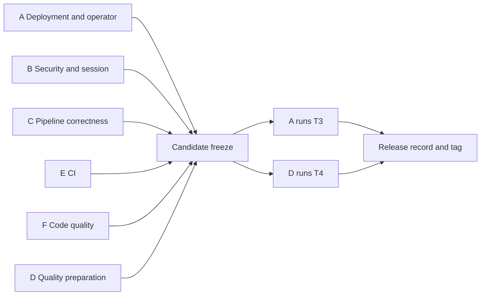
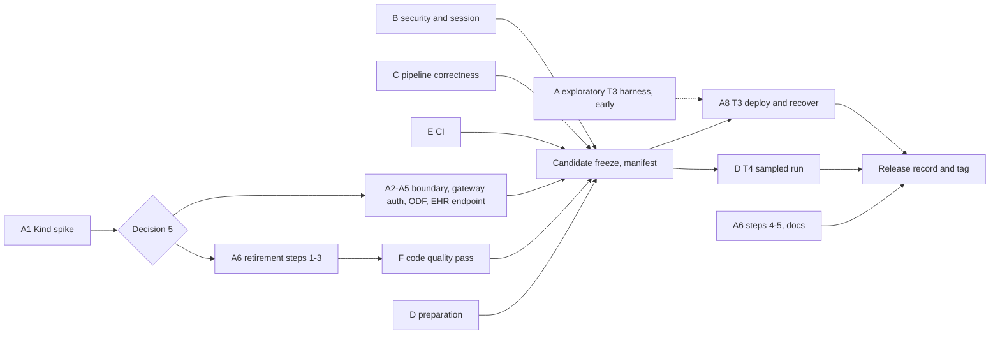

# Carewright release plan — November 2026

**Date:** November 3, 2026, corrected after the plan review and the second plan review; **updated November 5 after the team meeting** (Sam Schifman, Jaideep Rao, Khaled Sulayman). The November 5 changes: the plan is organised by **track**, because the work is split across the team by track; owners and an end-of-year target are recorded; OpenShell controller authentication and ODF object storage are added to Track A; a **code quality and organization** track (F) is added; per-stage evaluation is confirmed in place of a fixed end-to-end golden test. **Status:** adopted by the team on November 5 as the working plan; promoted into `dev_docs/` the same day (this file is the reference copy; the planning archive it was reduced from lives in the owner's gitignored `working/planning-nov-2026/` directory, outside the repository) and to be mirrored by one high-level Jira ticket per track. **Supersedes** as the working reference: the planning review, closure candidates, release gate (r4), both gate reviews and the topology and quality recommendations. Those files, the Jira and GitHub inventories, the evidence ledger and `sources/` remain as the archive this document was reduced from (all in the gitignored working directory, §4.4). **Evidence basis:** tracker snapshot November 2; November 3 tracker cleanup; source inspection of checkout `ba519da` (remote `main` was one commit ahead, `a3cc62b`, PR #200: operator workflow definitions, a parity test and documentation); team reports at the November 5 meeting, marked as reported where they are not yet in the repository. No live cluster, Kind deployment or model evaluation was run for this plan.

---

## Part 1 — Summary

### 1.1 Purpose

Carewright turns clinical practice guidelines into patient-specific, clinician-reviewed FHIR care plans. The project has advanced well beyond its July roadmap, and the trackers no longer describe what exists. This document states what a **release** means, what stands between the current code and that release, the decisions still open, and the implementation plan to get there. The plan is organised as six tracks with named owners that run in parallel and join at a single candidate freeze. It is written so that a reader who has not followed the planning threads, or who owns one track only, can start from here.

### 1.2 Where the project is

Delivered and merged:

- Both UIs (React/PatternFly), asynchronous BFFs, SonataFlow orchestration, an in-run human review gate with clinician feedback rounds, SMART launch from a Medplum mock EHR.
- DMN extraction with schema and lint validation, repair and escalation, temporal metadata, source-supplied clinical codes, a KIE validation endpoint and a benchmark (compile pass rate 0.61 → 1.00 on 11 decisions in one tuned run).
- LLM conflict detection recorded as AI-Transparency Provenance; real embedding provider wiring; review-time provenance fields.
- BPMN foundation: template extraction, deterministic compilation and validation, patient binding, read-only review, FHIR attachment, publication machinery and a compose-only receiver. **No process execution. No cluster receiver. Live runs reached `not-applicable`, never `published`.**
- Shared prompt-evaluation infrastructure (immutable artifacts, receipts, lineage, holdout mechanics).
- Kubernetes operator in the monorepo, with OpenShift deployment documentation and workflow synchronisation.

Tracker cleanup on November 3 closed 25 GitHub issues and one Jira story with evidence comments. Still open from that pass: GitHub #44 (live publication proof), GitHub #69 with Jira RHAIENG-6492 (allergy end-to-end), Jira RHAIENG-6491 (durable writer provenance) and RHAIENG-6496 (crash recovery).

Reported at the November 5 meeting, not yet verified in the repository:

- Jaideep ran ingestion on OpenShift with **OpenShift Data Foundation (ODF)** object storage in place of MinIO. All artifacts were stored except the DMN tables, whose object names contained spaces; a fix in the ingester assembly step removes the spaces. The writer's read path over the same S3-compatible interface is not yet confirmed. Nothing of this is on `main` yet.
- Jaideep identified that the operator's **OpenShell controller connects to the OpenShell gateway without authenticating itself**, although OpenShell supports OIDC-based authentication. Confirmed in source: the SandboxRequest controller opens an SDK client from an endpoint and an `insecure` flag only, and the bootstrap installs OpenShell with unauthenticated plaintext access on its cluster-internal Service.
- Khaled has a draft prompt-revision PR that changes evaluator conventions; its benchmarking run is not yet an official one because of connection problems, so the PR is not yet open for review.

### 1.3 What "release" means

A **reproducible reference deployment** that:

1. runs end to end in **the supported environments of one operator-managed topology** (OpenShift and local Kind, as fixed by decision 5), from a frozen image manifest per environment, and **no other full-system application deployment path exists in the repository**. Unit tests, single-service debugging, UI development and local image builds for the operator development loop remain; release installation consumes the accepted manifest;
2. uses **synthetic data only**, inside a deployment boundary **verified by access probes**;
3. has **no fail-open path** between model output and the trusted write path;
4. requires a **session or service credential on every application endpoint that mutates state**, and the **OpenShell controller authenticates to the OpenShell gateway**; any caller the gateway still admits without authentication is named, and accepted only while the boundary probes pass;
5. has **no reusable secret in browser code, no PHI-class payload in telemetry, no code execution from posted artifacts**;
6. has **CI that runs every component's tests** on every pull request and reports which suites ran;
7. has **quality evidence built for a nondeterministic pipeline**: invariants hold on every sampled run; each pipeline stage is measured by evaluation metrics tailored to that stage; generated content is judged against source-reviewed semantic rubrics that admit alternatives; useful end-to-end outcomes are demonstrated for the declared guidelines and patients; no unresolved critical clinical defect remains in accepted artifacts; completion, correction, escalation, latency and cost are reported with the sample's limits. **Identical output, success on every attempt, and a fixed end-to-end answer key are not requirements.**
8. has had a **bounded code quality pass** over every component, so that retired paths, dead code and accidental duplication do not ship in the tagged revision;
9. ships with a **dated release record** signed by a named owner, from artifacts not rebuilt after acceptance.

The boundary claim is a **peer-workload boundary**. Accepting privileged SCC use means the release makes **no claim against compromise of privileged infrastructure**. Both sentences go in `docs/security.md`.

**Pilot gate, not release gate:** OIDC/RBAC for users, workload identity, gateway TLS (unless controller authentication requires it, see Track A), per-bucket object-store credentials, authenticated clinical attribution and audit, adversarial test suite.

**Target:** the team agreed on November 5 to reach this definition by **the end of 2026**. See §1.8 for the calendar.

### 1.4 What would fail today

Verified on `ba519da`, November 3, with the November 5 additions marked:

| Area | Finding |
|---|---|
| Deployment | No Kind path; the operator's exposure controller requires the OpenShift Route API and its bootstrap assumes OperatorHub; this project's OpenShell-based Kind path has not been demonstrated in the inspected evidence. Four compose variants, the monolith entrypoint, hand-run deploy scripts and podman demo scripts all coexist; AGENTS.md says local dev uses compose. SonataFlow state does not survive on the local podman path. **(Nov 5)** OpenShift object storage is a namespace MinIO; ODF has been tried by hand only. |
| Operator security | **(Nov 5)** The SandboxRequest controller authenticates nothing to the OpenShell gateway ([`sandboxrequest_controller.go`](../carewright-operator/internal/controller/sandboxrequest_controller.go): endpoint plus `insecure`); the [bootstrap](../carewright-operator/docs/bootstrap-prerequisites.md) installs the gateway with unauthenticated plaintext access on its cluster-internal Service. |
| CI | Only the operator has CI. No Python, Java or UI test runs on pull requests. gitleaks extends none of the default rules. |
| Security | FastAPI autolog records request bodies into MLflow (PHI in traces). The decision service compiles Java function definitions from posted DMN. The SMART launch page sends a client secret from the browser to whatever `iss` the query string names. Approve, reject, write and template-register endpoints have no authentication. The ingester UI and the writer's direct routes have no session concept. Mermaid renders generated content with `securityLevel: 'loose'`. |
| Correctness | Both writer reviewers construct `APPROVE` when the model response cannot be parsed. DMN deployment proceeds when the validation engine is unreachable. Observation units are not normalised. `CarePlan.addresses` is never populated. Guideline applicability matches display text. |
| Code quality | **(Nov 5)** The operator's code has been checked for behaviour, not structure; the rest of the repository has grown quickly without a review pass for dead code, duplication or layout. |
| Evidence | No end-to-end run recorded at current images in either environment; no candidate manifest; no exposure matrix; no `docs/security.md`; no rubric sheets; no declared sampling design; the orchestrated compose config enables publication. |

### 1.5 Direction decisions already taken

Owner decisions of November 3 and team decisions of November 5, adopted here:

- **One operator-managed topology, two environments.** OpenShift and Kind share CRDs, reconciliation, services, workflows and review boundaries; only environment configuration differs. Compose, the monolith entrypoint, hand-run orchestration and the podman demo scripts are **retired as a release deliverable**, not kept as "development-only". A time-boxed Kind feasibility spike gates this; its no-go branch is OpenShift only, never a third path. Remote inference is the reference configuration; local model serving is outside this release, not retired as a capability. *(Confirmed by the team, Nov 5.)*
- **Quality evidence does not demand that every sampled run passes, and there is no fixed end-to-end golden test.** *(Team, Nov 5.)* A fixed expected care plan per guideline would push prompts toward overfitting and is rejected. Each stage is measured by metrics tailored to that agent (for the recommendation extractor, the proportion of source recommendations extracted per guideline and whether they land in the right contract and FHIR fields; for the writer, whether the expected recommendations surface in the plan and the provenance and reasoning hold up). Strict assertions apply to software invariants and to executing already-reviewed DMN. Generated content is assessed semantically. Safe escalation is a valid outcome counted in the denominator. Changing prompts, code or rubric to improve a result creates a new candidate and never erases earlier outcomes.
- **BPMN publication is off by default.** The release is care-plan generation plus BPMN artifact review, with the incomplete-instance safeguard on.
- **Identity stays a pilot gate; the OpenShell controller does not.** A bounded demo session design is required now: standard SMART authorization-code launch with PKCE terminating at the BFF, no token or secret in the browser, per-service tokens behind it. OIDC/RBAC for users and attribution of a named clinician are not. *(Nov 5)* Authentication of the operator's controller to the OpenShell gateway is release work in Track A; it sits between the deployment and security tracks and was placed in A because the gateway, bootstrap and controller are operator-owned.
- **A code quality and organization pass is in the release.** *(Team, Nov 5.)* Much code was written quickly and checked for behaviour only. Dead code and duplication cost tokens on every read, by a person or an agent, and a clear layout makes both faster. The pass is deliberate but bounded: trim, do not rebuild.
- **Tracks are the unit of assignment.** *(Team, Nov 5.)* One owner per track once it is picked up (Track F is deliberately unassigned until other tracks finish); one high-level Jira ticket per track, without a deep breakdown; existing tickets link to their track's ticket.
- **Standards boundaries hold.** Ingester emits DMN and recommendation contracts; writer owns decisions and the vector store; callers provide patient data; automation is a downstream executor; component ownership remains while the manual application deployment contracts are deliberately retired in favour of the operator. Guideline-specific content lives in fixtures and contracts, never in prompts or source.

### 1.6 Decisions still open

Decisions 2 and 3 are made. Decisions 1, 4, 5 and 9 are delegated to the tracks named in §1.7 and do not block the other tracks. Decisions 6, 7 and 8 are still open; the November 5 meeting did not settle them.

| # | Decision | Recommended position |
|---|---|---|
| 1 | Enforced deployment boundary | **Owned by Track A; does not block other tracks.** Private namespace, project team only, in both environments; NetworkPolicy on an enforcing CNI (OVN on OpenShift; Calico or Cilium on Kind); proven by probes. The browser-reachable surface is the UI entries plus the declared EHR authorization/API endpoint the SMART flow needs (Track B, §2.2); nothing else. The OpenShell gateway admits only authenticated callers once Track A's controller authentication lands (§2.1 A3). If probes cannot pass in an environment, tighten or drop it. |
| 2 | Entry, session and IPS flow per UI | **Decided (owner, Nov 3): standard SMART App Launch, authorization-code flow with PKCE and the `launch` scope, terminating at the BFF.** The browser starts the flow; the redirect lands on the BFF, which exchanges the code server-side as the confidential client, receives the token and patient context, fetches the IPS, and sets the session cookie. No token, secret or IPS in the browser; the EHR's authorization server binds launch context and makes codes single-use. The client-credentials grant is retired, not relocated. Writer: this launch is the only session-establishing entry; direct routes require a session. Ingester: one-time launch link minted server-side. The BFF is the caller that supplies patient data to the writer API; the pipeline never queries FHIR for patient data. Security design is Track B; Medplum SMART client configuration is Track A. |
| 3 | Recovery outcome per store and environment | **Decided (owner, Nov 3): as recommended.** Two outcomes per store, decided independently: **how state returns** (persisted; reloaded automatically from artifacts; restored from backup) and **what happens to the workflow** (same run resumes; new run required). After a process restart every store's state returns and the same run resumes, provided artifact identities are intact. This covers a run paused at review **and** a run in active generation: for the latter, the surviving orchestrator (SonataFlow step timeouts and retries, plus writer startup reconciliation of job state) detects the loss within a bounded, named time and re-dispatches the interrupted step duplicate-safely; the dying process is never relied on to record its own death. After a backup restore the durable artifacts return and a new run is required, so in-flight review rounds are lost on a backup restore. Shared SonataFlow persistence does not by itself establish recovery for any other store. Deleting a Kind cluster is not a backup. The cheap resilience items in §2.1 A8 are included. |
| 4 | Released fixture, model, configuration and sampling set | **Owned by Track D; answered as that track proceeds; does not block deployment or other tracks.** Two guidelines, their synthetic patients, one decoy guideline, one allergy-bearing patient, and **one joint patient to whom both guidelines apply** with a source-derived conflict visible in review; one request-changes case assessed for the requested semantic correction or a justified refusal. One inference and one embedding model per environment, named per sample; if the environments use different models, one model's quality baseline does not stand in for the other's. Sampling: three extractions per guideline; three writer runs per patient on one frozen extraction; one per patient on each other extraction; for the joint patient, a small declared set of paired extraction versions, not every combination; a fixed retry, review and human-intervention budget. Must be fixed before the candidate freeze. |
| 5 | Supported environments (after the spike) | **Owned by Track A; does not block other tracks.** Kind is the preferred target. Go: OpenShift + Kind. No-go: OpenShift only with a per-developer namespace, recorded as an owner scope decision, never an automatic result of an inconclusive spike. Never a third path. This decision fixes the environment set that every "both environments" exit test below refers to. |
| 6 | Release owner | One named person signs the record and dispositions non-blocking defects. **Open.** |
| 7 | Retirement inventory sign-off | See §2.1 A6; includes confirming with Khaled that the slice compose can go. **Open.** |
| 8 | First-release acceptance rule | A **deliberate minimal choice**, not a reliability threshold: invariants pass on every sampled run; deterministic tests pass; no unresolved critical defect in any accepted final artifact; at least one **accepted** plan per declared fixture within the declared budget. *Accepted* means useful against the source-reviewed rubric, with indispensable concepts represented or their omission justified and non-critical limitations dispositioned; absence of a critical defect alone is not acceptance. The retry, correction and human-intervention budget is named before sampling, and every incomplete outcome stays in the denominator. The recorded outcomes **inform** the next release's operating expectations; they do not become the standard merely because they were achieved. **Open.** |
| 9 | ODF on OpenShift: prerequisite or bootstrap-installed | **Owned by Track A (new, Nov 5); does not block other tracks.** Recommended: ODF is a verified cluster prerequisite, like the StorageClass check today; the bootstrap creates the buckets and scoped credentials it needs through ODF's object-bucket API and does not install ODF. On OpenShift, ODF replaces the namespace MinIO. MinIO remains the Kind object store behind the same S3 interface. |

### 1.7 Tracks

Six tracks start at once and join at the candidate freeze. One person need not do everything; each track has one owner. Owners were agreed on November 5 except where marked. The tranche labels T0–T4 from earlier revisions are kept as names for the acceptance gates, since tickets and reviews refer to them; each is listed inside the track that delivers it.

| Track | Scope | Owner | Starts | Needs from other tracks | Gives to other tracks |
|---|---|---|---|---|---|
| **A. Deployment and operator** (§2.1) | T0 Kind spike; decisions 1, 5 and 9; boundary and CNI; portable exposure; **OpenShell controller authentication to the gateway**; **ODF object storage on OpenShift**; Medplum SMART client registration and the browser-reachable EHR endpoint; retirement steps 1–3; image manifest mechanics; T3 deployment, recovery and resilience | Jaideep Rao | now | Track B's secrets layout, per-service tokens and EHR endpoint design before the final T3 run | Environments for every other track's final verification; the candidate manifest |
| **B. Security and session** (§2.2) | T2a: Tranche 1 fixes; the authorization-code launch terminating at the BFF; session store; per-service tokens; approval binding; telemetry sentinel check; `docs/security.md`; the access-matrix script | Sam Schifman | now | Track A's environments to run the access matrix at the end | Token and secret layout to A; protected endpoints that C's fail-closed paths and D's invariants rely on |
| **C. Pipeline correctness** (§2.3) | T2b: fail-closed reviewers; engine policy; units; FHIR references; allergies; guideline selection; identity collision; contract version; traceability; the artifact-name fix from the ODF run | Khaled Sulayman now; Sam Schifman joins after Track B if C is still open | now | nothing | Fail-closed pipeline that D's final run measures |
| **D. Quality evidence** (§2.4) | T4: PR #191 disposition and merge; decision 4 (fixtures, models, sampling); per-stage metrics; rubric sheets; baseline; human assessment; evidence durability | Khaled Sulayman | preparation now, on frozen artifacts; final run after the freeze | Track C's fail-closed changes and Track A's candidate images for the final run only; nothing for preparation | The quality half of the release record |
| **E. CI** (§2.5) | T1: the pull-request workflow, gitleaks, required checks; removal of CI targets for retired paths; the lint and format baseline Track F needs | unassigned; small, first week; any owner | now | nothing | A green check every other track relies on |
| **F. Code quality and organization** (§2.6) | A bounded review pass per component: dead code, leftovers of retired paths, duplication, layout against the AGENTS.md boundaries; operator first | **Unassigned.** Picked up as other tracks finish; expected to be a combined effort across the team | after retirement step 3 | Track A's retirement (so the sweep follows the deletions); Track E's baseline; file-level coordination with B and C | A tagged revision without dead code |
| **Cross-track** (§2.7) | Candidate freeze; docs and tracker reconciliation; release record; defect disposition | release owner (decision 6, open) | at freeze | all tracks | the release |

**Coordination points.**

- Tracks B and C both change the writer API and BFF; agree ownership of `api.py` and the BFF routes before both start.
- Tracks A and B both change operator configuration for secrets and NetworkPolicy, and jointly decide the browser-reachable EHR endpoint (§2.1 A5, §2.2).
- Track A's ODF naming fix touches ingester assembly code that Track C owns; agree who merges it.
- Track F never holds a PR open on a file that B or C has a PR open on; agree the order per component.
- Track D's preparation does not wait for anything; only its final sampled run waits for the freeze.
- **The candidate freeze is the single join point**: after it, Track A runs T3 and Track D runs T4 in parallel, and the release owner assembles the record.
- **Isolation condition:** T3 and T4 run in parallel only against separate deployments of the same candidate, or with T3's destructive actions (restarts, registry reloads, backup restores, fault injection) scheduled outside the T4 sampling window. Nothing that T3 does may modify the deployment used to measure generation quality.

### 1.8 Sequence, join point and calendar

B, C, D preparation and E do not depend on the spike's answer and start at once; only environment-specific implementation, retirement and the code quality sweep wait for decision 5. Retirement steps 1–3 precede the candidate freeze so no retired executable path survives into acceptance, and precede Track F so the sweep follows the deletions.

| Order | Work | Why |
|---|---|---|
| 0 | A1 Kind spike with an assigned effort limit; B, C, D preparation and E start at once | The spike decides the environment set; environment-independent work does not wait. |
| 1 | E: CI, gitleaks line, Mermaid strict; D: rubric sheets drafted | Small; protects everything after; sheets need source-review time. |
| 2 | B: authorization-code launch at the BFF, Tranche 1 fixes, access matrix, sentinel check, `docs/security.md`; A2–A5: boundary, controller authentication, ODF, EHR endpoint | Independent of the environment answer; the launch and session work is the largest single item. |
| 3 | C: fail-closed reviewers, engine policy, bounded correctness cases | Must land before the candidate. |
| 4 | A6: retirement steps 1–3; F: code quality pass; A: exploratory T3 harness on the surviving environments | Removes paths before anyone invests further; the sweep follows; early runs expose integration problems and are labelled exploration. |
| 5 | Freeze candidate, full image build, manifest | Before any final run. |
| 6 | A8: T3 final in both environments; D: T4 sampled run on candidate images | The evidence. |
| 7 | A6 steps 4–5, docs, release record, tag | Last; no rebuild. |

**Calendar.** Target: end of 2026. Known absences: Sam Schifman November 10–17; US Thanksgiving week of November 23; Jaideep Rao from about mid-December; the end-of-year shutdown. That leaves roughly five working weeks per person, fewer for the owner of Track A. Jaideep proposed time-boxing to one or two weeks and releasing whatever exists; the team settled on the end-of-year target with the same spirit: the release is not expected to be perfect, and work continues after it. If progress stalls, dropping to one environment is the largest scope cut; make it explicitly before cutting any correctness or authorization requirement. Track F is the second cut: whatever is not done by the freeze is deferred to the next release, never applied to the candidate.

### 1.9 Rules that govern the plan

- **Scope rule.** Keep implementation bounded to the declared capabilities and environments. If a mandatory assertion needs disproportionate work, simplify the implementation or explicitly reduce the supported capability or environment and re-review. A mandatory assertion is never waived because the fix is large.
- **Defect disposition rule.** A defect found while running the gate is blocking if it fails any exit test in Tracks A–C and E or any invariant or critical final-content condition in Track D. Measured generation outcomes are compared with predeclared expectations, not a universal pass rate. Only non-blocking limitations may be accepted, in writing, by the release owner.
- **Re-candidate rule.** Any change to code, prompts, model configuration, dependencies or deployment settings that affects an assertion produces a new candidate and reruns the affected checks. Documentation-only changes do not.
- **Refactor rule.** A Track F change carries no behaviour change and is never bundled with a Track B or C fix. After the freeze, no refactor is applied to the candidate.
- **Evidence rule.** Exploratory runs are never cited as release evidence. Acceptance outputs live off-cluster and outside `working/`.

### 1.10 People and trackers

Track owners agreed November 5: A Jaideep Rao; B Sam Schifman; C Khaled Sulayman now, Sam after B; D Khaled Sulayman; E unassigned (small); F unassigned, to be picked up as other tracks finish and shared across the team. Previously recorded assignments stand: Khaled (recommendation evaluation, golden suite, model comparison, safe drafting tracing); Jaideep (operator lifecycle); Sam (external demo, HL7 WGM follow-ups). At the November 2 snapshot, 43 of the 50 non-Done Jira children were unassigned (one has been closed since).

System of record going forward: **Jira** for outcome, owner and status, as **one high-level ticket per track** created by Sam, without a deep breakdown; **GitHub** for implementation and acceptance evidence; explicit cross-links. Existing tickets named in Part 2 link to their track's ticket. `dev_docs/project-plan.md` is historical and will point at the promoted copy of this plan. GitHub #171 is rewritten as the tracker for this gate.

---

## Part 2 — Implementation plan by track

Each track section opens with its owner, start condition and dependencies, lists its tasks with the tickets they narrow or close and the required behaviour, and ends with the track's exit tests. Tickets in brackets are existing; "new" means a task to create under the track's Jira ticket.

### 2.1 Track A — Deployment and operator · Jaideep Rao

| | |
|---|---|
| Owner | Jaideep Rao |
| Starts | now, with A1 |
| Needs | Track B's secrets layout, per-service tokens and EHR endpoint design before the final T3 run |
| Gives | the environments every other track verifies on; the candidate manifest; decisions 1, 5 and 9 |
| Exit | A1–A8 exit tests below |

#### A1 — Kind feasibility spike (T0, time-boxed)

Run before any further investment in local deployment tooling. Evidence for a **go**:

| Task | Detail |
|---|---|
| Kind under podman with an enforcing CNI | Calico or Cilium. Record startup time, memory, container runtime and CPU architecture. |
| Prerequisites without OpenShift | SonataFlow operator (not via OperatorHub), MinIO (note the amd64 digest pin in the [bootstrap prerequisites](../carewright-operator/docs/bootstrap-prerequisites.md)), Medplum, MLflow, **OpenShell / Agent Sandbox** (the largest unknown). |
| Portable exposure in the operator | [`pipeline_exposure.go`](../carewright-operator/internal/controller/pipeline_exposure.go) creates OpenShift Routes and the controllers watch them. Add Ingress or NodePort behind a switch; tolerate the Route API being absent. Bounded to the switch and Route-absence tolerance; no OpenShift refactor. |
| Application run | One guideline through ingestion and review; one synthetic patient through writer review, approval and Medplum readback, via the browser entry path at the documented origin, with the EHR authorization endpoint reachable from the browser and the session cookie policy in force (local HTTPS). |
| Targeted restart | Decision engine, then SonataFlow; record what state survived. |
| Isolation probes | The two isolation probes from Track B's access matrix: one from another namespace, one from a plain pod inside the namespace. |
| Developer loop | Measured edit, build, redeploy cycle for one component change. |
| Write-up | `dev_docs/spikes/kind-feasibility.md`: go / no-go, obstacles and their cost, and the existing artifacts the Kind path still depends on. |

Give the spike an explicit effort limit when assigning it. The operator's existing [Kind CI job](../.github/workflows/carewright-operator-ci.yml) tests only the manager and metrics endpoint. A successful Kind run does not replace OpenShift verification. Tickets: RHAIENG-7440 (narrow), #119 (closes as superseded).

**Exit test:** the write-up exists and decision 5 is recorded.

#### A2 — Deployment boundary and exposure (decisions 1 and 5)

| Task | Detail | Tickets |
|---|---|---|
| Namespace and CNI | Private namespace, project team only, in both environments; NetworkPolicy on an enforcing CNI (OVN on OpenShift; Calico or Cilium on Kind). Bootstrap keeps its enforcement check; the Kind bootstrap gets an equivalent. | #48 (M15 partial) |
| Policy set | The NetworkPolicies needed to make Track B's access matrix pass: gateway Service, model gateway, MinIO or ODF endpoint, Medplum, Postgres, Redis and the decision engine unreachable from other namespaces and from pods outside the allowed caller set. The service-proxy policy in the [bootstrap prerequisites](../carewright-operator/docs/bootstrap-prerequisites.md) is recorded for exactly what it protects; direct Service paths are probed separately. | #48 |
| Host exposure | OpenShift: only the UI Routes and the declared EHR endpoint (A5). Kind: only the UI Ingress or NodePort and the declared EHR endpoint; no data-service ports. | new |
| Reference origin | The reference Kind origin uses local HTTPS (a locally trusted certificate on the Ingress) so Track B's `Secure` cookie works; any plain-HTTP exception is limited to a browser-tested `localhost` origin. | new |

**Exit test:** Track B's access matrix passes in both environments; public exposure enumeration shows only the UI entries and the declared EHR endpoint.

#### A3 — OpenShell controller authentication to the gateway (new, Nov 5)

**Finding.** The [SandboxRequest controller](../carewright-operator/internal/controller/sandboxrequest_controller.go) opens an OpenShell SDK client from `spec.gateway.endpoint` or `OPENSHELL_GATEWAY_ENDPOINT`, with an `insecure` flag for plaintext or unverified TLS, and presents no credential. The [bootstrap](../carewright-operator/docs/bootstrap-prerequisites.md) installs OpenShell with unauthenticated plaintext access on its cluster-internal Service and says not to use that configuration on a shared cluster. Jaideep reports that OpenShell supports OIDC-based client authentication, which the project does not use. Today the only thing between any pod in the cluster and sandbox creation is NetworkPolicy.

| Task | Detail |
|---|---|
| Confirm the mechanism | Confirm in OpenShell's documentation and the installed version exactly which authentication the gateway supports (OIDC token validation; issuer, audience and claim mapping; whether it requires TLS on the listener). Record it in the operator docs before implementing. |
| Controller identity | Preferred: the cluster's own ServiceAccount token issuer with a projected, audience-bound token mounted into the operator, so no new identity provider is needed in either environment. An external issuer only if the gateway cannot validate Kubernetes-issued tokens. Record the choice and why. |
| Gateway configuration | Bootstrap configures the gateway to validate the chosen issuer and audience. Inventory every caller of the gateway first (the controller; the `openshell` CLI over port-forward; anything on the router or proxy path); once every in-cluster caller authenticates, unauthenticated access on the gateway Service is turned off. Any caller that must remain unauthenticated is named in `docs/security.md` as an accepted gap, conditional on the probes. |
| Controller change | The SDK client presents the token on every connection; projected-token rotation is handled; a failed authentication is a reconcile error surfaced as a status condition on the SandboxRequest, not a silent retry loop. A CRD field for issuer and audience only if the SDK needs it; `insecure` keeps its transport meaning and is documented. |
| Both environments | The same mechanism on Kind, in the same bootstrap step. |
| TLS question | If the gateway's authentication mode requires TLS on its listener, gateway TLS moves into the release with it and the `insecure` default flips; otherwise gateway TLS stays a pilot item (§3.1). Record the answer either way. |

**Exit test:** a plain pod inside the namespace, outside the allowed caller set, cannot create a sandbox through the gateway (refused, as an authentication failure and not only a network refusal); the controller can; both appear as rows in Track B's access matrix; the operator's Kind CI exercises the authenticated path. Tickets: new under the Track A ticket; narrows the H4 deferral in #48.

#### A4 — Object storage on OpenShift: ODF (new, Nov 5)

**Reported.** Ingestion stored all artifacts in ODF except the DMN tables, whose object names contained spaces; a fix in the ingester assembly step removes the spaces; the writer read path is unconfirmed; none of it is on `main`.

| Task | Detail |
|---|---|
| Decision 9 | Prerequisite or bootstrap-installed; recommended position in §1.6. Bootstrap verifies ODF is present, creates the artifact and PHI buckets and scoped credentials through ODF's object-bucket API, and no longer deploys MinIO on OpenShift. |
| Environment configuration | The OpenShift environment points the artifact store at the ODF S3 endpoint with scoped credentials delivered like every other secret (`secretKeyRef` on operator-managed pods, `read_secret` + `--env` in sandboxes). Kind keeps MinIO behind the same interface. No operator or application code knows which product is behind the endpoint. |
| Artifact naming | The no-spaces fix is merged on `main` with a unit test, and object keys are validated against a declared character set at the producer rather than relying on the store to reject them. This is ingester assembly code; agree the merge with Track C. |
| Writer and sandbox reads | Verify that the writer and the sandboxes read artifacts from ODF through the proxy-signed path from #198. |
| Backup and restore | The T3 backup procedure covers the ODF buckets; a restore into a fresh namespace returns the artifacts. |
| Record | ODF version recorded among the platform versions in the release record. |

**Exit test:** the OpenShift A1-equivalent and T3 runs use ODF with no MinIO in the namespace; the bucket listing after ingestion includes the DMN artifacts; a writer run reads them; the restore test returns them.

#### A5 — EHR integration configuration (joint with Track B)

| Task | Detail |
|---|---|
| Confidential SMART client | Register the writer as a confidential SMART client in Medplum with the BFF redirect URI, in both environments' bootstrap. Track B owns the BFF side. |
| Browser-reachable EHR endpoint | The SMART flow redirects the browser to the EHR's authorization endpoint **before** a writer session exists, and the [mock-EHR UI](../mock-EHR/ui/src/main.tsx) builds a browser-side Medplum client against a separate server [Route](../mock-EHR/deploy/chart/templates/medplum-server-route.yaml); its [nginx](../mock-EHR/ui/nginx.conf) has no API proxy. Removing the server Route to satisfy the exposure audit would break both. Choose with Track B and implement one of: a restricted proxy behind the approved browser origin that forwards only the authorization, token-adjacent and UI-required API paths; or an explicitly declared, authenticated EHR endpoint. Set Medplum's public URLs to match. Internal data and management services stay protected. |

**Exit test:** a fresh browser, from the intended origin, completes EHR login, the launch redirect, session establishment and one approval at the exact documented origin, in each environment (a row of Track B's access matrix).

#### A6 — Retirement of superseded paths (release deliverable; steps 4–5 cross-track)

After decision 5, in this order:

1. **Canonical operator path per environment:** bootstrap, verification, backup/restore and teardown. Consolidate duplicated application and workflow definitions while preserving component ownership.
2. **Inventory, then relocate** anything still needed:

   | Artifact | Disposition |
   |---|---|
   | `*/deploy/pods/Containerfile.*` | **Keep**: CI build inputs ([publish-images.yml](../.github/workflows/publish-images.yml)). |
   | Component charts used as prerequisite installers (e.g. mock-EHR) | **Keep**: a chart is not obsolete because it is a chart. |
   | `acp-writer/src/acp_writer/api.py` | **Retire the monolith entrypoint only**; the split services import the module. |
   | `compose.slice.yml`, `scripts/run-slice-local.sh`, `scripts/slice_automation_guard.py` | Feed prompt-evaluation work. **Confirm with Khaled** before removal or relocation (decision 7). |
   | `compose.yml`, `compose.orchestrated.yml`, `compose.acp-dev.yml` | **Retire.** |
   | `scripts/demo-up.sh`, `demo-down.sh`, `demo-backup.sh`, `demo-common.sh` | **Retire** (added October 26). |
   | `deploy/deploy-all.sh`, `teardown-all.sh`, `verify-all.sh`; component `deploy/deploy.sh`, `verify.sh`, `teardown.sh`; `deploy/load-published-artifacts.sh` | **Retire** once the operator path covers each responsibility; `verify-all.sh` and its pending MaaS route-segment patch are inputs to the operator verification command. |
   | Namespace MinIO manifests in the OpenShift bootstrap | **Retire** on OpenShift once A4 lands; keep for Kind. |
   | `acp-writer/src/acp_writer/mcp_server.py` | Reassess (#19); delete only if unused in both environments (Track F executes the deletion). |
   | AGENTS.md "Local dev uses `compose.yml`" | **Rewrite.** |

3. **Remove** the monolith launch and build path, every full-system compose variant, the podman demo scripts, manual orchestration, duplicate renderers and obsolete scripts, with their CI targets, commands and documentation. Track F starts after this step.
4. **Rewrite** root and component READMEs and AGENTS.md for the two environments. Short migration note; Git history for the rest. **No executable archive of unsupported deployments.** (Cross-track, with §2.7.)
5. **Verify** fresh setup from the surviving instructions in each environment; audit for references to removed entrypoints. (Cross-track.)

Tickets closed or superseded by this: #119, #166, the monolith sub-item of #174, #80's compose half. **Exit test:** the retired launch, build and orchestration paths are gone; no active script, CI target or Containerfile depends on them; current operational instructions offer only the operator path per environment; explicitly marked historical documents and the migration note may still name the retired files. A newcomer following the README reaches a running system in each supported environment.

#### A7 — Candidate freeze mechanics

Track A owns the mechanics of the freeze described in §2.7.1: the full image build on both workflows, the digest manifest per environment, the rule that supported paths contain no local build step, and the declared architecture and runtime per environment.

#### A8 — Deployment and recovery in both environments (T3)

**Recovery matrix**, every cell fixed by decision 3 before the run. Each store records two outcomes: how its state returns, and what happens to the workflow. The same matrix applies to both supported environments unless a cell says otherwise.

| Store / process | State after process restart | Workflow after process restart | After backup restore | Tickets |
|---|---|---|---|---|
| BFF (job index, review state) | persisted | same run resumes | durable records return; new run | #167 |
| SonataFlow (runs awaiting review) | persisted | same run resumes | in-flight runs are **not** recovered; new run | #165 revisit, RHAIENG-6496 |
| Decision engine + template registry | reloaded automatically from artifacts, no manual loader | same run resumes if artifact identities are intact | reloaded from restored artifacts; new run | #63 / 6486 |
| Guideline / recommendation vector store | reloaded automatically from artifacts | same run resumes | reloaded from restored artifacts; new run | #63 |
| Artifact object store (ODF on OpenShift, MinIO on Kind) | persisted | same run resumes | buckets restored from backup; new run | A4 |
| Approved plans + publication jobs | rehydrated from jobs | same run resumes | durable jobs return; new run | #167, #66 |

**Three failure classes, tested separately:**

| Class | What is done | Claim |
|---|---|---|
| Process restart, volumes intact | Targeted restart of **one** service at a time (BFF, SonataFlow, decision engine, writer), then one full-stack restart | Each cell holds; a broken rehydrator cannot hide behind a full restart. |
| Durable-store restore | The documented backup procedure restored into a **fresh namespace or fresh Kind cluster** | Approved plans, jobs, registry, artifacts and buckets return. In-flight run recovery is never claimed from a restore. |
| Upgrade / rollback | Named pair only: previous candidate → this candidate, and a broken image bump rolled back | Data intact for that pair and the tested startup-failure case; no general schema-downgrade claim. (#179 rollout strategy, #180 loader idempotency) |

**Scripted sequence per environment** (#78 / 6501, #79 / 6502 narrowed to this): install → ingest → pause at review → targeted restarts → observe each matrix cell → wherever the matrix says a new run is required, explicitly start and review the new run; old review links fail or show "restart required" and the abandoned run is not approvable → approve → retrieve by patient from the writer **and** read back from Medplum → upgrade to the candidate into the populated namespace → retrieve again.

**Additional windows in the same script:** FHIR write with lost response (Medplum accepts the transaction, the client restarts before recording it; recovery finds the same plan, creates no duplicate, does not report local-only storage as delivery); duplicate approval of the same revision (prior result, no write); request-changes followed by approval (new round, new revision, and the revision is assessed in Track D for the requested semantic correction or a justified refusal).

**BPMN capability, publication off, both environments** (#44 boundary recorded, not closed):

| Claim | Acceptance |
|---|---|
| Templates and instances reviewed; enabled instances attached to FHIR; publication reported as `unconfigured`, visibly not success | UI and API never present `unconfigured` or `not-applicable` as published. The CR and environment config carry **no automation URL or token**; a network capture shows **no publication request** after approval. |
| Incomplete-instance safeguard | Missing required values are visible, never invented, never yield an enabled or published instance. |

**Cheap resilience items** (owner decision, Nov 3; no HA claim):

| Item | Required behaviour | Evidence |
|---|---|---|
| Probes and resources | Readiness and liveness probes and resource requests on every Deployment, set by the operator | Present in the rendered manifests for both environments |
| Replica policy | Single replica wherever idempotency is not proven, enforced in the CRs and documented; stateless pods may be scaled only after the rehydration work lands and is tested | Scaling an unproven service is rejected or documented as unsupported |
| Termination handling, two failure modes | **Graceful (SIGTERM):** the process marks the in-flight step interrupted before exit. **Abrupt (SIGKILL, OOM, node loss):** nothing can be recorded by the dying process; detection comes from the orchestrator's step timeout or lease and from writer startup reconciliation. Both modes end in the same place: the same run resumes from the interrupted step with preserved run and artifact identities and no duplicate artifacts, within a named bounded detection time; after the retry budget, terminal visible failure. Never a hang. | Named detection time and responsible component in `docs/`; no run left in a running state past that time |
| Fault injection, two cases | In the T3 script, during active generation: (a) SIGTERM the writer pod; (b) SIGKILL it. Expected for both: same run resumes from the interrupted step, identities preserved, no duplicate artifacts, within the bounded time. Exhausting the retry budget yields visible failure, never a hang. If an implementation can achieve only visible failure for abrupt death, that is recorded as an explicit, owner-accepted exception narrowing decision 3, not a silent pass. | Script output in the release record |

Out of scope: database replication, SonataFlow clustering, multi-replica BFFs.

**Other:** a working verification command per environment owned by the operator path; terminology egress and timeout behaviour observed in each environment (#110); #171 rewritten as this gate's tracker; RHAIENG-7440 narrowed to the lifecycle cases this tranche exercises (reconcile, upgrade, data retention, finalizers).

**Execution condition:** T3's destructive actions never touch the deployment used for the Track D sample (§1.7). **Exit test:** the sequence passes in both environments with every cell matching its pre-declared outcome; both fault-injection cases meet the termination-handling row; destination readback matches; no duplicate from the lost-response window; the restore returns the durable stores in a fresh namespace or cluster; the named upgrade/rollback pair leaves data intact; no publication request observed. Output goes in the release record.

### 2.2 Track B — Security and session · Sam Schifman

| | |
|---|---|
| Owner | Sam Schifman |
| Starts | now |
| Needs | Track A's environments to run the access matrix at the end; A5 for the EHR endpoint and client registration |
| Gives | token and secret layout to Track A; protected endpoints that Track C and Track D's invariants rely on; `docs/security.md` |
| Exit | the T2a exit test below |

**Security Tranche 1** from the October 12 review, verified still open:

| Item | Where | Fix | Tickets |
|---|---|---|---|
| C1 PHI in MLflow traces | [`api.py:46`](../acp-writer/src/acp_writer/api.py) `mlflow.fastapi.autolog()`; `@mlflow.trace` on functions taking bundles, jobs, state, briefs, known-values | Disable FastAPI autolog on PHI-handling apps or mask capture; adopt a **safe tracing convention** (trace the function; suppress or redact sensitive inputs/outputs; keep timing, status, correlation ids) consistent with the AGENTS.md tracing rule. | #48, #82 |
| C3 Java in posted DMN | [`JitDmnResource.java`](../acp-writer/decision-service/src/main/java/com/redhat/cpg/JitDmnResource.java) | Walk definitions; 400 on `functionDefinition kind="Java"` or PMML before compile, on every entry point. | #48 |
| H3 SMART secret in the browser | [`SmartLaunchPage.tsx`](../acp-writer/ui/src/pages/SmartLaunchPage.tsx) | Token exchange and IPS fetch move into the BFF; allowlist `iss`; stop serving `smart-config.json` from the docroot; gitignore and dockerignore it. | #48, #53 |
| M6 callback SSRF | writer and ingester service modules, `cloud_events.py` | Pin callback host to the configured orchestrator origin; reject others. | #48 |
| M11 generated-content rendering | [`MermaidDiagram.tsx:13`](../cpg-ingester/ui/src/components/MermaidDiagram.tsx) | `securityLevel: 'strict'`; keep the title regex as defence in depth. | #48 |
| M1 loader injection | `deploy/load-published-artifacts.sh` | Retired with the manual path (§2.1 A6), or revalidated if the operator path keeps a loader. | #48 |
| **Browser-reachable EHR authorization and API** | see §2.1 A5 for the finding | Track B designs, Track A configures: a restricted proxy behind the approved browser origin, or an explicitly declared authenticated EHR endpoint. Register the BFF callback URI; record the endpoints in the access matrix with positive tests from a fresh browser. | #48, A5 |

**Authorization design.** The prohibition is on *reusable client or backend secrets in browser code*; the session cookie is a credential and is intentionally browser-held.

| Entry path | Session establishment | Notes |
|---|---|---|
| Writer `/launch` | Browser arrives with `iss` and `launch`. The BFF checks `iss` against the allowlist and redirects the browser into the EHR's **authorization-code flow with PKCE and the `launch` scope**. The EHR authenticates the clinician and binds the launch context. The redirect returns to the BFF, which exchanges the code **server-side** as the confidential client, receives the access token and patient context, fetches the IPS, stores it against a new run, and sets a session cookie scoped to that patient and run. | The EHR's code exchange is the authorization evidence; `iss` or `launch` alone is not. Codes are single-use and short-lived by the OAuth standard; a replayed code fails at the EHR. The browser never holds a token, a secret or the IPS. |
| Writer `/`, `/runs`, `/runs/:id`, `/careplans`, `/careplans/:id`, `/status` ([routes.tsx](../acp-writer/ui/src/routes.tsx)) | Require an existing session; otherwise redirect to a "launch from the EHR" page. Direct IPS submission on `/` is disabled in the release configuration. | One session-establishing entry. |
| Ingester UI ([App.tsx](../cpg-ingester/ui/src/App.tsx) has no launch) | An operator script behind the service token (via `kubectl exec`) mints a **one-time launch link**; opening it sets an operator session. | No password form, no secret in the UI. |
| All | Expiry (hours, configurable), explicit logout, session bound to patient/run scope. Cookie `HttpOnly` + `Secure` + `SameSite=Lax`. Browsers do not send a `Secure` cookie over a plain-HTTP origin, so the reference Kind origin uses **local HTTPS** (Track A, §2.1 A2). Any plain-HTTP exception is limited to an explicitly selected `localhost` origin that the browser is known to treat as secure, and is browser-tested at that exact origin; a custom hostname resolving to loopback does not qualify. The whole login, redirect, session and approval sequence is tested at the exact documented origin in each environment. CSRF token by double-submit header on every mutating request. | |

| Caller | Credential | Rule |
|---|---|---|
| Browser → BFF | Session cookie + CSRF header | Patient and run scope checked on every request. |
| BFF → EHR (SMART) | Confidential-client credential held server-side, used only to exchange authorization codes | Never reaches the browser. The client-credentials grant is removed. |
| BFF / workflow → writer API, FHIR service, registry, automation | Per-service shared token: `secretKeyRef` on operator-managed pods, `read_secret` + `--env` in OpenShell sandboxes; identical in both environments | Constant-time compare; **503** when the server has no configured credential; **401** when the caller's is missing or wrong. |
| Workflow callbacks and events that advance protected state | Same per-service token on the receiving endpoint | Caller-supplied `approved=true`, `rungs_passed` or validation markers are never proof of review. |
| Operator controller → OpenShell gateway | OIDC token (Track A, §2.1 A3) | Listed here so the matrix is complete; owned by Track A. |

**IPS ownership.** After H3 the BFF is the SMART client and the caller that supplies patient data to the writer API. The writer pipeline is unchanged and never queries a FHIR server for patient data. Decision 2 confirms this reading of the AGENTS.md boundary; the alternative is mock-EHR pushing the IPS to the BFF at launch.

**Launch mechanism is implementation work, not a relocation.** The current [launch page](../acp-writer/ui/src/pages/SmartLaunchPage.tsx) obtains a `client_credentials` token with no reference to the launch identifier and then reads `SmartAppLaunch/<id>`. That grant has no launch binding and must not simply be moved server-side. The work is: register the writer as a confidential SMART client in Medplum with the BFF redirect URI (Track A, §2.1 A5); add the BFF redirect endpoint, PKCE state handling, code exchange, IPS fetch and session store (Track B); remove the client-credentials path and `smart-config.json` from the UI. Launch binding and single use come from the EHR's authorization server, so the forged-launch and replayed-code exit tests are tests of that integration, not of BFF-invented logic. This stays bounded demo access; OIDC and roles for users remain deferred.

**Approval semantics.** An approval names run id, review round and artifact revision (content hash). A **duplicate** (same operation, same immutable artifact) returns the prior result with no second write. An **invalid replay** (obsolete round or revision, another run, different content under the same identifiers) fails. Protected endpoints: ingester approvals; writer approve, reject, request-changes; direct `/write`; template register and replace; retry and withdrawal; callback and event entry points. Tickets: #66 (rewrite acceptance), #174 (approval sub-item), #55 (partial; attribution stays pilot).

**Boundary verification.** `docs/security.md` carries an **exposure matrix** listing each UI, API, workflow endpoint, OpenShell gateway, model gateway, MLflow, MinIO or ODF endpoint, Medplum, Postgres and Redis with who may reach it, how that is enforced, and whether it is verified or accepted. Verification is an **access matrix** scripted by Track B and run in both of Track A's environments:

| Probe | Expected |
|---|---|
| Intended browser (session) and operator reach the UIs and BFFs | succeed |
| Unauthenticated browser hits a protected application endpoint | 401 |
| A pod in another namespace connects to the gateway Service, model gateway, object-store endpoint, Medplum, Postgres, Redis and the decision engine, by Service name and by pod IP | refused |
| A plain `curl` pod inside the namespace but outside the allowed caller set connects to the gateway Service and the proxy path | refused, or recorded as accepted if the boundary is namespace-wide |
| The same plain pod attempts to create a sandbox through the gateway with no token | refused as unauthenticated (§2.1 A3) |
| Public exposure enumeration (Routes on OpenShift, Ingress/NodePort on Kind) | only the UI entries and the declared EHR authorization/API endpoint exist |
| A fresh browser, from the intended origin, completes EHR login, the launch redirect, session establishment and one approval at the exact documented origin | succeed |

The privileged SCC and any gateway caller still admitted without authentication after A3 are accepted gaps **conditional on these probes passing**; the policy needed to make them pass is release work. Tickets: #48 (rescope), M15 partial.

**Telemetry check.** Run the full flow with **distinguishable non-numeric sentinels** (unusual strings in the patient name, an observation note, a plan activity, a forced error path). Assert they are absent from exported spans (inputs, outputs, nested autologged calls, exceptions) and component logs, while run ids and durations are present. Tickets: #82 (split), #48.

**`docs/security.md`:** threat model, the two boundary sentences from §1.3, the exposure and access matrices, the authorization design, and every accepted gap in §3.1 by name with its environment restriction. Ticket: #48.

**Exit test (T2a):** sentinel check passes on success and failure paths. A DMN with a Java function definition is rejected with 400 on validate and evaluate. Positive session path succeeds; forged launch, replayed launch code, missing CSRF, wrong patient or run, unauthenticated service call and invalid replay each fail with the specified status; a duplicate approval returns the prior result with no second write; the artifact written is the one reviewed. The access matrix passes in both environments. `docs/security.md` exists.

### 2.3 Track C — Pipeline correctness · Khaled Sulayman, then Sam Schifman

| | |
|---|---|
| Owner | Khaled Sulayman now; Sam Schifman joins after Track B if rows remain |
| Starts | now |
| Needs | nothing; coordinate `api.py` and BFF route ownership with Track B, and the artifact-name fix with Track A |
| Gives | the fail-closed pipeline that Track D's final run measures (Track D's preparation does not wait) |
| Exit | the T2b exit test below |

| Task | Tickets | Where | Required behaviour |
|---|---|---|---|
| Reviewers approve unparseable responses | #47 / RHAIENG-6469 | [`brief_reviewer.py:119`](../acp-writer/src/acp_writer/nodes/brief_reviewer.py), `fhir_semantic_reviewer.py` | Parse failure or missing verdict → retry within budget, then escalate to human review; never construct `APPROVE`. The legitimate empty-bundle case gets a specified rule. |
| Engine-unavailable deployment is provisional | #47 | [`api.py::_validate_dmn_with_engine`](../acp-writer/src/acp_writer/api.py) | Reject by default. A dev bypass is a named env flag, logged at startup, **absent from both environment configurations**. |
| Observation units | #104 | `tools/ips_extractor.py` | Preserve source value and unit; convert only the unit pairs claimed by the released fixtures; escalate anything else. Not general UCUM. |
| CarePlan references | #64 / 6487, #65 / 6488 | `validators/fhir_bundle_builder.py` | `subject`, `addresses`, goals, activities and provenance references **resolve in the destination after the transaction**. |
| Destination validation | #67 / 6490 | writer | Validation compatible with Medplum plus successful transaction and readback. No requirement for a specific server operation. |
| Allergies reach review | #69 / 6492 | scanner → resolver → BFF → UI | Allergy-bearing fixture shows allergies in the review UI; the safety reasoning references them. |
| Guideline selection | RHAIENG-6460 residual | `guideline_resolver.py::_condition_matches_scope` | Expected guidelines selected, decoy not selected, a coincidental display-text match does not apply a guideline silently, missing applicability metadata is visible. Generic behaviour tested by fixtures; not a terminology redesign. |
| Decision identity collision | #60 / 6483, #62 | `api.py::_parse_dmn_metadata`, ingester summary | Same-named decisions from two guidelines do not overwrite or masquerade; identity preserved or collision rejected explicitly. |
| Contract version | #61 / 6484 | writer ingestion of `CPGMetadata`, `RecommendationBundle` | Unsupported `contract_version` fails explicitly. |
| Artifact object names | A4 (new, Nov 5) | ingester assembly | Object keys contain only a declared character set (no spaces); validated at the producer with a unit test. Merged with Track A. |
| Minimum traceability | #128 residual | review UI and retained artifacts | Each activity traceable by a reviewer to guideline, recommendation and source version. Durable per-activity Provenance stays deferred. |
| Post-approval validity | #47 | write path | Structural invalidity blocks writing after Approve. An advisory finding on a valid artifact may be explicitly accepted; the two cases are distinguishable in UI and record. |

**Exit test (T2b):** negative-path tests for malformed, empty and budget-exhausted reviewer responses, engine timeout and connection refused, unsupported units, unsupported contract version, decision-name collision, decoy guideline, invalid object name; fixture runs for allergies and guideline selection; for the invalid-artifact case the test **attempts the approval** and verifies no write occurred.

### 2.4 Track D — Quality evidence for a nondeterministic pipeline · Khaled Sulayman

| | |
|---|---|
| Owner | Khaled Sulayman |
| Starts | preparation now, on frozen artifacts; the final sampled run after the candidate freeze |
| Needs | for the final run only: Track C's fail-closed changes and Track A's candidate images on a deployment T3 does not touch. Preparation (PR #191 disposition, decision 4, per-stage metrics, rubric sheets, baseline) needs nothing. |
| Gives | the quality half of the release record |
| Exit | the T4 exit test below |

A frozen experiment fixes source documents, patient inputs, software, model identifiers, prompts, configuration and budgets, and preserves every output and review decision. It cannot promise identical generation, and this plan does not ask for it. **The team confirmed on November 5 that there is no fixed end-to-end golden test**: a fixed expected care plan per guideline would drive prompt overfitting. Evaluation is per stage, with metrics tailored to each agent, and the end-to-end sampled run demonstrates integration and usefulness rather than matching an answer key.

**Per-stage metrics** (the instrument Khaled described, generalised): for each agent, a small set of metrics that measure what that stage must achieve against the source without prescribing one output. For the recommendation extractor: the proportion of source recommendations extracted per guideline, and whether each lands in the correct contract and FHIR fields. For DMN extraction: compile and validation rate, and decision results on unambiguous source rules. For the writer: whether the recommendations expected for the patient surface in the plan, whether provenance links hold, and whether the reasoning is defensible against the rubric. Each metric names the stage it measures and the frozen inputs it ran on. Khaled's draft prompt-revision PR and its evaluator-convention changes land here.

**Four kinds of expectation, kept apart:**

| Behaviour | Expectation | Blocking? |
|---|---|---|
| **Invariants:** patient identity, authorization, approval tied to the reviewed revision, unsupported-contract rejection, fail-closed validation, persistence, idempotency | Strict automated assertions on **every** sampled run | Yes. An invalid draft may occur; it must never become a trusted artifact by bypassing validation or review. |
| **Deterministic steps:** executing an already-reviewed DMN with fixed inputs; compiling a fixed structured representation | Deterministic tests | Yes |
| **Generated content:** wording, grouping, equivalent decision structure, source-supported alternatives, plan organisation | Per-stage metrics and a source-grounded **semantic rubric** admitting acceptable alternatives; never exact text or XML equality | A **critical** defect unresolved in an *accepted final artifact* blocks. A draft defect that review caught and corrected is recorded, not blocking. |
| **Usefulness:** completion, correction effort, escalation, latency, cost | Measured across all declared attempts; compared with the predeclared expectations | Blocks only if the first-release decision rule fails. A system that always escalates is safe but does not meet the objective. |

**Rubric sheets**, one per released fixture, written against source before the run and given to the human assessor: indispensable concepts; contraindicated or unsupported content; supported alternatives; justified omissions with rationale; severity per item; expected decision results where the source rule is unambiguous, with an explicit note where interpretation is genuinely ambiguous. An empty or no-action plan is acceptable only for a predefined case. Clinical details live in these fixtures and contracts only; nothing is added to prompts or source to make a fixture pass.

**Sampling design** (decision 4, including the joint-guideline patient and its paired extraction versions), declared before the run and not extended during it. Every attempt is retained, including refusals, corrections, escalations and incomplete runs. Nobody reruns until a clean sample appears. Frozen intermediate artifacts are used for diagnosis, and every measurement names the stage it covers.

**Outcomes, reported separately:** first-pass usefulness; completion after the permitted review/correction loop; escalation frequency; material defects by severity and whether review caught them; reviewer effort; whether each correction was automated or human; latency and cost where available; confirmation that final approval applied to the corrected revision.

**Assessment.** Source-informed human assessment is the reference evidence; the pipeline's own LLM reviewer is not independent proof. Model judges may assist with their disagreements visible. A defect that escaped review is investigated and dispositioned; human review is not a blanket waiver. A rubric error is documented and affected results reassessed consistently.

**First-release acceptance rule** (decision 8, open). A deliberate minimal choice for a synthetic reference release, not a usefulness threshold: invariants pass on every sampled run; deterministic tests pass; no unresolved critical defect in any accepted final artifact; **at least one accepted plan per declared fixture, including the joint-guideline fixture, within the declared budget**; outcome metrics and the sample's limits recorded. *Accepted* is defined in decision 8 against the rubric; a hand-rewritten showcase is not accepted generation, which is why the human-intervention budget is declared before sampling and every incomplete outcome stays in the denominator. The recorded outcomes inform the next release's operating expectations.

**Evidence items:**

| Item | Tickets | Scope for release |
|---|---|---|
| Recommendation harness | PR #191, #34 / RHAIENG-6456 | Disposition the October 22 review comments (unconditional `prompt_eval` imports, MLflow client/server compatibility, direct-provider routing versus production route, embedded roadmap edits); merge. The draft prompt-revision PR follows once its benchmarking run is official. |
| Recommendation baseline | #34 | One real guideline with source-reviewed goldens; pinned source and transformation digests. Tuning not required. |
| DMN measurements | #33 residual, PR #187 | Carried forward only if model, prompt and implementation still apply; otherwise a focused regression run. Known scoring limitations named. |
| Sampled integration run | #40 / RHAIENG-6462, #50 / 6472 | The sampling design through the assembled pipeline on the **candidate images**, on a deployment that T3's destructive actions do not touch (§1.7); failures diagnosed, fixed upstream, new candidate run. |
| Providers | #185, #77 | Actual inference and embedding providers and models named; the fake embedding provider must not satisfy the live path. |
| Evidence durability | #192 / RHAIENG-7789 | Off-cluster copy of baseline artifacts, registry, every attempt and every assessment. |

**Exit test (T4):** the first-release decision rule holds; non-blocking limitations accepted in writing by the release owner.

### 2.5 Track E — CI that runs the tests · unassigned, first week

| | |
|---|---|
| Owner | unassigned; small enough for whoever is free in the first week |
| Starts | now |
| Needs | nothing |
| Gives | a green check every other track relies on; the lint and format baseline Track F uses |
| Exit | the T1 exit test below |

| Task | Detail | Tickets |
|---|---|---|
| Pull-request workflow | `pytest` for `shared` (including the separately packaged `shared/prompt-eval`), `cpg-ingester`, `acp-writer`, `automation`. | new |
| Decision-service tests | Maven: [`JitDmnResourceTest`](../acp-writer/decision-service/src/test/java/com/redhat/cpg/JitDmnResourceTest.java) and the BPMN resource test, including Java/PMML rejection at every entry point. | new |
| UI builds | Production build and type check for `acp-writer/ui`, `cpg-ingester/ui`, `mock-EHR/ui`, `shared/ui`; unit tests where a test script exists (mock-EHR UI has build only; adding a framework there is not release work). | new |
| H1 regression | Test for the fixed cross-bucket read in the BFF artifact routes. | #48 |
| Secret scanning | gitleaks in the workflow; `[extend] useDefault = true` in [`.gitleaks.toml`](../.gitleaks.toml). | #48 (review H6, L11) |
| Lint and format baseline | Run whatever linters and formatters each component already configures, recording the current result as a baseline that must not regress; no new strictness that fails `main` on day one. Track F raises the bar where cheap. | new |
| Reporting | Job summary lists every suite that ran and every suite intentionally excluded. Live-provider and cluster acceptance are never part of this workflow and never implied by a green check. | new |
| Hygiene | Stale CI targets for retired paths removed with §2.1 A6. Required checks on `main`. Keep the operator checks. | new |

**Exit test (T1):** a PR that breaks a writer, decision-service or UI test is blocked; a PR that adds a fake AWS key is blocked; the summary names the suites.

### 2.6 Track F — Code quality and organization · unassigned, combined effort (new, Nov 5)

| | |
|---|---|
| Owner | **Unassigned for now.** Picked up as other tracks finish; expected to be a combined effort, with each contributor taking the components they know. One person still coordinates the per-component order and the exit test. |
| Starts | after retirement step 3 (§2.1 A6), so the sweep follows the deletions |
| Needs | Track E's lint and format baseline; file-level coordination with Tracks B and C |
| Gives | a tagged revision without dead code, leftovers of retired paths or accidental duplication |
| Exit | the exit test below; whatever is unfinished at the freeze is deferred to the next release and listed in §3.3 |

**Why.** Jaideep raised it and the team agreed: the operator's code has been checked for behaviour, not for structure, and the rest of the repository was written quickly. Dead code and duplication cost tokens every time a person or an agent reads them, and a clear layout makes both faster. The counter-view that code quality no longer matters when agents write the code was noted and not adopted. The pass is deliberate and bounded: trim the hedges, do not rebuild the garden.

| Item | Detail |
|---|---|
| Review pass per component | For each of `carewright-operator` (first, least reviewed), `acp-writer` (services, decision-service, UI), `cpg-ingester` (pipeline, UI), `automation`, `mock-EHR`, `shared`: a short written review of layout and structure against the ownership rules in AGENTS.md, with findings classified **keep**, **fix now**, **defer**. The note lives in the PR description or `dev_docs/`. |
| Dead code and leftovers | Remove code, configuration, scripts, CI targets and documentation made dead by retirement (§2.1 A6) or by earlier migrations; unused modules (`mcp_server.py` under #19 if unused in both environments); stale TODOs; commented-out blocks; test fixtures nothing reads. |
| Duplication | Consolidate duplicates where the consolidation is mechanical: duplicate renderers and workflow definitions already named in retirement; helpers duplicated across the two BFFs; repeated client construction. Cross-component sharing only through `shared/`, used sparingly. |
| Organisation and naming | Module and directory layout matches component boundaries; public entry points are obvious; technology-specific names become capability names where the rename is cheap (the recorded backlog item: `LITELLM_URL` → `LLM_BASE_URL` and similar). The AGENTS.md repository-structure section is made to match the tree. |
| Tooling | Where a component already has a linter or formatter, raise it to a clean run if the fix is mechanical; do not introduce a new tool chain in this release. |
| Constraints | **No behaviour change in a refactor PR; never bundled with a Track B or C fix** (§1.9 refactor rule). Each PR names the component and states that tests are unchanged or strengthened. Nothing clinical is touched: the rule that prompts and source carry no guideline-specific content is unaffected. After the freeze, no refactor is applied to the candidate. |

**Exit test:** a review note exists per component; dead-code removals are merged; CI is green at every step; no test count is reduced without a written reason; the AGENTS.md repository structure matches the tree; a reviewer can find each component's entry points from its README.

### 2.7 Cross-track · release owner (decision 6)

#### 2.7.1 Candidate freeze and image manifest (the join point; mechanics by Track A)

Before the T3 and T4 final runs:

1. Freeze the candidate source revision and configuration set (decision 4).
2. Build the **complete** image set: `workflow_dispatch` of [publish-images.yml](../.github/workflows/publish-images.yml) (it otherwise builds only changed groups) **and** [publish-operator-image.yml](../.github/workflows/publish-operator-image.yml). Record every project and third-party image digest (SonataFlow, MinIO, Medplum, Postgres, Redis, model gateway) and the ODF version on OpenShift.
3. Each environment's configuration references the manifest images; the supported paths contain **no local build step**.
4. Declare the one CPU architecture and runtime combination per environment. The operator image is multi-arch; that says nothing about the application images or MinIO.

Entry condition: Tracks B, C and E have passed their exit tests; Track A has passed A1–A6; Track F has merged what it will merge; Track D has fixed decision 4 and its rubric sheets.

#### 2.7.2 Documentation and tracker reconciliation (parallel with T3)

- `dev_docs/project-plan.md` marked historical, pointing at the promoted plan.
- Root and component READMEs and AGENTS.md describe the two environments only (§2.1 A6 step 4).
- `docs/security.md` added (Track B); `docs/automation.md` states publication is off by default and receive-and-store only.
- RHAIENG-7371 external demo: describe BPMN as generated, reviewed and stored; never as executed or production-authorised.
- One high-level Jira ticket per track (Sam); owners named; GitHub issues carry the acceptance evidence; stale mirrors reconciled per the closure log.
- Promote this plan into `dev_docs/` (Sam, agreed November 5): done November 5; this is that copy.

#### 2.7.3 Release record

One dated document, off-cluster and outside `working/`, signed by the release owner:

- Candidate source revision, configuration set, and tag (applied **after** acceptance).
- Image manifest per environment: every project and third-party image with tag, digest and source revision; declared architecture and runtime; ODF version on OpenShift.
- Platform and runtime versions, configuration templates, model identifiers, embedding settings.
- Track A: A1 result, A3 authentication evidence, T3 sequence output per environment with the pre-declared matrix, retirement audit. Track B: access matrices, session and sentinel results. Track C: test run. Track D: rubric sheets, per-stage metrics, every attempt, assessments, outcome metrics, invariant results. Track E: workflow summary. Track F: review notes per component.
- Clean-environment walkthrough: someone other than the author follows the released instructions from a fresh checkout in each environment, with only the documented credentials, using the manifest images.
- Upgrade test: previous candidate → this candidate, data intact.
- Accepted non-blocking limitations and §3.1 deferrals, each initialled by the owner.

---

## Part 3 — What is not in this release

### 3.1 Deferred to the pilot gate

Accepted gaps, each named in `docs/security.md` with its environment restriction:

| Gap | Tickets | Note |
|---|---|---|
| OIDC and role matrix for users | #53 / 6475, #54 / 6476 | Session-authorised actions are required now (Track B); named-user identity is not. Controller-to-gateway authentication is **not** deferred (Track A, §2.1 A3). |
| Authenticated clinical attribution and audit | #55 / 6477, #172 | |
| Workload identity; per-bucket object-store users (H5) | #53, #55 | Scoped ODF credentials from A4 narrow this on OpenShift. |
| OpenShell gateway TLS; privileged SCC (H4); any gateway caller still admitted unauthenticated after A3 | #48 | **Conditional:** deferred only while the Track B probes pass in both environments. Gateway TLS moves into the release if A3's authentication mode requires it. |
| Ingress NetworkPolicies beyond the access matrix (M15) | #48 | |
| Medplum credential hygiene and exposure hardening (H7) | #48 | Within the verified boundary. |
| Client-facing error redaction (M7); adversarial test suite | #48, #49 / 6471 | |
| Digest pins in templates (L1), security headers (L2), decision-service body limits (L3) | #48 | Digests are recorded in the manifest instead. |
| Durable per-activity FHIR Provenance | #128 residual, RHAIENG-6491 | |
| Operating-expectation thresholds for usefulness | #50, #51 | Set from this release's recorded baseline. |

### 3.2 Retired, not deferred

Compose deployments, the monolith entrypoint, hand-run deployment orchestration, the podman demo scripts, the namespace MinIO on OpenShift (once A4 lands), and obsolete local inference deployment scripts. See §2.1 A6. Remote inference is the reference configuration; a separately supplied local inference endpoint is outside this release, not a retired capability.

### 3.3 Deferred product and evaluation work

| Area | Tickets |
|---|---|
| BPMN publication and live `published` proof; cluster automation receiver; execution; parameter editing | #44, #45 residual, #59 / 6481 |
| Interactive editing; structured conflict resolution; multi-CPG at scale; user-added documents | #57 / 6479, #172, #56 / 6478, #58 / 6480 |
| Remaining stage evaluations and framework questions | #32 / 6454, #36 / 6458, #37 / 6459, #31 / 6453, #196, #52 / 6474, #109, #107, #193 / 7798, RHAIENG-6457 |
| Terminology and QA refinements | #88, #105, #106, #108, #70 / 6493, #74 / 6497 |
| Platform and inference | #72 / 6495 (DMN 1.5), #76 / 6499, #80 / 6503 (MaaS naming half), #81 / 6504, #83 / 6506, #75 / 6498, #18, #62 / 6485, #123 |
| Parsing enhancements | #149, #150 |
| mock-EHR UI | #21, #22, #23 |
| Code quality items Track F classifies as **defer** | Track F review notes |
| External | RHAIENG-7713 (HL7 WGM follow-ups; owner-confirmed dates needed) |
| Housekeeping | Draft PR #136 closure |

### 3.4 Explicit non-actions

- Do not build a fixed end-to-end golden test; measure per stage and assess the end-to-end sample semantically (team decision, Nov 5).
- Do not rewrite the evaluation framework before measuring; #196 is bounded, #31 is later synthesis.
- Do not schedule DMN 1.5 without runtime conformance evidence.
- Do not parallelise generation before measuring the current pipeline.
- Do not treat mock-EHR polish as care-plan acceptance; Medplum readback in T3 is the acceptance.
- Do not turn Track F into a rewrite; it trims, and anything larger is a deferred item with a reason.
- Do not infer delivery from a Closed state: #165 was deferred, #170 consolidated, #68 and #73 closed narrower than their Jira counterparts.
- Do not reintroduce broad editing, execution, complete terminology coverage or all six stage benchmarks into this release.

---

## Part 4 — Appendices

### 4.1 Evidence summary

The evidence ledger (archive, §4.4) distinguishes tracker facts, source inspection, reported verification and planning recommendation. One line each:

| Ref | Finding |
|---|---|
| E01 | UI, SMART launch and Medplum EHR foundation delivered; Jira Phase 4 closed; GitHub mirrors reconciled November 3. |
| E02 | Twelve direct mirrors disagreed; #35/RHAIENG-6457 and #38/RHAIENG-6460 are no longer pairs; 43 of 50 open Jira children unassigned. |
| E03 | PR #187 DMN improvements; compile rate 0.61 → 1.00 in one tuned run; manifest-fed benchmark; holdout process-enforced. |
| E04 | PR #191 harness open; excludes real goldens, baselines, tuning, reviewer evaluation; October 22 review comments undispositioned. |
| E05 | Shared evaluation mechanics merged; durable retention (#192) and stage ownership unresolved. |
| E06 | Fail-open: reviewers approve on parse failure; engine-unavailable accepts provisionally. |
| E07 | BPMN foundation merged; live runs reached `not-applicable`; no cluster receiver; no execution. |
| E08 | Persistence is several stores: in-memory guideline stores, no registry rehydration, approved-plan rehydration from jobs, devmode SonataFlow locally. |
| E09 | Embedding wiring delivered; retrieval quality unmeasured. |
| E10 | Conflict analyst and Provenance delivered; durable per-activity provenance deferred. |
| E11 | Units not normalised; applicability by display text; `addresses` missing; allergy plumbing present. |
| E12 | Postgres rollout strategy missing (#179); loader idempotency partially fixed (#180). |
| E13 | Identifier normalisation drops producer GUIDs; `contract_version` unchecked; monolith handler blocks the event loop. |
| E14 | PHI in traces and unauthenticated mutations are documented, accepted limitations of PR #197. |
| E15 | Operator migration, docs and workflow sync merged; cluster BPMN end-to-end not run. |

Plus the October 12 security review (3 critical, 7 high, 15 medium, 11 low; Tranche 1 still open on `main`), the November 3 topology and quality recommendations, and the November 5 team meeting (notes held outside this directory; the decisions are recorded in §1.5 and the reports in §1.2).

### 4.2 Method and limits

Jira: seven epics, 69 children, complete pagination. GitHub: 109 issues, REST and GraphQL sets equal; 84 PRs; two open (#191, #136 draft). Source: checkout `ba519da`; main-versus-checkout delta inspected; the SandboxRequest controller and bootstrap documentation re-inspected November 5 for the gateway authentication finding. Local checks on November 3: 84 ingester DMN tests, 205 + 74 writer tests, 123 shared automation tests, 18 receiver tests, 43 UI tests passed; no tests added. Not done: live cluster inspection, Kind deployment, paid model evaluation, penetration testing, clinician adjudication, verification of the ODF run or the draft prompt-revision PR reported on November 5. Unknown: current namespace state, whether the next audience is a demo or a pilot (this plan assumes a synthetic-data reference release with a pilot track behind it). Capacity and date are now known approximately (§1.8).

### 4.3 Vocabulary

| Term | Meaning |
|---|---|
| track | A unit of assignment with one owner, running in parallel with the others and joining at the candidate freeze. Tracks A–F plus cross-track. |
| T0–T4 | Names of the acceptance gates from earlier revisions, kept because tickets refer to them: T0 Kind spike (A1), T1 CI (E), T2a security and session (B), T2b pipeline correctness (C), T3 deployment and recovery (A8), T4 quality evidence (D). |
| `published` | The automation receiver accepted the BPMN. Not executed. Off by default in this release. |
| `unconfigured` / `not-applicable` | Valid terminal publication states. Neither is success, and the UI must not present them as such. |
| state return / workflow effect | The two recovery outcomes recorded per store: how state comes back (persisted, reloaded automatically, restored from backup) and whether the same run resumes or a new run is required. "Unsupported" is a documented third answer for either. |
| candidate | A frozen source revision plus configuration plus built image manifest. Acceptance runs against a candidate; any assertion-affecting change makes a new one. |
| invariant | A software guarantee asserted on every sampled run. Always blocking. |
| per-stage metric | A measurement tailored to one agent's job against frozen inputs; the quality instrument in place of an end-to-end answer key. |
| critical final-content defect | A rubric-critical clinical defect present in an artifact that was accepted as release evidence. Blocking. |
| exploration run | Any run before the candidate freeze. Never release evidence. |

### 4.4 Planning archive (outside the repository)

These files are in the owner's `working/planning-nov-2026/` directory, which is gitignored; ask the owner for them.

| File | Role now |
|---|---|
| README.md | November 2 planning review and milestone proposal (M0–M4). Superseded by this plan; retained for the reasoning and §10 deferrals. |
| closure-candidates.md | Tracker reconciliation and the November 3 execution log. Still current for what was closed and why. |
| release-gate.md | Gate revision 4. Part 2 of this plan is its content, reorganised by track. |
| release-gate-review.md, release-gate-review-r2.md | Reviews whose accepted changes are in the gate and here. |
| release-plan-review.md, release-plan-review-r2.md | Reviews of this plan; their corrections are applied here. |
| topology-and-quality-recommendations.md | Owner direction on environments and quality evidence; adopted in §1.5. |
| jira-inventory.md, github-inventory.md, backlog.csv | Ticket-by-ticket dispositions; the lookup table behind Part 3. |
| evidence.md, sources/ | Evidence ledger and raw snapshot. |
