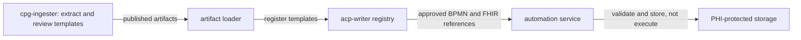

# Automation templates and publication

Carewright extracts BPMN automation templates from CPGs, lets reviewers inspect them, selects applicable templates during care-plan generation, and records approved per-patient automations with the FHIR CarePlan. This release validates and stores BPMN; it does not execute processes.

## Components

`cpg-ingester` extracts automation templates alongside DMN and recommendations. Extraction remains enabled for process items identified by the pipeline. Reviewers inspect templates in the ingester's **Automations** tab; accepted templates are published with the other CPG artifacts. The artifact loader registers them with acp-writer, which selects templates for relevant care-plan activities and presents the resulting automation read-only in the care-plan review. On approval, acp-writer writes the FHIR resources and attempts publication to the automation service. The receiver validates the BPMN and FHIR shapes, then stores the record and BPMN; it does not run them.

The shared validation ladder checks process IR and expressions, compiles and validates BPMN, checks structure, PHI and catalog conformance, then verifies template or instance grounding and (for templates) source-text grounding. It stops at the first rung with an error. An optional Kogito `validate_only` preflight can add engine validation.

## Configuration

| Variable | Purpose |
|---|---|
| `AUTOMATION_SERVICE_URL` | acp-writer's publication target. No cluster default is configured in this release. |
| `AUTOMATION_SERVICE_TOKEN` | Shared token required for automation write routes. The Compose-only default is for local development, not a cluster credential. |
| `BPMN_PREFLIGHT_URL` | Optional Kogito endpoint for template `validate_only` checks during ingester generation and review. Unset disables this extra engine preflight. |
| `ACP_JOB_STORE_DIR` | Local fallback directory for acp-writer publication jobs when the PHI artifact store is unavailable; defaults to `data/automation-publications`. |
| `AUTOMATION_STORE_DIR` | Local fallback directory for automation records when the PHI artifact store is unavailable; defaults to `data/automations`. |
| `ACP_AUTOMATION_DEFAULT_MONITORING_PERIOD` | Fallback ISO duration for a monitoring period when no CPG, CarePlan period, or policy value supplies one; defaults to `P90D`. |

The automation service is Compose-only and is not deployed to the cluster. Its Compose default token is a development value, not a secret. The service's health and read-only list/get routes do not require the token, so keep it on a trusted local network. The base Compose file does not publish its port; `scripts/run-slice-local.sh` binds the slice port to `127.0.0.1:8096`.

## Publication states

| State | Meaning |
|---|---|
| `not-applicable` | The approved CarePlan has no automation revisions. |
| `approving` | FHIR approval is in progress; publication has not completed. |
| `pending` | Publication is in progress or awaiting a bounded retry. |
| `published` | The automation service accepted the publication; this does not mean it executed the process. |
| `failed` | A publication attempt failed and can be retried through the writer's retry path. |
| `withdrawn` | A durable local withdrawal tombstone exists; remote withdrawal is attempted when configured. |
| `unconfigured` | Automation exists, but the service URL or token is missing. No publication request is sent. |

The FHIR approval is persisted independently of automation publication. Missing URL or token therefore leaves the CarePlan intact and marks its automation `unconfigured`. That state is terminal: adding configuration later does not retroactively publish or revive the job. A plan with no automation is `not-applicable`.

## Current gaps

- Cluster deployment and process execution are out of scope; cluster publications are `unconfigured` in this release.
- The automation service uses a shared token for writes, while health and read-only routes are unauthenticated; it is suitable only for a trusted local network.
- The acp-writer review is read-only; parameter editing and applying reviewer edits are not included.
- Template registration is performed by the artifact loader. Registry rehydration after a decision-engine restart is not automatic; rerun the loader.
