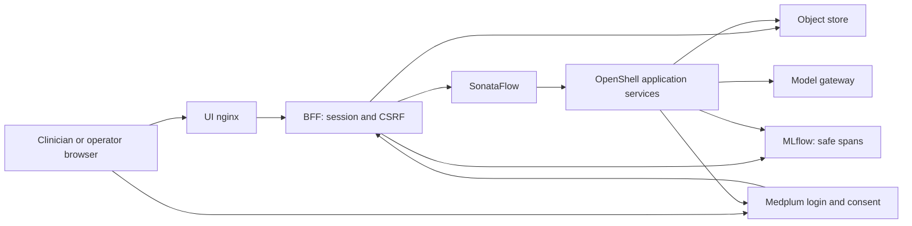

# Reference-release security

## Scope and claims

The boundary claim is a **peer-workload boundary**. Accepting privileged SCC use means the release makes **no claim against compromise of privileged infrastructure**.

Use synthetic data only. Application authorization is tested locally. Deployment isolation and gateway authentication remain pending Track A environment probes; this document does not claim those boundaries have passed.

## Threat model

Assets include IPS bundles, care plans, review records, service tokens, SMART client secrets, model API keys and object-store credentials. Actors include a clinician browser, an operator with Kubernetes access, an unlabelled pod in the application namespace, a pod in another namespace, and untrusted model output. Kubernetes administrators and compromised privileged infrastructure are outside the claim above.

Use one EHR patient-identifier authority per writer deployment. The UI Route is a browser boundary. A session authorizes one patient in the writer and an operator in the ingester. Internal service callers supply the receiving service's credential. Model output is data: Java/PMML/external FEEL definitions are rejected before DMN compilation; Mermaid uses strict rendering, with a best-effort directive filter.

## Authorization design

| Entry | Credential and scope |
| --- | --- |
| Writer launch | Exact `SMART_ISS_ALLOWLIST`; authorization code, S256 PKCE, one-time state and a browser nonce cookie |
| Writer callback | Server-side token exchange and IPS read; token patient must match the Bundle patient identity; access token discarded |
| Writer browser reads | Server-side patient session; run metadata enforces patient/issuer scope and CarePlan subjects enforce patient scope |
| Writer review, cancel and logout | Session plus `X-CSRF-Token`; Origin/Referer checked when supplied |
| Ingester launch | Ten-minute, single-use operator link minted by a token-protected admin route |
| Ingester reads | Operator session |
| Ingester upload, review, cancel, rerun and logout | Operator session plus CSRF |
| Direct IPS | Disabled by default; `ACP_ALLOW_DIRECT_IPS=true` enables a synthetic-data development entry |
| MCP generation | Returns a draft; cannot grant approval or invoke the publication route |

| Receiver | Header credential | Callers |
| --- | --- | --- |
| Writer BFF | `SERVICE_TOKEN_ACP_BFF` | Ingester workflow and writer workflow notifications |
| Decision engine | `SERVICE_TOKEN_ACP_DECISION_ENGINE` | Writer BFF, reasoning service, deploy CLI |
| Reasoning service | `SERVICE_TOKEN_ACP_LLM_REASONING` | Writer BFF and workflow |
| Patient data | `SERVICE_TOKEN_ACP_PATIENT_DATA` | Workflow |
| FHIR generation | `SERVICE_TOKEN_ACP_FHIR_GENERATION` | Workflow |
| FHIR publication/read service | `SERVICE_TOKEN_ACP_FHIR_SERVER` | Workflow and writer BFF |
| Ingester BFF | `SERVICE_TOKEN_CPG_BFF` | Workflow and launch-link script |
| Ingester parse/analyze/assemble/deliver | `SERVICE_TOKEN_CPG_INGESTION`, `SERVICE_TOKEN_CPG_LLM_ANALYSIS`, `SERVICE_TOKEN_CPG_ASSEMBLY`, `SERVICE_TOKEN_CPG_DELIVERY` | Workflow |

Credentials use `X-Service-Token` and constant-time comparison. A missing receiver configuration returns 503; absent or wrong credentials return 401. Missing sessions return 401, unavailable session storage 503, CSRF or scope violations 403, invalid launch state 400, and stale reviews 409. Health checks remain public.

Cookies (`acp_session`, `cpg_session`) are opaque 256-bit values, HttpOnly, Secure, SameSite=Lax, with an eight-hour default server expiry. Only the cookie hash is persisted. `SESSION_COOKIE_SECURE=false` is permitted solely with an HTTP localhost origin. Exact public origins are required for CSRF/CORS. Browser API responses and launch responses disable caching; nginx API access logs are off to avoid recording codes or launch credentials. Ingress/controller access-log redaction remains a deployment responsibility.

Sessions and one-time records can persist in `cpg-phi` (writer) or `cpg-uploads` (ingester), signed with `SESSION_SIGNING_KEY` (writer) or `CPG_SIGNING_KEY` (ingester). Writer run metadata and launch states use `SESSION_SIGNING_KEY`. This prevents possession of shared object-store credentials from becoming authority to forge a browser session or run scope. Object-store caches are bounded and briefly cached; expired records are removed lazily and by an hourly sweep. **Use one BFF replica and one process/worker.** One-time consumption and per-run review locks are process-local; the operator uses a Recreate deployment strategy to prevent overlapping BFF replicas. Horizontal scaling requires a distributed atomic store first.

Writer reviews require `reviewRound` and `artifactRevision` from the run detail. The BFF verifies the armed gate, current round and SHA-256 of canonical JSON, then signs an immutable record at `<run>/approvals/<round>.json`. Reviewer identity comes from server configuration; an unverified SMART `fhirUser` hint provides no clinical attribution or authorization. Only the writer BFF and FHIR publication service receive the signing credential in the writer pipeline. The ingester BFF signs its own review and browser records with a separate `CPG_SIGNING_KEY`. Only the writer BFF receives `SESSION_SIGNING_KEY`; only the writer BFF and FHIR publication sandbox receive `APPROVAL_SIGNING_KEY`.

Publication verifies HMAC, key ID, approval decision, workflow instance, exact normalized object reference, round and artifact hash, using the pinned `cpg-phi` bucket. The record's integrity does not depend on object-store access control. Direct `/write` and status activation both enforce this binding. Client-supplied `approved` or reviewer fields grant no authority. Key ID defaults to `v1`; both sides must use the same `APPROVAL_SIGNING_KEY_ID` when overridden.

Ingester reviews likewise bind gate, round and a canonical hash of the hydrated review artifacts, including their contents and references. The server supplies completion time, session subject and the configured `CPG_REVIEWER` (default `operator`). No downstream service currently verifies ingester review signatures; the workflow enforces the round guard only. Both workflows reject null/stale rounds and re-arm on unknown actions. A confirmed duplicate returns the stored result without another event. An unconfirmed delivery retries the same signed event, timestamp and event ID; workflow round guards reject a delayed duplicate. This is transport recovery, not a claim of exactly-once delivery across arbitrary infrastructure failure.

`WORKFLOW_CALLER_UNAUTHENTICATED` remains false. The local SonataFlow 10.2.0 spike proved secret-backed outbound headers. If explicitly enabled for a different runtime, the fallback admits only requests with an absent header on the named workflow routes: writer `/api/v1/scan`, `/api/v1/scan-async`, `/api/v1/execute-dmn-async`, `/api/v1/resolve-async`, `/api/v1/retrieve-async`, `/api/v1/compose-async`, `/api/v1/review-fhir-async`, `/api/v1/generate-bundle-async`, `/api/v1/write`, BFF `/api/v1/notify-review` and `/api/v1/notifications/artifacts-available`; ingester `/api/v1/parse-async`, `/api/v1/analyze-async`, `/api/v1/generate-async`, `/api/v1/assemble`, `/api/v1/deliver` and BFF `/api/v1/notify-review`. A present wrong header always fails. This fallback requires a separately verified caller-selective boundary; it is not part of the default deployment.

## Exposure matrix

“Verified” here means local application tests; cluster reachability still requires the access probes below.

| Endpoint | Allowed caller | Enforcement | Evidence/state |
| --- | --- | --- | --- |
| Writer UI `/`, `/health` | Browser/operator | Public UI entry | Verified locally; Route pending Track A |
| Writer BFF health, launch, callback, session | Browser | Launch validation; session reports 401 if absent | Verified locally |
| Writer BFF runs, artifacts, CarePlans, status | Patient browser | Session and patient/run scope | Verified locally |
| Writer BFF review/delete/logout | Patient browser | Session, CSRF; review binding | Verified locally |
| Writer BFF notifications | Workflow/ingester | Service token | Verified locally |
| Ingester UI | Operator browser | Public landing; session gate | Verified locally; Route pending Track A |
| Ingester BFF health, launch, session | Operator | Single-use launch; session status | Verified locally |
| Ingester BFF reads and artifacts | Operator | Session | Verified locally |
| Ingester BFF upload/review/delete/rerun/logout | Operator | Session and CSRF; review binding | Verified locally |
| Ingester BFF admin launch-links/notify-review | Operator pod/workflow | Service token | Verified locally |
| Each writer/ingester sandbox REST service | Workflow/BFF/service caller | Receiver token; private endpoint | Token verified; network pending Track A |
| Java decision service `/jit/*` | Decision engine | Precompile DMN policy; private endpoint | Policy verified; network pending Track A |
| MCP service | Governed tool caller | MCP gateway boundary; draft generation only | Draft verified; gateway pending Track A |
| SonataFlow start/cancel/`wait-*` | BFF/services | Private workflow boundary; no inbound application token | Accepted only within verified boundary; pending Track A |
| OpenShell gateway and service proxy | Operator/allowed application caller | Gateway auth and NetworkPolicy | Pending Track A A3 |
| Model gateway | Inference services | Model credential and NetworkPolicy | Pending Track A |
| MLflow | Application services/operator | Private telemetry boundary | Pending Track A |
| MinIO/ODF | Application services/BFF | Object credential and NetworkPolicy | Pending Track A; signed browser/approval integrity locally verified |
| Medplum API and authorization app | Browser and configured backend | EHR login/OAuth; declared public EHR entry | Local SMART verified; cluster pending Track A |
| Postgres, Redis | Medplum | Private services, credentials and NetworkPolicy | Pending Track A |

## Access matrix

Run [`tests/security/access-matrix.sh`](../tests/security/access-matrix.sh) from an operator workstation. Its results complement application tests; dry-run is not boundary verification.

| Probe | Expected | OpenShift | Kind |
| --- | --- | --- | --- |
| Other-namespace pod → private Service DNS and backing pod IP | Refused/timeout within five seconds | Pending environment | Pending environment |
| Unlabelled application-namespace pod → same targets | Refused, or explicitly declared namespace-wide accepted target | Pending environment | Pending environment |
| Same pod → unauthenticated gateway sandbox creation | HTTP authentication refusal; network refusal alone insufficient | Pending A3/environment | Pending A3/environment |
| Operator → both UIs and ingester launch/session | UI and health 200; minted link creates operator session | Pending environment | Pending environment |
| Outside unauthenticated protected BFF routes/notifications/config | Session 401; notification 401/503; config 404 | Pending environment | Pending environment |
| Public exposure enumeration | Only both UIs and declared Medplum entries | Pending environment | Pending environment |
| Clinician browser sign-in, EHR launch, consent, review and logout | Correct patient, one bound approval, logout revokes session | Pending environment | Pending environment |

## Telemetry

Use `cpg_contracts.tracing.trace_safe` on meaningful work that handles patient data or credentials. Inputs/outputs record shape only; identifiers are explicit opt-ins. Exceptions are re-raised after the MLflow context closes so its SDK cannot export their raw messages. Writer FastAPI autologging is disabled; safe spans and the redaction processor replace it. A processor supplements safe instrumentation and cannot make arbitrary raw spans safe. Raw bodies, patient names, decision inputs/results and exception tracebacks are absent from audited logs.

`acp-writer/tests/test_telemetry_sentinels.py` runs success and failure pipelines against actual MLflow storage and searches exported spans and captured logs for three synthetic sentinels. No sentinel may appear; the opted-in run identifier must remain searchable. Repeat on cluster telemetry and pod logs during environment verification. FHIR prompt DocumentReferences are separate retained artifacts; this telemetry policy does not make their contents nonclinical.

## Accepted gaps

All use is restricted to synthetic data within a boundary that passes the probes. The following pilot deferrals remain open:

| Gap | Restriction |
| --- | --- |
| OIDC and user role matrix | Patient/operator session authorization only; no named-user role claim |
| Authenticated clinical attribution and audit | Configuration-default reviewer; synthetic demonstration only |
| Workload identity and per-bucket users | Shared service-token Secret; no least-privilege claim after compromise of an authorized sandbox; scoped ODF credentials when Track A supplies them |
| OpenShell gateway TLS, privileged SCC, residual unauthenticated gateway callers | Conditional on successful boundary probes; A3 controller authentication remains required |
| Ingress NetworkPolicies beyond the access matrix | Only the probed peer-workload boundary is claimed |
| Medplum credential hygiene/exposure hardening | Declared EHR endpoint within the verified deployment; Medplum 5.1.27 PKCE branch does not validate the confidential client secret; PKCE and one-use codes remain enforced |
| Client-facing error redaction and adversarial suite | Telemetry fixes are not a comprehensive response-redaction claim |
| Digest pins in templates, broad security headers, Java body limits | Release manifest records digests; use only the verified environment |
| nginx API access logs disabled | `access_log off` avoids logging launch credentials but leaves an accepted request-audit gap |
| Durable per-activity FHIR Provenance | No durable per-activity audit claim |
| Usefulness thresholds | Use the recorded synthetic evaluation baseline |
| Mermaid directive regex | Best-effort filter; strict renderer is the primary control |
| Inbound workflow event authentication | Private boundary and approval/round guards; network probes mandatory |

## Secrets inventory

| Secret | Keys | Consumers |
| --- | --- | --- |
| `carewright-service-tokens` | All `SERVICE_TOKEN_*` names in the receiver table | BFFs via individual `secretKeyRef`; workflow pod via individual references; sandbox provider receives the shared service-token set |
| `carewright-approval-signing-key` | `APPROVAL_SIGNING_KEY` | Writer BFF and writer FHIR publication sandbox only |
| `carewright-session-signing-key` | `SESSION_SIGNING_KEY` | Writer BFF only |
| `carewright-ingester-signing-key` | `CPG_SIGNING_KEY` | Ingester BFF only |
| `smart-client-credentials` | `SMART_CLIENT_ID`, `SMART_CLIENT_SECRET` | Writer BFF only; deprecated `smart-config.json` compatibility key is never mounted into a UI docroot |
| Artifact-store credentials | Existing `ARTIFACT_STORE_*` / AWS aliases | BFFs and authorized application services |
| LLM credentials | Existing `LLM_API_KEY` | Model callers |

Bootstrap creates random service tokens/signing keys only if absent and validates existing keys without printing values. OpenShell uses credential-only profiles for service tokens/signing; these profiles grant no endpoint access. Profile lint/import and installed runtime compatibility must be verified in B9. To rotate, drain pending reviews, delete the relevant Secret, re-run bootstrap and restart BFF and workflow pods (and other token consumers). Sandbox provider reconciliation tracks the Secret resourceVersion marker and resyncs the provider when it changes; verify the resulting sandbox digest before resuming. Keep the approval key ID consistent between writer BFF and publication verifier. Rotation invalidates sessions and pending signed reviews; require relaunch. Never export credentials in logs or chat; one-time launch URLs are bearer credentials and must be handled privately.

## Deployment configuration and credential gate

Set `SESSION_TTL_HOURS` for writer expiry (`CPG_SESSION_TTL_HOURS` for ingester) and `SMART_SCOPES` for requested SMART scopes. Set `spec.smart.publicOrigin` explicitly to avoid the initial empty-origin rollout before the operator discovers the UI Route. `SMART_REDIRECT_URI` defaults to that origin plus `/api/v1/launch/callback`. Missing discovery fails closed; no provider endpoints are guessed. Pre-Track-B runs without signed `run.json` require relaunch.

Both pipelines must reference the same `carewright-service-tokens` Secret in a namespace to interoperate. This shared Secret is a perimeter control only; it does not separate authorized components from one another. Copy `smart-client-credentials`, created by the mock-EHR loader, into the writer namespace before referencing it. The SMART credential field is a plain `secretRef`, without a provider `type`.

Compose defaults are synthetic-data, localhost-only credentials, with distinct values per receiver and signing purpose. Never use them on a cluster or expose the ports to peers. Use the orchestrated profile for the BFF/browser path. Run the Medplum loader first, then recreate the writer BFF so it reads `.medplum/smart-client.env`; no SMART file is mounted into a UI. Direct IPS remains off unless `ACP_ALLOW_DIRECT_IPS=true` is explicitly set. Configure the mock-EHR OAuth page at build time with `VITE_SMART_REDIRECT_ORIGINS` (comma-separated exact origins); an empty list refuses all callbacks. Only `/api/v1/launch/callback` is accepted, without credentials, query or fragment. Rebuild the mock-EHR UI image with this build argument for the writer Route; Helm cannot alter values already compiled into the image.

**First B9 gate:** run `python3 tests/security/credential-digest-probe.py --namespace <ns> --pod <sb-pod> --secret carewright-service-tokens --key SERVICE_TOKEN_ACP_FHIR_SERVER --env SERVICE_TOKEN_ACP_FHIR_SERVER`, and repeat for `APPROVAL_SIGNING_KEY` using `carewright-approval-signing-key` and each service-token consumer. It prints only SHA-256 digests. A mismatch or absent variable blocks deployment: credential-only OpenShell providers may supply egress placeholders, which cannot serve as inbound tokens or HMAC keys. Do not put credentials in `SandboxRequest.spec.env` or `OPENSHELL_USER_ENVIRONMENT`.

The decided fallback is operator-managed Secret volumes in sandbox pods, with `secretKeyRef`/read-only projection and a file-to-environment entrypoint, **only after the installed OpenShell API supports and preserves that pod template**. The current repository integration exposes no such field. If the gateway cannot support secure projections, this release must upgrade that integration before deployment; proxy header injection alone is insufficient for the FHIR approval HMAC and will not replace inbound service authentication. This is a concrete deployment prerequisite, not an implemented or verified fallback. Keep the release blocked instead of weakening application checks or moving secrets into CR environment strings.

Medplum 5.1.27 login-API probe (November 6, 2026, isolated synthetic project): `POST /auth/login` returned **200 with an authorization code for both the registered and an unregistered `redirectUri`**. Do not rely on that API to validate callback destinations. The reference OAuth UI therefore enforces its own build-time origin allowlist and fixed path before rendering `SignInForm`; the provider limitation remains part of the mock-EHR hardening gap.

## Test telemetry and error responses

Writer, ingester, shared-contract and prompt-evaluation suites select a temporary SQLite MLflow backend for each pytest session, including inherited subprocesses. Tests that inspect trace contents select their own temporary databases and restore the session backend. Queued traces flush during fixture teardown. Routine tests must not append to working-directory `mlflow.db` files; existing files contain previous local history and may be deleted deliberately by their owner. External object-store calls retain tracing as required by AGENTS.md.

Ingester error responses use stable `detail.error` codes. Missing runs/artifacts return `run-not-found`/`artifact-not-found` (404); workflow/storage failures return `workflow-unavailable`/`artifact-store-unavailable` (503). Review validation uses `unknown-template`, `unknown-parameter` and `parameter-*`/`acknowledgement-*` codes; it does not echo submitted identifiers or parameter values. Cancellation at an armed gate requires the artifact store for the signed review record and returns `503 approval-store-unavailable` if that store is absent.
